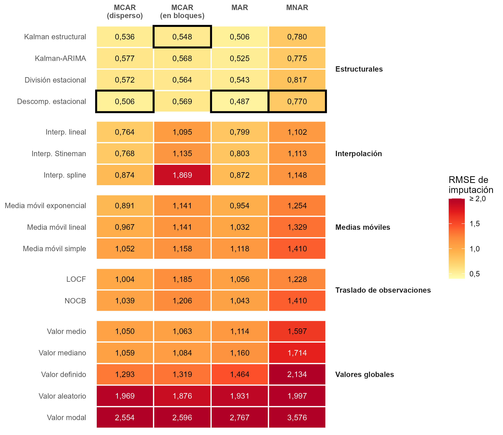
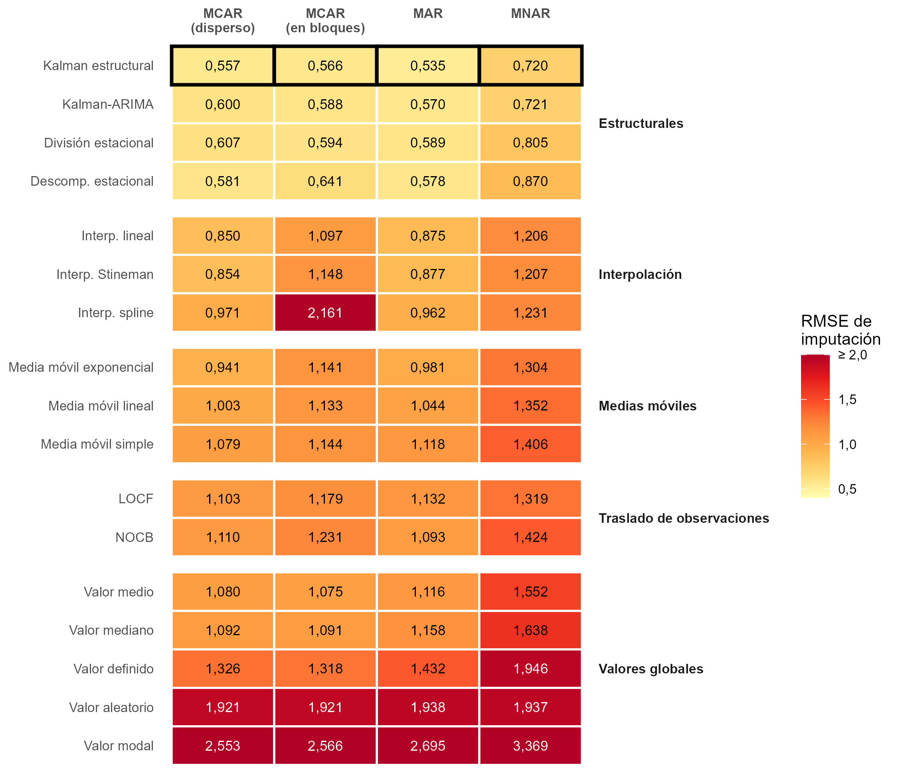
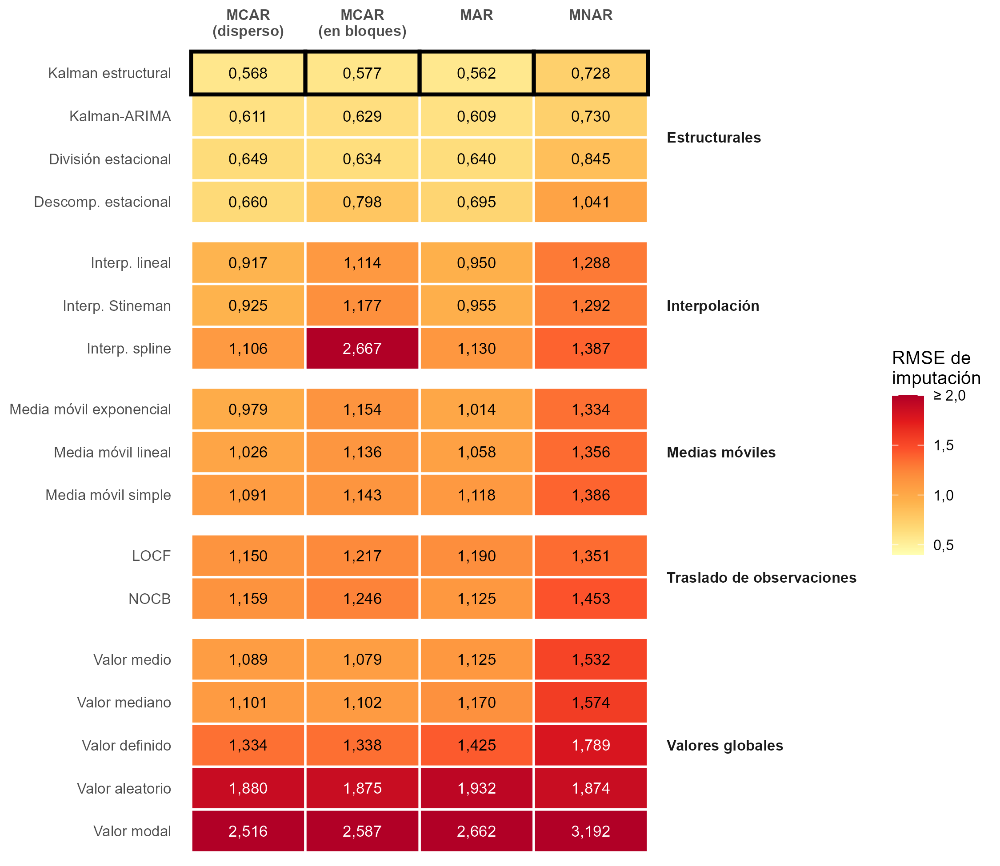
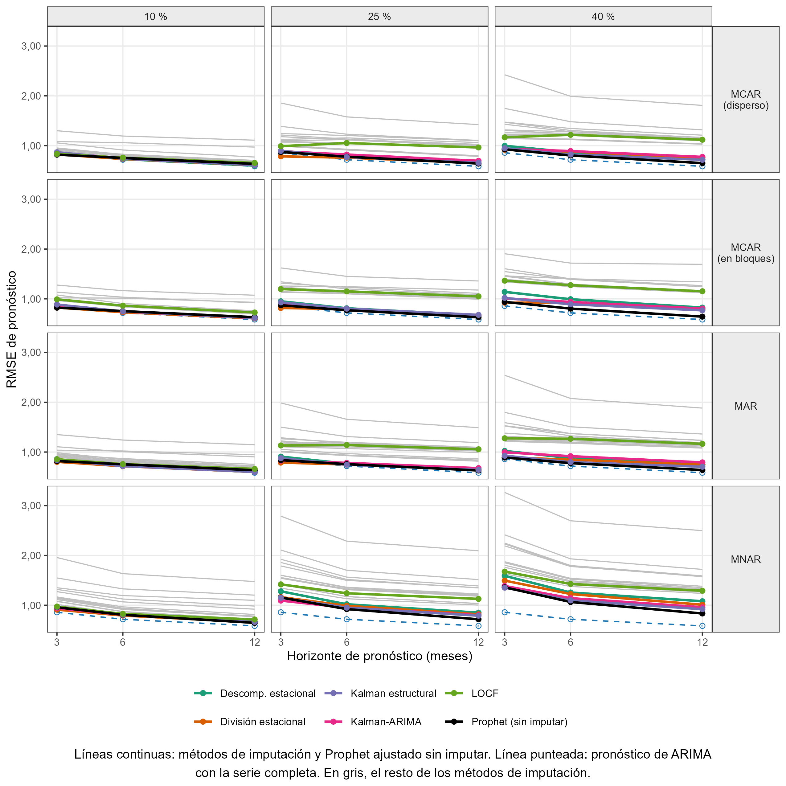
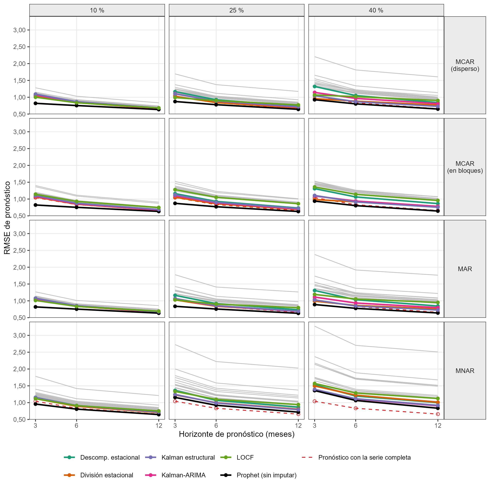
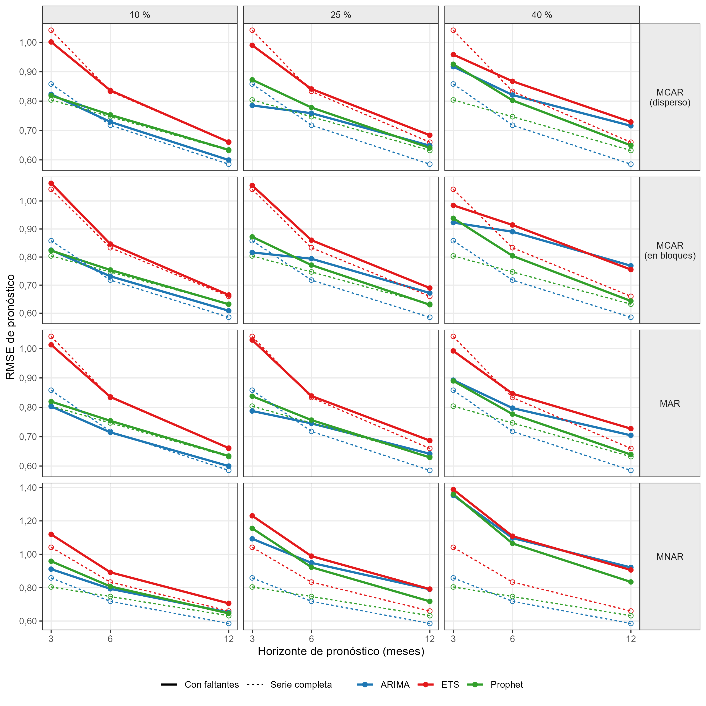
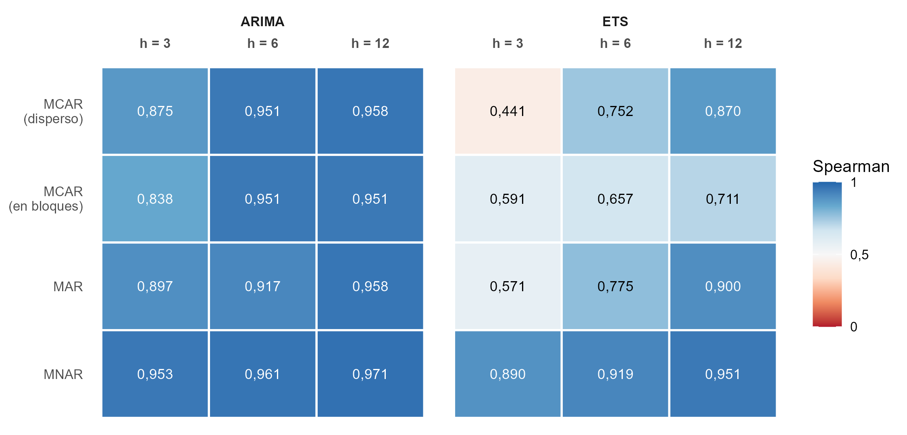
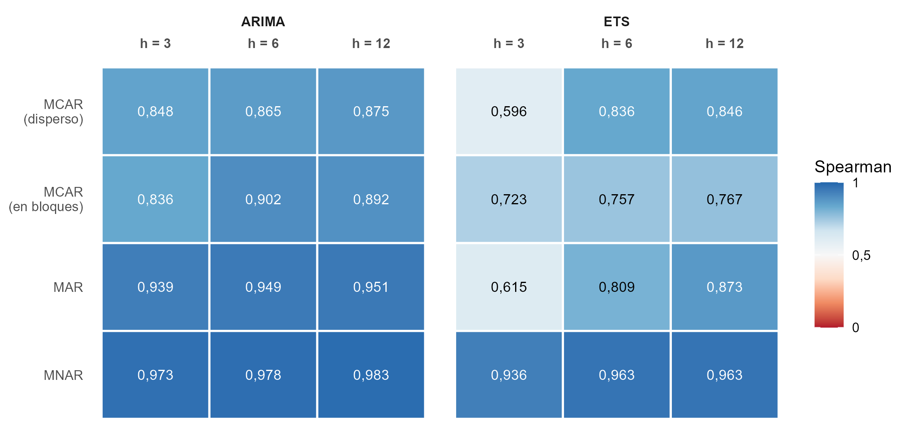
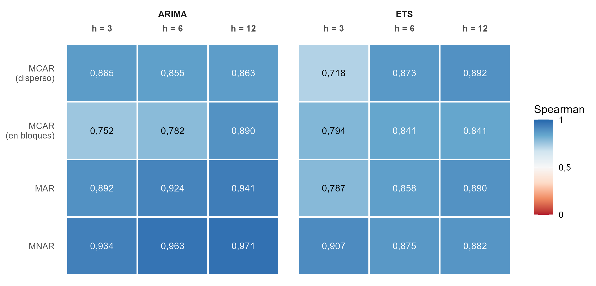

```{r setup, include = FALSE}
knitr::opts_chunk$set(echo = FALSE, warning = FALSE, message = FALSE, fig.align = "center")

# Librerías
library(dplyr)
library(forecast)
library(ggfortify)
library(ggplot2)
library(ggrepel)
library(gridExtra)
library(gt)
library(kableExtra)
library(knitr)
library(lubridate)
library(purrr)
library(readr)
library(scales)
library(stringr)
library(tidyr)
library(tseries)
library(zoo)

#Funciones
resaltar_min <- function(x, x_num) {
  cell_spec(
    sprintf("%.3f", x),
    bold = (x_num == min(x_num, na.rm = TRUE)),
    color = ifelse(x_num == min(x_num, na.rm = TRUE), "#1E90FF", "black"),
    format = "latex"
  )
}
```

\begin{titlepage}
\centering
\vspace*{0.5cm}
\includegraphics[width=0.4\textwidth]{logounr.png} \par
\vspace{0.5cm}
{\large UNIVERSIDAD NACIONAL DE ROSARIO \par}
{\large Facultad de Ciencias Económicas y Estadística \par}
\vspace{3cm}
{\Huge\bfseries Imputación de Datos Faltantes en Series Temporales Univariadas: Evaluación Basada en Desempeño de Pronóstico \par}
\vspace{1cm}
{\Large\bfseries Tesina de grado \par}
\vfill 
\begin{flushright}
\large
\underline{Carrera}: Licenciatura en Estadística \\
\underline{Alumno}: Sánchez Travella, Joaquín \\
\underline{Directora}: Mag. Méndez, Fernanda
\end{flushright}
\vspace{1.5cm}
{\large Año 2026 \par}
\thispagestyle{empty}
\end{titlepage}

\newpage

\pagenumbering{arabic}
\setcounter{page}{2}

## Agradecimientos {.unnumbered .unlisted}

\newpage

## Resumen {.unnumbered .unlisted}

Las series temporales univariadas constituyen una herramienta fundamental para el análisis y la predicción de fenómenos que evolucionan a lo largo del tiempo en múltiples áreas de aplicación. Sin embargo, en la práctica es frecuente la presencia de datos faltantes, lo que puede afectar tanto la calidad del análisis como el desempeño de los modelos predictivos. En este contexto, la imputación de valores faltantes surge como una estrategia clave para completar las series o estimar valores faltantes y permitir la aplicación de métodos de modelado y pronóstico.

El presente trabajo tiene como objetivo evaluar y comparar distintos métodos de imputación de datos faltantes en series temporales univariadas, incorporando como criterio principal el desempeño de pronóstico posterior, bajo el enfoque conocido como *forecast-after-imputation*. A diferencia de gran parte de la literatura existente, que se centra en la calidad de los datos imputados, este estudio analiza el impacto de las distintas técnicas de imputación sobre la capacidad predictiva de los modelos ajustados a partir de las series completas.

Para ello, se propone un esquema de simulación basado en series temporales completas a las que se les introducen valores faltantes de manera artificial, considerando distintos  =  de ausencia, patrones de observaciones faltantes y niveles de pérdida de información. Sobre estos datos incompletos se aplican diversos métodos de imputación, que incluyen tanto enfoques simples como técnicas más avanzadas adaptadas a la estructura temporal de los datos. Posteriormente, se ajustan modelos de series temporales y se evalúa su desempeño mediante métricas de error de pronóstico, tales como RMSE (*Root Mean Square Error*), MAE (*Mean Absolute Error*) y MAPE (*Mean Absolute Percentage Error*), considerando distintos horizontes de predicción y un enfoque de evaluación fuera de muestra.

Los resultados obtenidos permiten analizar cómo la elección del método de imputación influye en la precisión de los pronósticos, evidenciando que no existe una técnica universalmente superior en todos los escenarios considerados, sino que su desempeño depende de las características de la serie y del tipo de datos faltantes. En particular, se identifican escenarios en los que ciertos métodos resultan más adecuados cuando el objetivo principal es mejorar la capacidad predictiva.

En conclusión, este trabajo aporta una perspectiva integral para la evaluación de métodos de imputación en series temporales univariadas, integrando el proceso completo desde la imputación hasta el pronóstico. Asimismo, proporciona recomendaciones prácticas orientadas a la selección de técnicas en función del objetivo de predicción, contribuyendo al desarrollo de estrategias más robustas para el análisis y la predicción en presencia de datos faltantes.

\underline{Palabras clave}: Series temporales univariadas, datos faltantes, imputación, pronóstico, desempeño.


\newpage

\tableofcontents

\newpage

# Introducción

Las series temporales desempeñan un papel fundamental en el análisis y la predicción de fenómenos que evolucionan a lo largo del tiempo, siendo ampliamente utilizadas en diversas áreas como la economía, la meteorología, la salud y los negocios. A través de ellas es posible identificar patrones, tendencias y comportamientos recurrentes que permiten anticipar escenarios futuros y apoyar la toma de decisiones. Sin embargo, en la práctica, es frecuente que los datos observados presenten valores faltantes debido a múltiples causas, tales como errores en dispositivos de medición, fallas en sensores, restricciones en la recolección de datos o eventos imprevistos.

La presencia de datos faltantes constituye un desafío relevante, ya que un tratamiento inadecuado de estos valores puede generar sesgos en las estimaciones, afectar la inferencia y disminuir la precisión de los modelos predictivos. En este contexto, la imputación de datos surge como una estrategia clave para el tratamiento de valores ausentes, permitiendo estimar valores plausibles y preservar, en la medida de lo posible, la estructura temporal de la serie. Este aspecto resulta particularmente relevante en el análisis de series temporales, donde muchos métodos de modelado y pronóstico requieren series completas para su correcta implementación.

Existen diversos métodos de imputación para series temporales univariadas, que van desde técnicas simples —como la imputación por media, interpolación o el método de último valor observado— hasta enfoques más complejos basados en la estructura temporal de la serie o en modelos estadísticos, como el suavizamiento de Kalman o los modelos ARIMA. No obstante, no existe un método de imputación que resulte óptimo en todos los contextos, ya que su desempeño depende de las características de la serie, del mecanismo de generación de los datos faltantes y de la estructura temporal subyacente.

En la mayoría de los estudios, la evaluación de los métodos de imputación se centra exclusivamente en la precisión de los valores reconstruidos, comparando los datos imputados con los valores reales mediante distintas métricas de error. Sin embargo, en muchos contextos aplicados, la imputación no constituye un objetivo en sí mismo, sino un paso previo para tareas posteriores, como el modelado y el pronóstico de series temporales. En consecuencia, resulta relevante analizar no solo qué tan bien un método de imputación logra aproximar los valores faltantes, sino también cómo afecta el desempeño de los modelos de pronóstico ajustados sobre las series imputadas.

Esta perspectiva permite evaluar si los métodos que presentan menor error de imputación son también aquellos que generan mejores predicciones, cuestión que no siempre ha sido abordada de manera sistemática en la literatura. En este sentido, se identifica un vacío en relación con la evaluación conjunta de la imputación y el desempeño predictivo, particularmente en el contexto de series temporales univariadas.

Como antecedente directo, este trabajo se apoya en la tesina de Tamplin (2025), en la cual se evaluaron distintos métodos de imputación mediante simulaciones de datos faltantes y métricas de precisión como RMSE, MAE y MAPE. La presente tesina propone extender dicho enfoque incorporando un criterio adicional de evaluación basado en el desempeño de pronóstico posterior (*forecast-after-imputation*), integrando así ambas dimensiones en un mismo marco metodológico.

En este marco, el objetivo del trabajo es analizar el desempeño de distintos métodos de imputación no solo en función de su capacidad de reconstrucción, sino también en función de su impacto sobre la calidad de los pronósticos generados a partir de las series imputadas. De este modo, se busca aportar evidencia empírica que permita orientar la selección de métodos de imputación en situaciones donde el interés principal radica en la predicción.

La estructura del trabajo se organiza en siete capítulos, incluyendo la presente introducción. En el Capítulo 2 se presentan los objetivos de la tesina, mientras que en el Capítulo 3 se describe la metodología empleada. En el Capítulo 4 se desarrollan los experimentos de simulación, en los que se utilizan series temporales completas a las que se les introducen valores faltantes de manera controlada, con el objetivo de evaluar el efecto que distintos métodos de imputación tienen tanto sobre la reconstrucción de los datos como sobre el desempeño de los modelos de pronóstico. En el Capítulo 5 se presentan las conclusiones del trabajo y se proponen posibles líneas de investigación futura. Finalmente, en los Capítulos 6 y 7 se incluyen las referencias bibliográficas y los anexos, respectivamente.


\newpage

# Objetivos

## Objetivo general

El objetivo principal de la tesina es analizar y comparar distintos métodos de imputación de datos faltantes en series temporales univariadas, considerando como criterio principal de evaluación el impacto de dichas técnicas sobre el desempeño de los modelos de pronóstico.

## Objetivos específicos

* Revisar la literatura sobre métodos de imputación de datos faltantes en series temporales univariadas y su relación con tareas de pronóstico.
* Seleccionar un conjunto representativo de métodos de imputación que incluya técnicas simples, métodos basados en la estructura temporal de la serie y enfoques basados en modelos.
* Diseñar un esquema de simulación que contemple distintos  =  de datos faltantes (MCAR, MAR temporal y MNAR), así como diferentes patrones de ausencia (dispersos y en bloques) y niveles de pérdida de información.
* Construir un *pipeline* de procesamiento reproducible que integre de forma secuencial la generación de datos faltantes, la aplicación de técnicas de imputación, el ajuste de modelos de series temporales y la generación de predicciones.
* Comparar la eficacia de los métodos mediante el uso de métricas de error de imputación (RMSE, MAE y MAPE) en conjunto con métricas de desempeño de pronóstico para horizontes de tiempo de corto y mediano plazo ($h=3, 6\text{ y }12$).
* Validar el desempeño de los métodos mediante su aplicación a series temporales reales.
* Derivar recomendaciones prácticas fundamentadas en los resultados obtenidos, que permitan identificar qué técnicas de imputación resultan más adecuadas según la estructura de la serie y el objetivo específico de mejorar la predicción.

\newpage

# Metodología

## Conceptos básicos de series de tiempo

Una serie temporal se define como una secuencia de observaciones ordenadas en el tiempo calendario, resultado de registrar los valores de una variable en intervalos generalmente regulares a lo largo del tiempo. Estos intervalos de tiempo definen la periodicidad (diaria, mensual, anual, etc.). Una característica fundamental de las series temporales es la dependencia entre sus observaciones, lo que implica que el orden en que estas ocurren resulta relevante para su análisis. En consecuencia, los métodos estadísticos basados en el supuesto de independencia entre observaciones no son directamente aplicables, por lo que se requieren enfoques específicos que tengan en cuenta la estructura temporal de los datos.

Formalmente, una serie temporal se define como un conjunto de variables aleatorias indexadas en el tiempo, ${Y_1,…,Y_T}$. En este sentido, una serie temporal observada se denota por ${y_1,…,y_T}$, donde el subíndice $i$ indica el tiempo al que pertenece la observación $y_i$. El primer valor observado $y_1$ puede interpretarse como una realización de la variable aleatoria $Y_1$. Del mismo modo, $y_2$ es una realización de $Y_2$ y así sucesivamente. Las variables aleatorias $Y_1$, $Y_2$,…, $Y_T$ no necesariamente son idénticamente distribuidas.

Los fenómenos observados mediante series temporales pueden clasificarse en dos clases. Los primeros son los que toman valores estables en el tiempo alrededor de un nivel constante, sin mostrar una tendencia a crecer o a decrecer a largo plazo. Estos procesos se denominan estacionarios. Por otro lado, existen los procesos no estacionarios, que son aquellos que pueden mostrar tendencia, estacionalidad y otros efectos evolutivos en el tiempo. En las series estacionarias, la media y varianza se mantienen constantes en el tiempo y la covarianza entre observaciones depende únicamente del rezago y no del tiempo en sí, mientras que en las no estacionarias, estas características cambian a través del tiempo. 

Para un proceso $\{Y_t: t = 0, \pm 1, \pm 2, \dots\}$ se define:

- La función media del proceso: \begin{equation}
E(Y_t) = \mu_t
\end{equation}
- La función varianza del proceso: \begin{equation}
\sigma_t^2 = E(Y_t-\mu_t)^2
\end{equation}
- La función covarianza entre $Y_{t_1}$ y $Y_{t_2}$: \begin{equation}
\gamma(t_1,t_2)=E(Y_{t_1}-\mu_{t_1})(Y_{t_2}-\mu_{t_2})
\end{equation}

En un proceso estacionario resulta:

\begin{equation}
\mu_t=\mu, \quad \forall t 
\end{equation}
\begin{equation}
\sigma_t^2=\sigma^2, \quad \forall t
\end{equation}
\begin{equation}
\gamma(t_1,t_2)=\gamma(t_1+k,t_2+k), \quad \forall\, t_1,t_2 \text{ y } k
\end{equation}

\newpage

En este contexto, resulta útil descomponer una serie temporal en sus principales componentes no observables, ya que estos permiten interpretar y modelar su comportamiento a lo largo del tiempo. En particular, la presencia de tendencia, estacionalidad, ciclos y un componente aleatorio está estrechamente relacionada con la noción de no estacionariedad, dado que estos elementos introducen cambios sistemáticos en la media o en la estructura de dependencia de la serie. A continuación, se presentan definiciones más precisas de estos componentes, fundamentales para el análisis y modelado de series temporales.

### Tendencia 

La tendencia representa el comportamiento a largo plazo de una serie temporal, reflejando la evolución sostenida de la variable a lo largo del tiempo. Este componente describe la dirección general en la que se desplazan los datos, pudiendo manifestarse como un crecimiento, decrecimiento o estabilidad en el nivel medio de la serie. La tendencia no necesariamente es lineal, ya que puede presentar formas más complejas, como curvaturas o cambios en la pendiente, asociados a transformaciones estructurales del fenómeno analizado.

La presencia de tendencia implica que la media de la serie no permanece constante en el tiempo, lo que constituye una fuente de no estacionariedad. La identificación y modelado de la tendencia resultan fundamentales, ya que permiten separar el comportamiento estructural de largo plazo de otras fluctuaciones de menor escala. En muchos contextos aplicados, la tendencia se asocia a factores como crecimiento económico, cambios tecnológicos o evolución demográfica, entre otros.

### Componente estacional

La estacionalidad se refiere a la existencia de patrones que se repiten de manera sistemática en intervalos de tiempo fijos y conocidos. Estos patrones suelen estar asociados a factores externos recurrentes, como las estaciones del año, los meses, los días de la semana o incluso las horas dentro del día. A diferencia de otros componentes, la estacionalidad presenta una periodicidad constante, lo que permite su identificación mediante herramientas descriptivas y su modelado a través de métodos específicos.

Se dice que una serie es estacional cuando su valor esperado no es constante, pero varía con una pauta cíclica. En concreto, si:
\begin{equation}
E(y_t)=E(y_{t+s})
\end{equation}
se dice que la serie tiene una estacionalidad de periodo $s$. El periodo estacional, $s$, define el número de observaciones que forma el ciclo estacional. Por ejemplo, $s=12$ para series mensuales, $s=4$ para series trimestrales, etc. Se supone que el valor de $s$ es fijo en la serie. Es importante notar que puede existir mas de un tipo de estacionalidad en una serie. 

Desde una perspectiva analítica, la estacionalidad introduce variaciones sistemáticas en la serie que dependen del momento dentro del ciclo temporal considerado. Esto implica que observaciones correspondientes a un mismo período dentro de distintos ciclos (por ejemplo, el mismo mes en diferentes años) tienden a presentar comportamientos similares. La adecuada identificación de este componente es esencial, ya que su omisión puede distorsionar el análisis de la tendencia y afectar la precisión de los modelos de pronóstico.

### Componente ciclo

Los ciclos corresponden a fluctuaciones de la serie temporal que se desarrollan en horizontes de mediano y largo plazo, pero que no presentan una periodicidad fija ni conocida. A diferencia de la estacionalidad, cuya duración es constante, los ciclos pueden variar en su extensión, intensidad y forma, lo que dificulta su identificación y modelado. Este componente refleja cambios en la dinámica subyacente del fenómeno que no responden a patrones regulares, sino a procesos más complejos.

En muchos casos, los ciclos se asocian a fenómenos económicos, como expansiones y recesiones, aunque también pueden aparecer en otros contextos. Su duración suele ser mayor a la de los efectos estacionales y, en general, no existe un período predeterminado que permita anticipar su repetición. Desde el punto de vista del análisis de series temporales, los ciclos representan una fuente adicional de variabilidad que puede influir en la estructura de dependencia de la serie y en su comportamiento a largo plazo.

### Componente aleatorio

El componente aleatorio, también denominado irregular o ruido, recoge la variabilidad de la serie temporal que no puede ser explicada por los componentes sistemáticos como la tendencia, la estacionalidad o los ciclos. Este componente representa fluctuaciones impredecibles originadas por factores no observados, errores de medición o variaciones inherentes al fenómeno bajo estudio.

En términos estadísticos, suele modelarse como un proceso estocástico con media cero y varianza constante, aunque en la práctica puede presentar estructuras más complejas, como heterocedasticidad o dependencia temporal. A diferencia de los componentes anteriores, el componente aleatorio no presenta una estructura sistemática identificable, lo que limita la capacidad de modelado determinístico. Sin embargo, su correcta caracterización es fundamental, ya que determina el nivel de incertidumbre asociado al análisis y establece un límite natural a la precisión de los pronósticos.

Las irregularidades pueden tener un impacto significativo en la precisión de los modelos de series temporales y en las previsiones, ya que pueden ocultar las tendencias subyacentes y los patrones de estacionalidad en los datos. 

En conjunto, la identificación y análisis de estos componentes permiten comprender la estructura subyacente de una serie temporal, facilitando tanto su modelado como la formulación de pronósticos más precisos.

Una serie temporal, $Y_1,Y_2,\dots,Y_T$, puede descomponerse en sus componentes fundamentales mediante modelos de descomposición. En particular, el modelo aditivo se expresa como:
\begin{equation}
Y_t=T_t+E_t+C_t+A_t
\end{equation}
donde: $T_t$ representa la tendencia, $E_t$ la componente estacional, $C_t$ los ciclos y $A_t$ la componente aleatoria.

Por otro lado, el modelo multiplicativo se define como:
\begin{equation}
Y_t=T_t\times E_t\times C_t\times A_t
\end{equation}
el cual resulta más adecuado cuando la magnitud de las variaciones estacionales o cíclicas depende del nivel de la serie.
 
 
## Autocorrelación

La autocorrelación es una medida fundamental en el análisis de series temporales que permite cuantificar el grado de dependencia existente entre observaciones de una misma serie en distintos momentos del tiempo. A diferencia de los datos independientes, en una serie temporal los valores suelen estar relacionados con sus propios valores pasados, lo que implica que la información contenida en una observación puede aportar conocimiento sobre observaciones futuras o pasadas. Esta dependencia temporal constituye una de las características distintivas de las series temporales y es clave para su modelado.

El estudio de la autocorrelación resulta esencial en la práctica, ya que proporciona información relevante sobre la estructura interna de la serie y orienta la selección de modelos adecuados para su análisis y pronóstico. En particular, muchas metodologías de modelado de series temporales se basan explícitamente en la forma en que las observaciones se correlacionan a lo largo del tiempo, lo que convierte a la autocorrelación en una herramienta central dentro del análisis estadístico de datos temporales.

### Función de autocorrelación

La función de autocorrelación constituye una herramienta fundamental para el análisis de la dependencia temporal en una serie. Esta función describe cómo se correlacionan las observaciones de la serie con sus propios valores pasados en función del rezago considerado. En particular, permite analizar el grado de asociación lineal entre observaciones separadas por distintos intervalos de tiempo, proporcionando una visión global de la estructura de dependencia de la serie.

Para cada rezago $k$, la función de autocorrelación mide la intensidad de la relación lineal entre 
$Y_t$ y $Y_{t+k}$, tomando valores comprendidos entre -1 y 1. Valores cercanos a 1 indican una fuerte correlación positiva, mientras que valores próximos a -1 reflejan una correlación negativa. Por su parte, valores cercanos a cero sugieren ausencia de dependencia lineal significativa para ese rezago. En el caso de series temporales estacionarias, la función de autocorrelación depende únicamente del rezago y no del tiempo, lo que simplifica su análisis e interpretación.

Formalmente, la autocorrelación para un rezago $k$  se calcula utilizando la siguiente fórmula:

\begin{equation}
\rho_k = \frac{\sum_{t=k+1}^{T} (y_t - \bar{y})(y_{t-k} - \bar{y})}{\sum_{t=1}^{T} (y_t - \bar{y})^2}
\end{equation}

### Función de autocorrelación parcial

La función de autocorrelación parcial constituye una herramienta complementaria a la función de autocorrelación, permitiendo analizar la dependencia directa entre observaciones de una serie temporal. Mientras que la autocorrelación mide la relación total entre $y_t$ y $y_{t+h}$, la autocorrelación parcial evalúa la relación entre estas dos observaciones una vez eliminada la influencia de los valores intermedios comprendidos entre ambos momentos.

En otras palabras, la autocorrelación parcial mide el grado de dependencia lineal “pura” entre dos observaciones separadas por un rezago $h$, controlando por los efectos de los rezagos menores. Esto permite aislar la contribución específica de cada rezago en la estructura de dependencia de la serie, evitando la superposición de efectos indirectos presentes en la función de autocorrelación.

El análisis de la función de autocorrelación parcial resulta especialmente útil en la identificación de modelos de series temporales, en particular en la determinación del orden de los modelos autorregresivos. De este modo, junto con la función de autocorrelación, constituye una herramienta fundamental en el análisis exploratorio y en el proceso de modelado de series temporales.

## Datos faltantes en series temporales

En el desarrollo teórico de numerosos modelos y técnicas estadísticas, a menudo no se consideran ciertas situaciones que surgen en la práctica, entre las cuales se destaca la presencia de datos faltantes, también denominados valores perdidos o incompletos. Esta problemática es especialmente frecuente en el análisis de series temporales, donde es habitual encontrar observaciones ausentes dentro de la secuencia de datos.

Desde un punto de vista metodológico, no todos los datos faltantes presentan las mismas características ni tienen el mismo impacto sobre el análisis. En particular, la forma en que se generan los valores ausentes, conocida como mecanismo de faltantes, resulta fundamental para determinar el enfoque más adecuado para su tratamiento. Ignorar este aspecto puede conducir a la aplicación de métodos inapropiados y, en consecuencia, a conclusiones erróneas.

En este sentido, la literatura estadística distingue tres mecanismos principales de generación de datos faltantes: faltantes completamente al azar (MCAR), faltantes al azar (MAR) y faltantes no al azar (MNAR). Cada uno de estos mecanismos implica distintos supuestos sobre la relación entre la ausencia de datos y la información observada o no observada, lo que influye directamente en la elección y el desempeño de los métodos de imputación.

### Tipos de datos faltantes

Hay varios tipos de observaciones faltantes:

* Datos faltantes completamente al azar (Missing Completely at Random, MCAR). Los datos faltantes siguen un patrón aleatorio; la probabilidad de que un valor esté perdido es independiente tanto del valor de esta variable como del valor de otras variables del conjunto de datos. La ausencia de información no procede de ninguna variable presente en la matriz de datos, ya que la base de datos se interpreta como una matriz en donde los renglones son las unidades de observación y las columnas representan a las variables de interés. Hay que señalar que, en la práctica, la hipótesis de este supuesto no siempre es satisfactoria porque la falta de respuesta se asocia a características personales.

* Datos faltantes al azar (Missing at Random, MAR). La probabilidad de que una respuesta sea dato faltante es independiente de los valores de la variable pero es dependiente de los valores de otras variables del conjunto de datos. En suma, la ausencia de datos está asociada a variables presentes en la matriz de datos. En el contexto de las series temporales, un ejemplo de MAR puede presentarse en el registro horario de la concentración de material particulado en el aire, suponiendo que un sensor tiene una mayor probabilidad de interrumpir sus mediciones durante determinados horarios debido a tareas de mantenimiento programadas. En este caso, la probabilidad de ausencia depende de una característica temporal conocida, como la hora del día, pero no del nivel de contaminación que se habría registrado. Por lo tanto, el mecanismo es compatible con el supuesto MAR.

* Datos no faltantes al azar (Missing not at random, MNAR). La probabilidad de que una respuesta a una variable sea dato faltante es dependiente de los valores de la variable. Por ejemplo: el sensor mencionado en el caso anterior tiene una mayor probabilidad de dejar de registrar observaciones ante concentraciones muy elevadas de material particulado, debido a limitaciones en su capacidad de medición. En este caso, la probabilidad de que una observación esté ausente depende del propio valor no observado de la variable, por lo que se trata de un mecanismo MNAR. Este tipo de dato faltante también se denomina no ignorable.

Para series temporales univariadas, el panorama de los mecanismos de datos faltantes es ligeramente diferente. A primera vista, solo hay una variable en los datos. Sin embargo, el tiempo (que se da implícitamente) debe tratarse como una variable al determinar el mecanismo de datos faltantes de un conjunto de datos. Otra diferencia radica en que los algoritmos de imputación de series temporales no necesitan basarse únicamente en covariables para la estimación de valores faltantes, sino que también pueden utilizar las características de las series temporales.

En el contexto de series temporales univariadas, los mecanismos MCAR y MAR pueden presentar algunas similitudes desde el punto de vista de la imputación, dado que en ambos casos los métodos pueden aprovechar la información observada y la estructura temporal de la serie para estimar los valores faltantes. Sin embargo, ambos mecanismos difieren en el proceso que genera la ausencia: bajo MCAR, la probabilidad de que una observación esté ausente no depende de los datos, mientras que bajo MAR puede depender de información observada, como el tiempo o valores previos de la serie.

Por otro lado, en el caso de datos faltantes que no faltan al azar (MNAR), la probabilidad de que falte una observación puede depender del momento en que se encuentra esa observación en la serie, así como del valor de la propia observación.

En la práctica, no es posible verificar con certeza cuál es el mecanismo de generación de los datos faltantes únicamente a partir de los datos observados. Por este motivo, la clasificación en MCAR, MAR y MNAR suele basarse en supuestos teóricos y conocimiento del contexto en el que se generaron los datos.

No obstante, esta distinción resulta fundamental, ya que los diferentes métodos de imputación se basan en supuestos implícitos sobre el mecanismo de faltantes. En consecuencia, la elección de la técnica más adecuada requiere considerar qué supuesto resulta más plausible en cada situación.

## Métodos de imputación

La existencia de valores faltantes introduce diversas dificultades en el análisis, ya que puede afectar la estimación de parámetros, distorsionar la identificación de patrones y limitar la aplicación de ciertos métodos que requieren series completas. En consecuencia, su tratamiento constituye una etapa fundamental dentro del preprocesamiento de los datos. Entre las distintas estrategias disponibles, la imputación se presenta como una de las más utilizadas.

Se denomina imputación al proceso que utiliza la información procedente de la muestra para asignar un valor a aquellos registros con valor ausente, ya sea porque se carece de información o porque se detecta que algunos de los valores obtenidos no se corresponden con el comportamiento esperado. Existen diversos métodos de imputación que difieren tanto en la información que utilizan como en la forma en que generan los valores imputados. La elección del método más adecuado dependerá de las características de la serie, la estructura de los datos faltantes y el objetivo del análisis.

La imputación suele resultar menos problemática bajo MCAR, ya que la probabilidad de ausencia no depende de los valores de la serie ni de otras variables. En cambio, bajo MNAR, dicha probabilidad depende del propio valor no observado, lo que dificulta su reconstrucción y puede introducir sesgos en las estimaciones. Esta dificultad puede acentuarse cuando las observaciones faltantes se presentan en bloques extensos. Sin embargo, cuando la serie presenta una estructura bien definida, los métodos que aprovechan características como la estacionalidad, los ciclos y la autocorrelación pueden ofrecer ventajas frente a otros enfoques más simples.

Debe tenerse en cuenta que la eficiencia de cada técnica depende del conjunto de datos. Esto significa que cada técnica funciona de manera diferente dependiendo de la estructura de cada serie temporal; en otras palabras, no existe un método único que se adapte a todos los tipos de datos. Por ello, al seleccionar un método de imputación, es necesario considerar las características específicas de la serie y el mecanismo que genera los faltantes. Por lo tanto, es necesario analizar las características específicas de la serie temporal con datos faltantes y, a partir de ese análisis, seleccionar el procedimiento de imputación que mejor se adapte a dicha estructura.

A continuación, se describen los métodos de imputación que serán evaluados en cada situación.

### Valor aleatorio

Para reemplazar cada valor faltante en la serie temporal, se selecciona aleatoriamente uno de los valores observados de la serie (todos con igual probabilidad de ser seleccionados). El procedimiento se repite para cada dato faltante, lo que puede resultar en diferentes imputaciones para distintos valores faltantes, incluso dentro de la misma brecha.

A diferencia de métodos determinísticos, la imputación aleatoria permite preservar, al menos parcialmente, la variabilidad de los datos, evitando la subestimación de la varianza que suele ocurrir en enfoques más simples, como la imputación por la media.

Entre sus ventajas, se destaca su simplicidad de implementación y su flexibilidad, ya que no requiere supuestos complejos sobre la estructura de los datos. Además, al introducir variabilidad en los valores imputados, permite reflejar en cierta medida la incertidumbre asociada a los datos faltantes.

Sin embargo, este método presenta importantes limitaciones, especialmente en el contexto de series temporales. En particular, no tiene en cuenta la dependencia temporal entre observaciones, como la autocorrelación o la estacionalidad, lo que puede generar imputaciones poco realistas. Asimismo, la naturaleza aleatoria del procedimiento puede introducir ruido artificial en la serie, afectando la coherencia de los datos imputados.

En resumen, este procedimiento puede resultar adecuado en contextos donde la serie no presenta una estructura temporal marcada, es decir, en ausencia de tendencias, estacionalidad o fuerte autocorrelación. Asimismo, su uso puede ser razonable cuando el porcentaje de datos faltantes es reducido o cuando se emplea como referencia en estudios comparativos. Sin embargo, su aplicabilidad es limitada en series con patrones temporales definidos, donde la preservación de la dinámica de la serie resulta fundamental.

### Valor definido

La imputación por valor definido consiste en reemplazar los valores faltantes por un valor fijo previamente establecido. Este valor puede ser seleccionado con base en el conocimiento previo del fenómeno que se está modelando o por conveniencia en situaciones específicas.

Una de las principales características de este método es su naturaleza determinística, ya que, dado un conjunto de datos, siempre produce el mismo resultado. Además, se trata de un enfoque sumamente simple desde el punto de vista computacional, lo que facilita su implementación incluso en conjuntos de datos de gran tamaño. Sin embargo, esta simplicidad implica que el método no tiene en cuenta la estructura temporal de la serie ni las posibles relaciones entre las observaciones.

Este método presenta importantes limitaciones, ya que la imputación por un valor constante tiende a distorsionar la distribución de los datos, dado que introduce una concentración artificial de valores en el punto elegido. Esto puede afectar la estimación de parámetros, reducir la variabilidad de la serie y generar sesgos en el análisis. Además, al no considerar la dependencia temporal, los valores imputados pueden resultar inconsistentes con la dinámica de la serie. Por este motivo, la imputación por valor definido suele utilizarse en situaciones muy específicas o como punto de comparación, más que como una solución adecuada para preservar la información temporal de la serie.

### Valor medio

El método de imputación por el valor medio es una técnica simple que consiste en reemplazar los valores faltantes en una serie temporal con el valor medio de los datos observados. El proceso es bastante directo: se calcula la media aritmética de los valores no faltantes de la serie, y este valor se utiliza para imputar todos los datos faltantes.

Dicho método se caracteriza por ser determinístico y de muy sencilla implementación, ya que solo requiere el cálculo de un estadístico resumen. Sin embargo, al igual que otros métodos simples, no tiene en cuenta la estructura temporal de la serie, ignorando posibles patrones como la tendencia, la estacionalidad o la autocorrelación.

Entre sus principales ventajas se destaca su simplicidad y rapidez de aplicación. Además, permite mantener el valor medio de la serie, lo cual puede resultar útil en ciertos análisis descriptivos donde la media es una medida de interés. Por otro lado, esta técnica presenta importantes desventajas. En particular, tiende a subestimar la variabilidad de los datos, ya que reemplaza múltiples valores por un mismo valor constante. Esto genera una reducción artificial de la varianza y puede distorsionar la distribución de la serie. 

Estas limitaciones pueden afectar negativamente el desempeño de los modelos, ya que la alteración de la variabilidad y de la estructura temporal puede conducir a estimaciones sesgadas y a una menor precisión en las predicciones. Por este motivo, la imputación por la media suele considerarse como un método básico o de referencia, más que como una técnica adecuada cuando se busca preservar la dinámica temporal de la serie. Esta técnica es más adecuada para situaciones en las que la serie tiene pocos valores faltantes y los datos no presentan grandes variaciones a lo largo del tiempo. 

Es importante destacar que este método constituye un caso particular de la imputación por valor definido, donde el valor elegido corresponde a la media de los datos observados.

### Valor mediano

La imputación por la mediana consiste en reemplazar los valores faltantes de una serie por la mediana calculada a partir de las observaciones disponibles. Al igual que en el caso de la media, este método asigna un valor constante a todos los datos faltantes, sin considerar la posición temporal de las observaciones dentro de la serie, siendo también un caso particular de la imputación por valor definido.
 
Este método se caracteriza por ser determinístico y de fácil implementación, ya que requiere únicamente el cálculo de un estadístico resumen. Una de sus principales particularidades es su robustez frente a valores atípicos, dado que la mediana no se ve afectada por observaciones extremas en la misma medida que la media. Sin embargo, al igual que otros métodos simples, no tiene en cuenta la estructura temporal de la serie, ignorando patrones como la tendencia, la estacionalidad y la autocorrelación, pudiendo afectar negativamente el modelado y el pronóstico.

### Valor modal

La imputación por la moda consiste en reemplazar los valores faltantes por el valor más frecuente entre las observaciones disponibles. Al igual que otros métodos basados en estadísticos resumen, este enfoque asigna un único valor constante a todos los datos faltantes, sin tener en cuenta la posición temporal de las observaciones dentro de la serie, siendo de igual manera un caso particular de imputación por valor definido.

En este caso, se trata de una técnica determinística y de sencilla implementación, ya que solo requiere identificar el valor con mayor frecuencia en la serie. Es particularmente útil en series temporales categóricas o discretas, donde ciertos valores ocurren repetidamente, y puede ser una opción efectiva si la serie tiene un valor dominante que se presenta con frecuencia. Sin embargo, en el contexto de series temporales continuas puede no ser informativa o incluso no estar claramente definida.

La imputación por la moda presenta varias limitaciones. En primer lugar, introduce una concentración artificial de valores en el valor modal, lo que puede distorsionar la distribución de los datos. Asimismo, no tiene en cuenta la variabilidad ni la estructura temporal de la serie, ignorando patrones como la tendencia, la estacionalidad o la autocorrelación. En el caso de series continuas, su uso puede resultar poco apropiado si no existe un valor claramente predominante. Estas limitaciones pueden afectar negativamente el modelado y el pronóstico.

### Interpolación lineal

La interpolación lineal es un método de imputación que estima los valores faltantes utilizando la información de las observaciones vecinas, asumiendo que la evolución entre dos puntos consecutivos conocidos sigue una trayectoria lineal. En otras palabras, cuando se presenta un valor faltante entre dos observaciones disponibles, el método construye una recta que une dichos puntos y asigna al dato ausente el valor correspondiente sobre esa recta.

Formalmente, si $y_t$ es un valor faltante ubicado entre dos observaciones conocidas $y_{t_1}$ y $y_{t_2}$, con $t_1<t<t_2$, la imputación se realiza como una combinación lineal de estos valores, proporcional a la distancia temporal entre ellos. De este modo, el valor imputado refleja una transición suave y continua entre los puntos observados, respetando la estructura temporal de la serie. El valor imputado queda definido como: \begin{equation}
\hat{y_t}=y_{t_1}+\frac{(t-t_1)(y_{t_2}-y_{t_1})}{t_2-t_1}
\end{equation}

Este método es particularmente adecuado cuando la serie presenta cambios graduales y relativamente suaves, sin variaciones abruptas en cortos períodos de tiempo. Su principal ventaja radica en su simplicidad y en su capacidad para preservar la continuidad de la serie, evitando saltos artificiales. Sin embargo, puede resultar inadecuado en presencia de patrones no lineales, como cambios bruscos, estacionalidad marcada o comportamientos altamente volátiles, ya que tiende a suavizar en exceso la dinámica real de los datos.

### Interpolación spline

La interpolación spline es un método de imputación que estima los valores faltantes mediante funciones polinómicas definidas por tramos, en lugar de utilizar una única recta entre dos puntos. En este enfoque, la serie se aproxima mediante una sucesión de polinomios de bajo grado (habitualmente cúbicos) que se ajustan entre pares de observaciones consecutivas, garantizando que la función resultante sea suave en todo el dominio.

El proceso comienza dividiendo la serie en intervalos adecuados, generalmente entre puntos de datos consecutivos o en función de la distribución de los datos disponibles. Luego, para cada intervalo, se ajusta un polinomio spline que asegura la continuidad en los puntos de unión (nodos) y, dependiendo de las condiciones de borde especificadas, puede garantizar continuidad en las derivadas.

A diferencia de la interpolación lineal, que asume una evolución constante entre dos puntos, la interpolación spline permite capturar curvaturas en los datos. Esto se logra imponiendo condiciones de continuidad no solo en los valores de la función, sino también en sus derivadas, lo que genera transiciones más naturales entre los puntos observados. Como resultado, los valores imputados siguen trayectorias suaves que reflejan mejor la dinámica subyacente de la serie.

Dicho enfoque es especialmente útil en series temporales donde se esperan cambios graduales pero no necesariamente lineales, como en procesos con tendencias suaves o componentes estacionales. Entre sus ventajas se destacan su flexibilidad y su capacidad para modelar estructuras más complejas que la interpolación lineal. Sin embargo, es importante tener en cuenta que la precisión de la interpolación puede verse afectada por la elección de los intervalos y la adecuación de los polinomios spline a los datos disponibles. Además, puede presentar dificultades cuando los datos son muy ruidosos o cuando existen valores atípicos, ya que los splines pueden generar oscilaciones indeseadas (fenómeno conocido como sobreajuste local).

Mientras que la interpolación lineal impone una estructura rígida basada en cambios constantes entre observaciones, la interpolación spline introduce mayor flexibilidad al permitir curvaturas suaves, lo que puede resultar más adecuado en series con dinámica no lineal.

### Interpolación de Stineman

La interpolación de Stineman es un método de imputación que construye una función suave entre observaciones conocidas, con el objetivo de evitar las oscilaciones indeseadas que pueden aparecer en otros métodos más flexibles, como los splines. A diferencia de la interpolación spline, que utiliza polinomios por tramos con condiciones de suavidad global, el método de Stineman se basa en pendientes locales calculadas a partir de los puntos vecinos, lo que le permite adaptarse de manera más controlada a la forma de la serie.

Este método combina la simplicidad de la interpolación lineal con una mayor capacidad para reflejar la curvatura de los datos. En lugar de imponer una recta entre dos puntos, ajusta la trayectoria utilizando información sobre la dirección y magnitud de los cambios en los valores adyacentes, generando transiciones suaves pero evitando cambios bruscos o sobreajustes. De esta manera, logra una interpolación que respeta la tendencia local sin introducir fluctuaciones artificiales.

El proceso comienza identificando los puntos de datos más cercanos a cada valor faltante en la serie. Estos puntos actúan como referencias para determinar la forma de la función de interpolación de Stineman. En lugar de asumir una relación lineal entre puntos adyacentes, Stineman ajusta una función no lineal que se adapta mejor a la estructura y las variaciones de los datos disponibles.

A partir de las pendientes locales estimadas utilizando las observaciones vecinas, el método construye una curva de interpolación que busca adaptarse a la forma de la serie sin generar oscilaciones artificiales. Posteriormente, esta curva se evalúa en las posiciones correspondientes a los valores faltantes para obtener las estimaciones. Una vez ajustada esta función, se utiliza para calcular los valores faltantes en la serie temporal. Para cada punto de tiempo sin datos, se evalúa la función interpolada para obtener la imputación correspondiente.

La interpolación de Stineman resulta especialmente adecuada en series temporales donde se desea preservar la forma general de los datos sin asumir una estructura estrictamente lineal ni permitir excesiva flexibilidad. Entre sus ventajas se destacan su estabilidad numérica y su capacidad para evitar oscilaciones no realistas. Sin embargo, como desventaja, puede no capturar adecuadamente patrones complejos o altamente no lineales, y su uso es menos extendido en comparación con métodos más tradicionales.

La interpolación de Stineman puede interpretarse como un compromiso entre la rigidez de la interpolación lineal y la flexibilidad de los splines, ofreciendo una alternativa que prioriza la estabilidad y la forma global de la serie.

### Media móvil simple

La imputación mediante media móvil simple es un método que estima los valores faltantes utilizando el promedio de un conjunto de observaciones vecinas de la serie temporal. A diferencia de métodos globales, como la imputación por la media total, este enfoque aprovecha información local de la serie, considerando únicamente valores cercanos al instante en el que ocurre el dato faltante. De esta manera, la imputación se adapta parcialmente a la dinámica temporal de los datos.

El procedimiento consiste en reemplazar cada observación faltante por el promedio de las $k$ observaciones más próximas, donde $k$ representa el tamaño de la ventana de la media móvil. En este trabajo, la imputación mediante media móvil simple se implementa utilizando una ventana centrada, considerando observaciones anteriores y posteriores al dato faltante. Sin embargo, puede realizarse la imputación únicamente con valores anteriores al dato faltante, únicamente posteriores o una combinación de ambos. Como resultado, el valor imputado refleja el comportamiento promedio reciente de la serie, suavizando fluctuaciones de corto plazo.

De esta manera, la estimación puede expresarse como: \begin{equation}
\hat{y}_t = \frac{1}{k}\sum_{i=1}^{k} y_i
\end{equation}
donde:

- $\hat{y}_t$ es el valor imputado,

- $y_i$ las observaciones vecinas utilizadas,

- k es el tamaño de la ventana.

Este método resulta especialmente útil en series relativamente estables, con cambios suaves y sin variaciones abruptas, ya que permite preservar parcialmente la estructura temporal local. Entre sus principales ventajas se encuentran su simplicidad de implementación y su capacidad para reducir el impacto del ruido. No obstante, la media móvil tiende a suavizar excesivamente la serie, reduciendo su variabilidad natural y dificultando la representación de cambios bruscos, picos o puntos de inflexión. Además, la elección del tamaño de la ventana puede influir significativamente en los resultados: ventanas pequeñas generan imputaciones más sensibles a fluctuaciones locales, mientras que ventanas grandes producen estimaciones más estables pero menos adaptadas a la dinámica inmediata de la serie.

### Media móvil lineal ponderada

La imputación mediante media móvil lineal ponderada es un método que estima los valores faltantes utilizando un promedio ponderado de las observaciones vecinas de la serie temporal. A diferencia de la media móvil simple, donde todas las observaciones consideradas tienen la misma importancia, en este enfoque se asignan pesos diferentes a cada valor de la ventana.

El procedimiento consiste en definir una ventana alrededor de la observación ausente y calcular un promedio ponderado de los valores disponibles dentro de dicha ventana. Los pesos varían de manera lineal según la distancia temporal respecto al dato faltante, de modo que las observaciones más próximas reciben un peso mayor y las más alejadas un peso menor. Esto permite que la imputación refleje de manera más precisa la dinámica local de la serie, especialmente cuando existen cambios graduales en el tiempo.

La estimación del valor faltante está dada por: \begin{equation}
\hat{y}_t = \frac{\sum_{i=1}^{k} w_i y_i}{\sum_{i=1}^{k} w_i}
\end{equation}
donde:

- $\hat{y}_t$ es el valor imputado,

- $y_i$ las observaciones vecinas utilizadas,

- $w_i$ son los pesos asignados a cada observación,

- k es el tamaño de la ventana.

Los pesos $w_i$ suelen sumar uno para asegurar que la media ponderada esté normalizada y refleje adecuadamente la contribución relativa de cada valor observado en la imputación del valor faltante. Estos pesos pueden ser predefinidos, basados en la distancia temporal o calculados dinámicamente según la estructura de los datos y la distribución de los valores observados.

La estimación por media móvil simple es un caso particular, en el cual: \begin{equation}
w_i = \frac{1}{k}, \quad \forall i
\end{equation}Por lo tanto, la media móvil lineal ponderada constituye una generalización de la media móvil simple.

Este método resulta adecuado en series temporales donde las observaciones cercanas presentan mayor similitud entre sí que las más distantes, situación frecuente en procesos con dependencia temporal moderada. Entre sus principales ventajas se destacan su simplicidad y su capacidad para adaptarse mejor a variaciones locales en comparación con la media móvil simple. Sin embargo, al igual que otros métodos basados en promedios, puede producir un efecto de suavización excesiva, reduciendo la variabilidad natural de la serie y dificultando la representación de cambios abruptos o valores extremos. Además, su desempeño depende de la elección del tamaño de la ventana y del esquema de ponderación utilizado.

### Media móvil ponderada exponencial

La imputación mediante media móvil ponderada exponencial es un método que estima los valores faltantes utilizando un promedio ponderado de observaciones vecinas, asignando pesos que decrecen exponencialmente a medida que aumenta la distancia temporal respecto al dato faltante. De esta manera, las observaciones más cercanas tienen una influencia mayor sobre la imputación que las más alejadas, permitiendo capturar con mayor sensibilidad la estructura reciente de la serie temporal.

El procedimiento consiste en definir una ventana de observaciones alrededor del valor ausente y calcular un promedio ponderado utilizando pesos exponenciales. A diferencia de la media móvil lineal ponderada, donde los pesos disminuyen de manera lineal, en este enfoque la reducción es más rápida, concentrando la mayor parte de la información en las observaciones más próximas temporalmente. Esto resulta especialmente útil en series donde los valores recientes contienen información más relevante que los antiguos.

La expresión del valor imputado resulta igual a la imputación usando el método media móvil lineal ponderada. Sin embargo, en esta técnica, los pesos decrecen exponencialmente con la distancia temporal. Una forma habitual de representarlos es: \begin{equation}
w_i = \alpha (1-\alpha)^{i-1},  \quad 0 < \alpha < 1 
\end{equation} donde $\alpha$ es el parámetro de suavizamiento, encargado de controlar la rapidez con la que disminuyen los pesos. Valores elevados de $\alpha$ otorgan mayor importancia a las observaciones más recientes, mientras que valores pequeños producen un suavizado más paulatino. 

Este método resulta particularmente adecuado en series temporales donde la información más reciente refleja de manera más precisa el comportamiento actual del proceso. Entre sus principales ventajas se encuentran su capacidad para adaptarse rápidamente a cambios locales y su mayor sensibilidad frente a variaciones recientes de la serie. Sin embargo, puede verse afectado por valores atípicos cercanos al dato faltante, debido al alto peso asignado a las observaciones más próximas. Además, la elección del parámetro de suavizamiento influye significativamente en los resultados obtenidos.

### Última observación trasladada hacia adelante

La imputación mediante última observación trasladada hacia adelante (*Last Observation Carried Forward*, LOCF) es un enfoque sencillo y directo que consiste en reemplazar cada valor faltante con el último valor observado disponible. De esta manera, se asume que el valor de la serie permanece constante hasta que se dispone de un nuevo dato observado.

El procedimiento consiste en recorrer la serie temporal y, ante la presencia de una observación faltante, asignarle el valor correspondiente a la observación válida más reciente. En consecuencia, cuando existen varios valores faltantes consecutivos, todos ellos son reemplazados por la misma observación previa conocida. 

Este método resulta especialmente útil en series temporales con alta persistencia o cambios lentos en el tiempo, donde las observaciones consecutivas tienden a presentar valores similares. Entre sus principales ventajas se destacan su simplicidad computacional y la preservación de valores reales observados, evitando introducir valores artificiales intermedios. Sin embargo, presenta importantes limitaciones. La utilización repetida de una misma observación puede generar tramos artificialmente constantes, reduciendo la variabilidad de la serie y distorsionando su dinámica temporal. Además, el método puede producir sesgos significativos cuando la serie presenta tendencias, estacionalidad o cambios bruscos, ya que asume implícitamente estabilidad temporal entre observaciones consecutivas.

### Siguiente observación trasladada hacia atrás

La imputación mediante próxima observación trasladada hacia atrás (*Next Observation Carried Backward*, NOCB) es un método que reemplaza cada valor faltante utilizando la primera observación disponible posterior al instante faltante. En este enfoque, se asume que el valor observado en el futuro inmediato puede utilizarse como aproximación para los datos ausentes anteriores.

El procedimiento consiste en recorrer la serie temporal e imputar cada observación faltante con el valor válido más cercano ubicado posteriormente en el tiempo, en contraposición al método LOCF. En consecuencia, cuando existen varios valores faltantes consecutivos, todos ellos son reemplazados por la misma observación futura conocida.

Este método resulta adecuado en contextos donde las observaciones futuras pueden considerarse representativas de los valores faltantes previos o cuando se desea evitar la propagación de valores antiguos hacia adelante. Entre sus principales ventajas se encuentran su simplicidad de implementación y la preservación de valores reales observados. Sin embargo, al igual que LOCF, puede generar tramos artificialmente constantes y reducir la variabilidad natural de la serie. Además, puede resultar poco realista en series con tendencia o cambios abruptos, ya que utiliza información futura para estimar observaciones pasadas, lo que puede introducir distorsiones en la dinámica temporal del proceso.

### División estacional

La imputación mediante división estacional es un método que estima los valores faltantes aprovechando la estructura estacional presente en la serie temporal. Asume que los datos tienen un patrón estacional recurrente y utiliza este patrón para inferir los valores faltantes, lo que permite una imputación más precisa cuando la serie temporal tiene una fuerte estacionalidad. 

El enfoque de este método se basa en dividir la serie temporal según los ciclos estacionales identificados, y luego imputar los valores faltantes dentro de cada ciclo en función de los valores observados correspondientes a las mismas posiciones estacionales en otros ciclos. La idea principal es que los valores en una misma fase de la estacionalidad (por ejemplo, el mismo mes en diferentes años) tienden a ser similares, por lo que los valores faltantes en una parte del ciclo estacional pueden ser imputados usando datos de otras partes del mismo ciclo en años o periodos anteriores o posteriores.

Este método resulta especialmente útil en series temporales con patrones estacionales marcados y relativamente estables en el tiempo, ya que permite preservar la estructura periódica de los datos durante el proceso de imputación. Entre sus principales ventajas se destaca su capacidad para mantener la estacionalidad de la serie, evitando distorsiones que podrían producir métodos más simples. Sin embargo, su desempeño depende de una correcta estimación del componente estacional y puede verse afectado en series con estacionalidad débil, cambiante o difícil de identificar. Además, requiere que la serie sea de una longitud suficientemente grande para estimar adecuadamente los patrones estacionales.

### Descomposición estacional

La imputación mediante descomposición estacional es un método que estima los valores faltantes aprovechando la estructura interna de la serie temporal a través de la separación de sus componentes principales. Este enfoque parte de la idea de que una serie temporal puede representarse como la combinación de distintos componentes, generalmente tendencia, estacionalidad y ruido, los cuales pueden analizarse por separado para facilitar la imputación de observaciones ausentes.

El procedimiento consiste en descomponer la serie temporal en sus principales componentes estructurales, principalmente tendencia y estacionalidad. Luego, estos componentes se remueven temporalmente para obtener una serie ajustada o residual, sobre la cual se estiman los valores faltantes mediante métodos auxiliares de imputación o interpolación, como la interpolación lineal o las medias móviles. Finalmente, los componentes previamente removidos se reincorporan para reconstruir la serie en su escala original. De esta manera, el método busca preservar las principales características temporales de los datos durante el proceso de imputación.

Una vez eliminados estos componentes, los valores faltantes de la serie ajustada se estiman mediante métodos auxiliares de imputación o interpolación, como interpolación lineal, medias móviles u otros procedimientos de suavizamiento. Posteriormente, los componentes previamente removidos son reincorporados para reconstruir la serie temporal completa en su escala original. De esta manera, la imputación final conserva tanto la tendencia como los patrones estacionales presentes en la serie, evitando distorsionar su estructura temporal.

Este método resulta especialmente adecuado en series temporales que presentan patrones estacionales y tendencias claramente definidos, ya que permite preservar dichas estructuras durante la imputación. Entre sus principales ventajas se destacan su capacidad para mantener las características fundamentales de la serie y su flexibilidad para adaptarse a diferentes tipos de comportamiento temporal. Sin embargo, su desempeño depende de la calidad de la descomposición realizada y puede verse afectado cuando la serie presenta alta volatilidad, cambios estructurales o patrones estacionales poco estables. Además, requiere una cantidad suficiente de observaciones para estimar adecuadamente los componentes de la serie.

### Suavizado de Kalman en un modelo estructural

Este enfoque captura la estructura interna de la serie, descomponiéndola en componentes como la tendencia, la estacionalidad y el ruido, lo que permite una imputación más precisa y coherente con la dinámica temporal subyacente de los datos. Una vez que la serie temporal se ha descompuesto en sus componentes estructurales, se reformula en un formato conocido como "espacio de estados". En este marco, los componentes de la serie (como la tendencia o la estacionalidad) se tratan como estados no observados que evolucionan a lo largo del tiempo. A partir de esta representación, entra en juego el filtro de Kalman, que es un algoritmo diseñado para calcular estos estados ocultos basándose en las observaciones disponibles, incluso cuando hay datos faltantes.

Como se mencionó anteriormente, el filtro de Kalman funciona en dos etapas: predicción y actualización. En la fase de predicción, el filtro utiliza el modelo estructural para calcular los valores futuros de la serie basándose en los datos pasados y los estados estimados previamente. Cuando falta un valor en la serie, el filtro de Kalman puede seguir realizando estas predicciones sin necesidad de observaciones en ese punto específico, utilizando solo la información estructural y las observaciones adyacentes. Después, cuando el filtro encuentra nuevas observaciones, ajusta las predicciones iniciales en función de estos nuevos datos, mejorando así la precisión de las imputaciones.

Sin embargo, el verdadero poder de esta técnica se despliega cuando se aplica el suavizado de Kalman. Mientras que el filtro de Kalman se enfoca en predecir hacia adelante (de pasado a presente), el suavizado de Kalman revisa estas predicciones considerando también la información futura. Esto es crucial cuando hay valores faltantes, ya que no solo se utiliza la información previa al valor perdido, sino también las observaciones posteriores, lo que permite refinar las imputaciones de manera mucho más precisa.

Al descomponer la serie en componentes estructurales, el modelo es capaz de capturar patrones que otros métodos de imputación más simples no podrían. Además, el uso del filtro de Kalman permite hacer imputaciones en puntos donde faltan datos de manera precisa, sin necesidad de realizar supuestos fuertes sobre el comportamiento de los datos. El suavizado de Kalman, al aprovechar información tanto pasada como futura, hace que las imputaciones sean mucho más exactas que si solo se consideraran los datos anteriores al valor faltante.

Entre sus principales ventajas se destacan su sólido fundamento estadístico, su capacidad para incorporar simultáneamente tendencia y estacionalidad, y el aprovechamiento eficiente de toda la información temporal disponible. Además, al utilizar información tanto pasada como futura, suele producir imputaciones más precisas que métodos más simples de interpolación o suavizamiento. Sin embargo, requiere una correcta especificación del modelo estructural y una longitud suficiente de la serie temporal para estimar adecuadamente sus componentes. Asimismo, su implementación resulta considerablemente más compleja y su desempeño puede verse afectado cuando la serie presenta alta irregularidad, cambios estructurales abruptos o patrones difíciles de modelar.

### Representación del espacio en estados de ARIMA y suavizado de Kalman

La imputación mediante representación en espacio de estados de modelos ARIMA y suavizado de Kalman es un método que combina la capacidad de modelado de los procesos ARIMA con las técnicas de estimación recursiva del filtro y suavizado de Kalman. Este enfoque permite estimar valores faltantes utilizando la estructura de dependencia temporal propia de los modelos ARIMA, incorporando además información tanto pasada como futura de la serie temporal.

Los modelos ARIMA describen la evolución de una serie temporal a partir de relaciones autorregresivas, diferenciación e incorporación de componentes de medias móviles. Aunque tradicionalmente estos modelos se expresan mediante ecuaciones de series temporales, también pueden reformularse en el marco de espacio de estados. En esta representación, la dinámica del modelo queda expresada mediante estados no observables que evolucionan en el tiempo y generan las observaciones de la serie. En el apartado siguiente se presentarán estos modelos con mayor detalle.

A partir de esta formulación, el filtro de Kalman puede utilizarse para estimar recursivamente los estados del modelo y manejar naturalmente la presencia de observaciones faltantes. Cuando ocurre un dato ausente, el algoritmo continúa realizando predicciones utilizando únicamente la estructura estimada del modelo ARIMA y las observaciones disponibles. Posteriormente, cuando se incorporan nuevas observaciones, las estimaciones son ajustadas mediante el mecanismo de actualización del filtro.

Sin embargo, al igual que en los modelos estructurales, el mayor potencial del método surge al aplicar el suavizado de Kalman. Mientras que el filtro utiliza únicamente información pasada para estimar los estados del sistema, el suavizado incorpora además observaciones futuras, refinando las estimaciones de los valores faltantes. Como consecuencia, las imputaciones obtenidas resultan más consistentes con la dinámica global de la serie temporal.

Este método resulta especialmente útil en series temporales con fuerte dependencia temporal, ya que los modelos ARIMA permiten capturar relaciones dinámicas complejas entre observaciones consecutivas. Entre sus principales ventajas se destacan su sólido fundamento estadístico, su capacidad para manejar naturalmente datos faltantes y la utilización eficiente de toda la información disponible en la serie. Además, al incorporar la estructura propia del modelo ARIMA, las imputaciones suelen preservar adecuadamente la dinámica temporal de los datos.

No obstante, el desempeño del método depende de una correcta especificación del modelo ARIMA subyacente. Una elección inadecuada de los órdenes autorregresivos, de diferenciación o de medias móviles puede afectar significativamente la calidad de las imputaciones. Asimismo, su implementación resulta más compleja que la de métodos simples de interpolación o suavizamiento y puede presentar dificultades en series con cambios estructurales abruptos o comportamientos no lineales.

## Técnicas de modelado

En el análisis de series temporales, los modelos pueden clasificarse de manera general en deterministas y estocásticos. Los primeros describen la evolución de la serie mediante reglas completamente especificadas, sin incorporar un término aleatorio explícito. En cambio, los modelos estocásticos incluyen una componente de aleatoriedad que permite representar la incertidumbre inherente a los datos y describir con mayor realismo la variabilidad observada en fenómenos temporales. Este ruido representa la variabilidad y la incertidumbre que no pueden explicarse únicamente por los valores pasados de la serie. Como resultado, las predicciones generadas por modelos estocásticos son probabilísticas, proporcionando una distribución de posibles valores futuros.

Uno de los casos mas simples de procesos estocásticos es el ruido blanco, los cuales son una secuencia de datos completamente aleatorios, con una media constante, varianza constante y ninguna autocorrelación significativa en ningún rezago. Si una serie se comporta como ruido blanco, cualquier intento de modelarla utilizando enfoques que asumen dependencias temporales resultará en un modelo que no tiene capacidad predictiva y simplemente se ajustará al ruido. Antes de aplicar modelos que asuman estructuras temporales, es fundamental verificar si la serie muestra autocorrelación significativa o si, por el contrario, se trata de una secuencia aleatoria, lo que indicaría que no hay patrones temporales que puedan ser aprovechados para la predicción.

Los modelos deterministas presentan ciertas limitaciones, ya que pueden ser una simplificación excesiva de la realidad, ignorando la aleatoriedad inherente a muchos sistemas reales, lo que puede llevar a grandes diferencias en las predicciones si no se conocen con precisión estas condiciones. En cambio, una de las principales dificultades de los modelos estocásticos es la necesidad de estimar un gran número de parámetros, lo que puede llevar a problemas de sobreajuste si el modelo es demasiado complejo para los datos disponibles. Además, la incorporación de términos aleatorios puede hacer que la interpretación de los modelos sea más compleja y menos intuitiva.

Dentro de los enfoques deterministas y estocásticos, se incluyen varios modelos fundamentales en la modelización de series temporales, como los modelos autorregresivos, los de media móvil, y sus combinaciones, como los modelos ARMA, ARIMA y SARIMA. A continuación, se ofrece una descripción de cada uno de ellos.

### Procesos Autorregresivos (AR)

La idea principal de los procesos autorregresivos es que el valor actual de la serie puede explicarse a partir de una combinación lineal de observaciones pasadas y un término aleatorio que representa perturbaciones no explicadas por el modelo.

Un modelo autorregresivo de orden $p$, denotado como $AR(p)$, supone que cada observación depende linealmente de las p observaciones inmediatamente anteriores. De esta manera, la dinámica de la serie queda determinada por su propia historia reciente. Formalmente, un proceso AR(p) puede expresarse como: \begin{equation}
Y_t=c+{\phi}_1Y_{t-1}+{\phi}_2Y_{t-2}+\dots+{\phi}_pY_{t-p}+a_t 
\end{equation} donde:

- $Y_t$ representa el valor de la serie temporal en el instante $t$,

- $c$ es una constante,

- ${\phi}_1$, ${\phi}_2$, ..., ${\phi}_p$ son los parámetros autorregresivos del modelo,

- $a_t$ es un proceso ruido blanco, con media cero y varianza constante.

Los parámetros autorregresivos determinan la influencia que tienen las observaciones pasadas sobre el valor actual de la serie. En particular, valores elevados de estos coeficientes indican una fuerte dependencia temporal entre observaciones.  

Estos modelos resultan especialmente útiles para describir series temporales con dependencia temporal persistente, donde los valores observados presentan correlación significativa con observaciones previas.

### Procesos Promedio Móvil (MA)

Los procesos de media móvil constituyen otra clase fundamental de modelos estocásticos utilizados en series temporales. A diferencia de los modelos autorregresivos, donde el valor actual de la serie depende de observaciones pasadas, en los modelos de media móvil cada observación se expresa como una combinación lineal de errores pasados.

Un proceso de media móvil de orden $q$, denotado como $MA(q)$, supone que el valor observado en cada instante temporal depende de los errores ocurridos en los $q$ períodos anteriores. La ecuación resulta: \begin{equation}
Y_t=\mu+\theta_1a_{t-1}+\theta_2a_{t-2}+\dots+\theta_qa_{t-q}
\end{equation} donde:

- $Y_t$ representa el valor de la serie temporal en el instante $t$,

- $\mu$ es la media de la serie,

- $\theta_1,\theta_2,\dots,\theta_q$, son los parámetros del proceso media móvil y determinan el efecto que ejercen los errores pasados sobre el valor actual de la serie,

- $a_t$ representa un proceso ruido blanco, con media cero y varianza constante.

Una característica importante de los procesos $MA(q)$ es que son siempre estacionarios, ya que se definen como una combinación lineal de procesos estacionarios. Además, son conocidos como procesos de memoria corta, ya que presentan una estructura de dependencia temporal de corto plazo, dado que la influencia de los errores desaparece completamente luego de $q$ períodos. Esto implica que su función de autocorrelación se anula después del rezago q. Por lo tanto, debido a su estructura de memoria corta, los modelos de media móvil son apropiados para representar series temporales donde la influencia de los errores decrece rápidamente y desaparece tras un número finito de períodos.

### Procesos Autorregresivos de Media Móvil (ARMA)

Los procesos ARMA intentan combinar las propiedades de los procesos autorregresivos y de los promedio móvil,  permitiendo representar series temporales cuya dinámica depende tanto de observaciones pasadas como de sus errores pasados.

En un modelo $ARMA(p,q)$, el valor actual de la serie temporal se expresa como una combinación lineal de las $p$ observaciones previas y de los $q$ errores aleatorios pasados. Formalmente, se expresa como: \begin{equation}
Y_t=c+\sum_{i=1}^p\phi_iY_{t-i}+\sum_{j=1}^q\theta_ja_{t-j}
\end{equation} cuyos componentes ya fueron definidos anteriormente.

La componente autorregresiva permite modelar la dependencia entre observaciones sucesivas, mientras que la componente de media móvil incorpora el efecto de variaciones aleatorias recientes. Gracias a esta combinación, los modelos $ARMA(p,q)$ poseen una mayor flexibilidad para representar distintos patrones de dependencia temporal presentes en las series. Por lo tanto, resultan adecuados para series temporales estacionarias que presentan tanto persistencia temporal como efectos transitorios de corto plazo.

### Procesos Autorregresivos Integrados de Media Móvil (ARIMA)

Cuando la serie no es estacionaria, se utiliza el modelo Autorregresivo Integrado de Media Móvil (ARIMA). El término "integrado" significa que se aplica una diferenciación de orden $d$ para hacer la serie estacionaria antes de aplicar los componentes AR y MA, permitiendo así eliminar tendencias u otros patrones no estacionarios presentes en la serie. La notación de un modelo ARIMA es $ARIMA(p,d,q)$, donde $d$ es el número de diferencias necesarias para lograr estacionariedad. 

La idea principal de los modelos ARIMA consiste en diferenciar la serie temporal un determinado número de veces hasta alcanzar estacionariedad y, posteriormente, modelar la serie transformada mediante un modelo ARMA. De esta manera, el modelo combina tres componentes fundamentales:

- una componente autorregresiva (AR),

- una componente de integración (I),

- una componente de media móvil (MA).

### Procesos Estacionales, Autorregresivos Integrados de Media Móvil (SARIMA)

Los modelos autorregresivos integrados, de media móvil y estacionales, conocidos como modelos $SARIMA(p,d,q)(P,D,Q)_s$, constituyen una extensión de los modelos $ARIMA(p,d,q)$ diseñada para representar series temporales que presentan comportamiento estacional. Estos modelos permiten incorporar simultáneamente dependencia temporal de corto plazo, tendencia y patrones periódicos que se repiten regularmente en el tiempo.

La principal diferencia respecto de los modelos ARIMA radica en la inclusión de componentes estacionales autorregresivos, de diferenciación y de media móvil. De esta manera, el modelo es capaz de capturar relaciones temporales tanto entre observaciones consecutivas como entre observaciones separadas por un período estacional fijo.

## Modelos de pronóstico

A diferencia del análisis predictivo convencional, que puede hacer hincapié en las variables explicativas para predecir un resultado, el pronóstico de series temporales busca estimar el comportamiento futuro de una variable a partir de sus valores históricos. Se pueden categorizar a grandes rasgos los problemas de series temporales de la siguiente manera: si se quiere pronosticar un paso de tiempo hacia adelante en el futuro, que es el caso más común de problemas de series temporales, se denomina predicción de un paso o de un solo paso. Por otro lado, si se hace una predicción que se adelanta varios pasos de tiempo en el futuro, se denomina predicción de varios pasos.

Formalmente, si se quiere pronosticar el valor $Y_{T+K}$, con $k>0$, para una serie $Y_1,Y_2,\dots,Y_T$, se define $\hat{Y}_{T+K}$ como un predictor lineal de la observación $Y_{T+K}$, obtenido como función de las $T$ observaciones, con origen de predicción $T$ y horizonte de predicción $k$.

A continuación, se describen los modelos de predicción que serán comparados en cada situación.

### Modelos ARIMA Y SARIMA

Los modelos ARIMA y SARIMA, descriptos anteriormente, constituyen algunas de las herramientas más utilizadas para el pronóstico de series temporales. Estos modelos permiten describir la dependencia temporal presente en los datos y proyectar dicha estructura hacia períodos futuros. 

Una vez ajustado el modelo a la serie observada, los pronósticos se obtienen de manera recursiva utilizando las relaciones definidas por el propio modelo. En particular, las predicciones para horizontes futuros se construyen a partir de los valores observados y de los valores pronosticados en períodos anteriores. De esta forma, es posible generar estimaciones para distintos horizontes de pronóstico y obtener intervalos de predicción asociados.

Es importante destacar que estos modelos requieren series completas para su estimación. Por este motivo, las observaciones faltantes son reemplazadas previamente mediante los distintos métodos de imputación considerados en este trabajo. Una vez completada la serie, el modelo se ajusta sobre los datos imputados y se generan pronósticos para los distintos horizontes de predicción analizados.

La especificación del modelo se realiza de forma automática mediante el procedimiento implementado en la función `auto.arima()` del paquete `forecast` de R. Este algoritmo selecciona los órdenes autorregresivos, de diferenciación y de media móvil que optimizan determinados criterios de información, considerando además la posible presencia de componentes estacionales.

### Modelo ETS

El modelo ETS (*Error*, *Trend*, *Seasonal*) se basa en el marco de modelos de espacio de estados para el suavizado exponencial. Este enfoque permite descomponer la serie temporal en tres componentes fundamentales: el Error, la Tendencia y la Estacionalidad.

La principal característica de este enfoque es que permite representar explícitamente cada uno de estos componentes mediante estructuras aditivas o multiplicativas, dando lugar a diferentes especificaciones del modelo. De esta manera, los modelos ETS son capaces de adaptarse a una amplia variedad de comportamientos observados en series temporales, incluyendo series con tendencia creciente o decreciente, patrones estacionales de distinta intensidad y variabilidad dependiente del nivel de la serie. 

A diferencia de los modelos ARIMA, que describen la dependencia temporal a través de relaciones entre observaciones y errores pasados, los modelos ETS se basan en la descomposición de la serie en componentes no observados que evolucionan a lo largo del tiempo. Esta formulación permite modelar de manera flexible la tendencia y la estacionalidad, actualizando continuamente sus estimaciones a medida que se incorporan nuevas observaciones.

La especificación del modelo se realiza utilizando la función `ets()` del paquete `forecast` de R, la cual evalúa distintas combinaciones de componentes de error, tendencia y estacionalidad, seleccionando aquella que optimiza un criterio de información, generalmente el Criterio de Información de Akaike (AIC). Este procedimiento permite identificar de forma automática la estructura que mejor representa el comportamiento de la serie temporal entre un conjunto de modelos candidatos.

Al igual que los modelos ARIMA y SARIMA, el modelo ETS requiere series completas para su estimación, por lo que los datos faltantes son imputados previamente mediante las técnicas consideradas en el estudio. 

### Modelo Prophet

Prophet es un procedimiento de pronóstico de código abierto propuesto por Taylor y Letham, desarrollado originalmente en Facebook para abordar problemas de previsión empresarial caracterizados por tendencias cambiantes, estacionalidades marcadas y presencia de valores faltantes o atípicos. Aunque fue diseñado principalmente para series temporales de frecuencia diaria, admite otras periodicidades y permite incorporar información sobre eventos y días festivos conocidos de antemano.

A diferencia de los modelos autorregresivos tradicionales, como ARIMA, o de los modelos de suavizado exponencial, como ETS, Prophet plantea el pronóstico como un problema de ajuste de curvas mediante un modelo de regresión aditiva basado en la estructura de los modelos aditivos generalizados (GAM). La serie se representa mediante la siguiente expresión:

$$
y(t) = g(t) + s(t) + h(t) + \varepsilon_t,
$$

donde $g(t)$ representa la tendencia de largo plazo, $s(t)$ captura los patrones estacionales periódicos, $h(t)$ recoge los efectos de eventos especiales o días festivos y $\varepsilon_t$ representa el término de error, que se supone distribuido normalmente con media cero y varianza $\sigma_\varepsilon^2$.

El componente de tendencia puede especificarse mediante una función lineal por tramos o una función logística. Asimismo, el modelo permite detectar automáticamente puntos de cambio en la tendencia histórica. La estacionalidad se representa mediante series de Fourier, lo que proporciona flexibilidad para capturar patrones periódicos complejos. También admite una especificación multiplicativa de la estacionalidad, en la que la amplitud de las fluctuaciones estacionales depende del nivel de la tendencia. Esta alternativa resulta apropiada cuando las variaciones estacionales aumentan o disminuyen en proporción al nivel de la serie. Por otra parte, los efectos de eventos particulares pueden incorporarse mediante información específica sobre sus fechas y características.

Una característica relevante para esta investigación es que Prophet admite observaciones faltantes sin requerir una imputación previa. El ajuste se realiza a partir de los pares de tiempo y valor correspondientes a las observaciones disponibles, por lo que no es necesario completar la serie para estimar el modelo. Esta característica permite utilizarlo como una alternativa frente a los enfoques basados en imputación previa, aunque no garantiza por sí sola un mejor desempeño predictivo.

En esta tesina se utilizó la implementación del paquete `prophet` para R, configurada con estacionalidad anual multiplicativa, sin estacionalidad semanal ni diaria y sin incorporar días festivos o eventos especiales. El resto de los hiperparámetros se mantuvo en sus valores predeterminados. A diferencia de ARIMA y ETS, que en este trabajo se ajustan sobre las series previamente completadas mediante los distintos métodos de imputación, Prophet se aplica directamente sobre las series con valores faltantes. Por este motivo, Prophet no constituye una estrategia de *forecast-after-imputation*, sino que se incorpora como un modelo de referencia (*benchmark*), con el objetivo de comparar los enfoques que requieren imputación previa con una alternativa que admite observaciones ausentes durante el ajuste.

## Evaluación del desempeño

La precisión de los pronósticos se evaluará utilizando observaciones que no hayan sido empleadas en la estimación de los modelos. Para ello, se aplicará un enfoque de evaluación fuera de la muestra (*out-of-sample*), dividiendo los datos disponibles en dos conjuntos: datos de entrenamiento (*training set*) y datos de prueba (*test set*). Por otro lado, el error de imputación será calculado comparando los valores imputados con los valores reales de la serie.

Los datos de entrenamiento se utilizarán para la estimación de los parámetros de cada método de predicción, mientras que los datos de prueba se reservarán exclusivamente para evaluar su desempeño. Siguiendo la práctica habitual en el análisis de series temporales, se separarán las últimas observaciones de la serie para conformar el conjunto de prueba (por ejemplo, en series de frecuencia mensual se reservarán las últimas 12 observaciones). 

### Evaluación del desempeño de los métodos de imputación

En una primera instancia se evaluará el desempeño de los métodos de imputación comparando los valores imputados con los valores originales de la serie antes de la introducción de datos faltantes. Para ello se utilizarán métricas de error como el error cuadrático medio (RMSE), el error absoluto medio (MAE) y el error porcentual absoluto medio (MAPE), que permiten cuantificar la capacidad de cada método para reconstruir adecuadamente los valores faltantes.

### Evaluación del desempeño del pronóstico posterior

En una segunda etapa se evaluará el impacto de los métodos de imputación sobre el desempeño de los modelos de pronóstico. Para ello se ajustarán distintos modelos de series temporales sobre las series imputadas y se generarán pronósticos para un horizonte determinado. Posteriormente, los valores pronosticados se compararán con los valores reales mediante métricas de error como RMSE, MAE y MAPE.

Como referencia, se ajustarán los mismos modelos sobre el conjunto de entrenamiento completo, sin valores faltantes. El error de pronóstico así obtenido (línea base) permite cuantificar la pérdida de precisión atribuible a los datos faltantes y a su tratamiento, y se distingue de Prophet, que se aplica sobre series incompletas sin imputación previa.

### Métricas del error

Para evaluar el desempeño tanto de los métodos de imputación como de los modelos de pronóstico se utilizarán distintas métricas de error comúnmente empleadas en el análisis de series temporales.

En este contexto, el error se define como la diferencia entre un valor observado y el valor estimado o pronosticado por el modelo. En particular, se considerarán la raíz del error cuadrático medio (RMSE), el error absoluto medio (MAE) y el error porcentual absoluto medio (MAPE), cuyas expresiones se presentan a continuación.

* Error absoluto medio (MAE): El MAE representa el promedio de los valores absolutos de las diferencias entre las observaciones reales y los valores estimados o pronosticados. Al utilizar valores absolutos, evita que los errores positivos y negativos se compensen entre sí. Esta métrica permite cuantificar la magnitud promedio de los errores en las mismas unidades que la variable analizada.

\begin{equation}
MAE = \frac{\sum_{t=1}^{n} |\hat{y}_t - y_t|}{n}
\end{equation}

* Error medio cuadrado (MSE)
El MSE se calcula como el promedio de los errores elevados al cuadrado. Esta transformación asigna un peso mayor a los errores de gran magnitud, por lo que permite penalizar con mayor intensidad las estimaciones que se alejan considerablemente de los valores observados. En este trabajo se presenta como paso intermedio para definir el RMSE, aunque no se reporta en los resultados

\begin{equation}
MSE = \frac{\sum_{t=1}^{n} (\hat{y_t} - y_t)^{2}}{n}
\end{equation}

* Raíz del error cuadrático medio (RMSE)
El RMSE se obtiene calculando la raíz cuadrada del MSE. De esta manera, el resultado vuelve a expresarse en las unidades originales de la variable, lo que facilita su interpretación

\begin{equation}
RMSE = \sqrt\frac{\sum_{t=1}^{n} (\hat{y_t} - y_t)^{2}}{n}
\end{equation}

* Porcentaje de error medio absoluto (MAPE)
Esta es una métrica de la precisión, pero se presenta como si fuera un porcentaje, como ventaja tiene que es independiente de la escala y fácil de interpretar. Como desventaja es que puede producir valores no definidos, infinito o muy cercanos a cero.
El cálculo es sencillo, para cada observación se obtiene su porcentaje de error y luego se calcula la media de todos esos valores.

\begin{equation}
MAPE = \frac{100}{n}\sum_{t=1}^{n}\left| \frac{y_t - \hat{y}_t}{y_t} \right|
\end{equation}
siendo $y_t$ el valor observado, $\hat{y_t}$ el valor imputado o pronosticado y $n$ la cantidad de valores perdidos o pronosticados.

En las cuatro métricas, un valor menor indica un menor error y, por lo tanto, un mejor desempeño de la imputación o del pronóstico; el valor óptimo es cero, que corresponde a reproducir exactamente los valores observados. El RMSE y el MAE se expresan en las unidades de la serie, el MSE en unidades al cuadrado y el MAPE en porcentaje; el MSE y el RMSE penalizan en mayor medida los errores grandes. El MSE se presenta como paso intermedio para definir el RMSE: en los resultados se reportan el RMSE, el MAE y el MAPE, y el RMSE se utiliza como criterio principal de comparación. Las métricas solo son comparables entre métodos evaluados sobre las mismas observaciones: en imputación, sobre los valores faltantes de cada escenario; en pronóstico, sobre los primeros $h$ meses del conjunto de prueba.

\newpage
# Aplicación: Consumo de electricidad

```{r}
#Carga de datos
datos <- read_csv("demanda.csv", show_col_types = FALSE) %>%
  mutate(fecha = ymd(fecha),
         anio  = year(fecha),
         mes  = month(fecha),
         demanda = demanda/1000)

vals <- datos$demanda

serie <- ts(vals, 
            start = c(2001, 1), 
            frequency = 12)

serie_train <- window(serie,start=c(2010,1), end = c(2024, 12))
serie_test <- window(serie, start = c(2025, 1)) 
#serie_test tiene observaciones que se guardan para luego evaluar pronosticos
```

En este trabajo se utilizó una serie temporal mensual de la demanda de electricidad en Argentina, construida a partir de los registros de CAMMESA y de la Secretaría de Energía de la Nación. La serie comprende el período entre enero de 2010 y diciembre de 2025, con un total de 192 observaciones, cuyos valores se expresan en miles de GWh.

## Análisis descriptivo

Se realizó una partición de la serie temporal en dos subconjuntos. Las observaciones comprendidas entre enero de 2010 y diciembre de 2024 conformaron el conjunto de entrenamiento, sobre el cual se generaron los escenarios de datos faltantes, se aplicaron los métodos de imputación y se ajustaron los modelos de pronóstico. Las observaciones correspondientes a 2025 se reservaron como conjunto de prueba y se utilizaron exclusivamente para evaluar el desempeño predictivo fuera de muestra.

Con el objetivo de identificar las principales características de la serie y los patrones relevantes para el proceso de imputación y pronóstico, se realizó un análisis exploratorio. En primer término, se examinó gráficamente su evolución temporal, presentada en la @fig-grafico1.

```{r fig-grafico1, fig.cap="Demanda mensual de energía eléctrica en Argentina (2010–2024)", fig.height=3, fig.width=5}
ggplot() +
  autolayer(serie_train, series = "Serie de entrenamiento")  +
  scale_colour_manual(
    name = "Serie",
    values = c(
      "Serie de entrenamiento" = "black"
      )
  ) +
  scale_fill_manual(
    name = "Serie",
    values = c(
      "Serie de entrenamiento" = "black"
    )
  ) +
  scale_x_continuous(breaks = seq(2010, 2025, by = 2)) +
  labs(
    title = NULL,
    x = "Año",
    y = expression(y[t])
  ) +
  theme_minimal(base_size = 13) +
    theme(
    legend.position = "none",
    plot.title = element_text(hjust = 0.5, face = "bold"),
    panel.background = element_rect(fill = "grey90", color = NA),
    panel.grid.major = element_line(color = "white"),
    panel.grid.minor = element_line(color = "white")
  )
```

La @fig-grafico1 muestra una tendencia general creciente de la demanda durante el período analizado, aunque con cambios en su evolución a lo largo del tiempo. Asimismo, se observa un patrón de fluctuaciones recurrentes compatible con una componente estacional y algunos movimientos de magnitud inusual, particularmente alrededor de 2020. Estas características sugieren que la serie no presenta un comportamiento estacionario en media y justifican un análisis más detallado de su estructura de dependencia temporal y estacionalidad.

```{r fig-grafico2, fig.cap= "Función de autocorrelación muestral", fig.height=3, fig.width=5.5}
ggAcf(serie_train, lag.max = 96) + 
      scale_x_continuous(breaks = seq(0,96,6), labels = seq(0,96,6)) +
      labs(title = NULL,x = "Rezago (meses)", y = "FACM") +
  theme_minimal() +
  theme(
    panel.background = element_rect(fill = "grey90", color = NA),
    panel.grid.major = element_line(color = "white"),
    panel.grid.minor = element_line(color = "white")
  )

```

```{r fig-grafico3, fig.cap= "Función de autocorrelación parcial muestral", fig.height=3, fig.width=5.5}
ggPacf(serie_train, lag.max = 96) + 
      scale_x_continuous(breaks = seq(0,96,6), labels = seq(0,96,6)) +
      labs(title = NULL,x = "Rezago (meses)", y = "FACPM") +
  theme_minimal() +
  theme(
    panel.background = element_rect(fill = "grey90", color = NA),
    panel.grid.major = element_line(color = "white"),
    panel.grid.minor = element_line(color = "white")
  )

```

La función de autocorrelación muestral (@fig-grafico2) presenta valores elevados en los primeros rezagos y un decaimiento gradual, comportamiento consistente con la persistencia temporal observada en la serie. Asimismo, se identifica una estructura periódica en las autocorrelaciones, compatible con la presencia de estacionalidad anual.

Por su parte, la función de autocorrelación parcial muestral (@fig-grafico3) muestra asociaciones significativas principalmente en los primeros rezagos, lo que evidencia dependencia temporal de corto plazo. En conjunto, ambas funciones confirman la existencia de una estructura de dependencia temporal que deberá ser considerada tanto en la imputación como en el posterior modelado de la serie.

En ambos gráficos se observan picos significativos en rezagos múltiplos de 12 meses, lo que sugiere la presencia de un patrón estacional anual.

Estas características de tendencia, estacionalidad y cambios estructurales resultan especialmente relevantes en el contexto de la imputación, ya que distintos métodos pueden afectar de manera diferente la preservación de la estructura temporal de la serie.

En la @fig-grafico4 se presenta el comportamiento estacional de la serie por año y mes.

```{r fig-grafico4, fig.cap= "Distribución de la demanda mensual de energía eléctrica según año, Argentina, 2010–2024.", fig.height=3, fig.width=5.5}
demanda_filtrada <- subset(datos, 2010 <= anio & anio < 2025)
ggplot(demanda_filtrada, aes(x = factor(anio), y = demanda)) +
  geom_boxplot(fill = "slateblue4", alpha = 0.7) +
  labs(x = "Año", y = "Demanda (miles de GWh)") +
  ggtitle(NULL)+
  theme_minimal() +
  theme(
    panel.background = element_rect(fill = "grey90", color = NA),
    panel.grid.major = element_line(color = "white"),
    panel.grid.minor = element_line(color = "white")
  )
``` 

En la @fig-grafico4 se observa que antes del 2015 la demanda fue aumentando con el paso de los años, entre 2015 y 2019 la demanda se mantuvo relativamente estable, mientras que en 2020 se produjo una caída marcada con mayor dispersión, asociada al impacto de la pandemia. A partir de 2021, la mediana anual comenzó a incrementarse de forma sostenida, alcanzando máximos en 2023–2024. Asimismo, en los años más recientes se evidencia una mayor variabilidad intraanual, lo cual refleja la aparición de episodios extremos de consumo, como olas de calor e inviernos más intensos.

```{r fig-grafico5, fig.cap= "Evolución de la demanda mensual por año y mes", fig.height=3, fig.width=5.5}
p <- ggseasonplot(serie_train) +
  labs(x = "Mes",
       y = "Demanda (miles de GWh)") +
  ggtitle(NULL) +                     
  theme_minimal(base_size = 14) +
  theme(
    plot.title = element_text(face = "bold", hjust = 0.5, size = 16),
    axis.text.x = element_text(angle = 45, hjust = 1),
    legend.position = "none",
    panel.background = element_rect(fill = "grey90", color = NA),
    panel.grid.major = element_line(color = "white"),
    panel.grid.minor = element_line(color = "white")
  )

datos_plot <- p$data
etiquetas_izquierda <- c(2010, 2012, 2014, 2016, 2018, 2020, 2022, 2024)
datos_izq <- datos_plot %>% filter(year %in% etiquetas_izquierda, cycle == 1)
datos_der <- datos_plot %>% filter(!(year %in% etiquetas_izquierda), cycle == 12)

grafico_final_centrado <- p +
  geom_text_repel(data = datos_izq, 
                  aes(x = time, y = y, label = year, color = as.factor(year)),
                  nudge_x = -0.055,      
                  size = 3.5,            
                  direction = "y",      
                  segment.color = NA,   
                  show.legend = FALSE,
                  hjust = 0.5) +         
  geom_text_repel(data = datos_der, 
                  aes(x = time, y = y, label = year, color = as.factor(year)),
                  nudge_x = 0.055,       
                  size = 3.5,
                  direction = "y", 
                  segment.color = NA,   
                  show.legend = FALSE,
                  hjust = 0.5) +      
  coord_cartesian(xlim = c(-1/12, 1), expand = FALSE, clip = "off") + 
  theme(plot.margin = margin(t = 10, r = 15, b = 10, l = 15)) 

grafico_final_centrado
```

En la @fig-grafico5 se observa que la serie tiene un patrón claramente estacional, donde en cada año se ven picos y valles recurrentes, consistentes con una demanda energética influenciada por factores climáticos, como el uso de sistemas de climatización durante períodos de temperaturas extremas. La amplitud de las fluctuaciones estacionales varía a lo largo del período, observándose valores mayores en los años más recientes

```{r fig-grafico6, fig.cap= "Gráfico estacional de la serie por mes", fig.height=3, fig.width=5.5}
ggmonthplot(serie_train)+
  labs(x = "Mes",
       y = "Demanda (miles de GWh)") +
  ggtitle(NULL) +                     
  theme_minimal(base_size = 14) +
  theme(
    plot.title = element_text(face = "bold", hjust = 0.5, size = 16),
    axis.text.x = element_text(angle = 45, hjust = 1),
    legend.position = "none",
    panel.background = element_rect(fill = "grey90", color = NA),
    panel.grid.major = element_line(color = "white"),
    panel.grid.minor = element_line(color = "white")
  )
```

La @fig-grafico6 confirma la presencia de un patrón estacional anual. Los mayores niveles medios de demanda se observan principalmente durante los meses de verano, mientras que abril presenta uno de los niveles más bajos. Este comportamiento evidencia que el nivel esperado de la serie varía sistemáticamente según el mes del año.

## Diseño de la simulación

Con el objetivo de evaluar el impacto de distintos métodos de imputación sobre el desempeño de modelos de pronóstico en series temporales univariadas, se plantea un procedimiento experimental basado en la introducción controlada de datos faltantes en series originalmente completas. Esta estrategia permite conocer en todo momento los valores reales de las observaciones eliminadas y, en consecuencia, evaluar la calidad de las imputaciones realizadas y su efecto sobre la precisión de los pronósticos. Al introducir los valores faltantes, no se consideran los extremos de la serie, dado que su imputación requeriría extrapolar a partir de las observaciones disponibles, en lugar de interpolar utilizando información a ambos lados del valor faltante.

Se selecciona una serie temporal univariada completa, es decir, sin valores faltantes, y sobre esta se realiza un análisis exploratorio inicial con el fin de identificar sus principales características, tales como la presencia de tendencia, estacionalidad, posibles valores atípicos y estructura de autocorrelación. Asimismo, la serie se divide en un conjunto de entrenamiento y un conjunto de prueba. El conjunto de entrenamiento se utiliza para realizar la imputación de los datos faltantes y ajustar los modelos de pronóstico, mientras que el conjunto de prueba permanece sin modificaciones y se emplea exclusivamente para evaluar la capacidad predictiva de los modelos.

A partir de las series de entrenamiento se generan artificialmente distintos escenarios de datos faltantes. Para ello, se consideran diferentes porcentajes de observaciones ausentes y distintos mecanismos de generación de faltantes, con el propósito de reproducir escenarios plausibles en aplicaciones reales. En todos los casos, la introducción de valores faltantes se restringe al interior de la serie, preservando los extremos inicial y final para garantizar que el procedimiento corresponda a una imputación y no a un problema de pronóstico hacia adelante o hacia atrás.

Una vez generados los escenarios de datos faltantes, se aplican los diferentes métodos de imputación considerados para reconstruir las observaciones ausentes. Con el propósito de reducir el efecto del azar asociado a la ubicación de los datos faltantes, cada combinación de serie, mecanismo y porcentaje de faltantes se replica 100 veces utilizando distintas configuraciones de eliminación aleatoria. De esta manera, los resultados obtenidos corresponden al promedio de un elevado número de iteraciones, proporcionando estimaciones más estables del desempeño de cada método. 

La calidad de las imputaciones se evalúa comparando los valores imputados con las observaciones originales eliminadas artificialmente. Para cuantificar la precisión de cada método se utilizan las métricas RMSE, MAE y MAPE, anteriormente definidas.

Luego, utilizando las series imputadas, se ajustan los modelos de pronóstico ARIMA/SARIMA y ETS, siguiendo el enfoque forecast-after-imputation. Adicionalmente, se ajusta Prophet directamente sobre la serie con valores faltantes, sin aplicar imputación previa. De este modo, Prophet se incorpora como un *benchmark* externo al esquema *forecast-after-imputation*, permitiendo comparar la estrategia de imputar y luego pronosticar con una alternativa que puede generar predicciones a partir de series incompletas. Los pronósticos se generan para horizontes de $h=3, 6\text{ y }12$ períodos hacia adelante. También se obtienen pronósticos de los modelos ARIMA/SARIMA y ETS utilizando la serie completa, cuyos resultados se emplean como línea base para las comparaciones posteriores. Finalmente, el desempeño predictivo de cada modelo se evalúa comparando los valores pronosticados con las observaciones reales del conjunto de prueba mediante las mismas métricas de error utilizadas para evaluar la imputación. Esto permite analizar no solo la capacidad de cada método para reconstruir los valores faltantes, sino también el impacto que dichas imputaciones tienen sobre la precisión de los pronósticos posteriores. El ajuste de los modelos ARIMA/SARIMA se realiza mediante la función `auto.arima()`, mientras que para los modelos ETS se utiliza la función `ets()`, ambas pertenecientes al paquete `forecast` de R. Estas funciones permiten seleccionar automáticamente una especificación del modelo a partir de un conjunto de alternativas, utilizando un criterio de información para determinar la más adecuada. En el caso de `auto.arima()`, la búsqueda considera distintos órdenes autorregresivos y de media móvil, tanto estacionales como no estacionales, así como la necesidad de aplicar diferenciación estacional y no estacional. Por su parte, `ets()` selecciona automáticamente la combinación de componentes de error, tendencia y estacionalidad que mejor se ajusta a los datos, contemplando distintas estructuras dentro de la familia de modelos de suavizamiento exponencial.

En cada escenario se eliminan el 10, 25 o 40% de las observaciones del conjunto de entrenamiento. En adelante, se denomina serie original a la serie completa, sin faltantes; serie con faltantes a la obtenida tras introducir las ausencias; y serie imputada a la resultante de aplicar un método de imputación. En los cuatro casos la cantidad de faltantes es exactamente la establecida, de modo que los escenarios son comparables entre mecanismos para un mismo porcentaje.

El procedimiento completo puede resumirse en las siguientes etapas:

1 - Selección de la serie temporal. Se seleccionan series temporales univariadas completas, que servirán como referencia para la generación de los escenarios experimentales.

2 - Análisis exploratorio de la serie. Se estudian las principales características de la serie, incluyendo tendencia, estacionalidad, autocorrelación y posibles valores atípicos. Asimismo, se define la partición entre conjunto de entrenamiento y conjunto de prueba.

3 - Línea base. Previo a la introducción de faltantes, se ajustan los modelos ARIMA/SARIMA y ETS sobre la serie completa. Luego, se obtienen los pronósticos para los horizontes de 3, 6 y 12 meses.

4 - Generación de datos faltantes. Se introducen valores faltantes de forma artificial sobre el conjunto de entrenamiento, considerando distintos porcentajes y mecanismos de generación de faltantes.

5 - Aplicación de los métodos de imputación. Se imputan las observaciones faltantes mediante las técnicas consideradas en el estudio.

6 - Evaluación de la imputación. Se comparan los valores imputados con los valores originales mediante las métricas RMSE, MAE y MAPE.

7 - Ajuste de los modelos de pronóstico. Se ajustan los modelos ARIMA/SARIMA y ETS utilizando las series imputadas, mientras que Prophet se ajusta directamente sobre la serie con datos faltantes.

8 - Generación de pronósticos. Se obtienen predicciones para horizontes de $h=3, 6\text{ y }12$.

9 - Evaluación del pronóstico. Se comparan los pronósticos con las observaciones del conjunto de prueba utilizando las métricas RMSE, MAE y MAPE.

10 - Comparación de resultados. Se analizan conjuntamente los errores de imputación y de pronóstico para determinar el efecto que tienen los distintos métodos de imputación sobre el desempeño predictivo de cada modelo.

### MCAR (Disperso)

Se seleccionan al azar, sin reposición y con igual probabilidad, posiciones del interior de la serie (excluyendo la primera y la última observación) hasta alcanzar la cantidad de faltantes correspondiente a cada porcentaje. Las ausencias quedan así distribuidas de manera aislada a lo largo de la serie.

### MCAR (En bloques)

Se generan bloques de meses consecutivos cuya longitud es aleatoria, con igual probabilidad entre 2 y 10, y cuya posición inicial se elige al azar dentro del interior de la serie. Los bloques se agregan sucesivamente hasta alcanzar la cantidad de faltantes establecida: cuando el último bloque excede la cantidad restante, se acorta para que el total fuera exacto, y cuando un bloque se superponga con ausencias previas, solo se contabilizarán las nuevas. La probabilidad de ausencia no depende de los valores ni de la ubicación temporal, pero las ausencias se agrupan.

### MAR

La probabilidad de que una observación sea eliminada depende del mes del año y no del valor de la serie. Los meses de enero, julio y diciembre, identificados en el análisis descriptivo como los de mayor demanda, tienen una probabilidad dos veces mayor que el resto. De esta forma, se seleccionan posiciones del interior de la serie mediante muestreo sin reposición con esas probabilidades. En consecuencia, las ausencias se concentran en dichos meses sin depender de los valores observados.

### MNAR

La probabilidad de eliminación aumentó con el valor de la propia observación. Se estandarizó la serie de entrenamiento y a cada observación del interior se le asignó un peso proporcional a $exp (\beta × z)$, donde $z$ es el valor estandarizado y $\beta=1$ controla la intensidad (con $\beta=0$ el mecanismo coincide con MCAR). Las observaciones se seleccionaron mediante muestreo sin reposición con esas probabilidades. En consecuencia, los faltantes se concentran en los niveles más altos de la serie; como esta presenta tendencia y estacionalidad.

## Desempeño predictivo con la serie completa (Línea base)

Antes de analizar los escenarios con datos faltantes, se evaluó el desempeño predictivo de los modelos ajustados sobre la serie de entrenamiento completa (enero de 2010 a diciembre de 2024), sin valores faltantes ni imputación. Estos resultados constituyen la línea base con la que se compara el desempeño obtenido en cada escenario. Dado que el procedimiento no incluye componentes aleatorios, se realizó una única vez. Los pronósticos se generaron a 12 meses y, para cada $h$, el error se calculó sobre los primeros $h$ meses de 2025.

```{r tablaprono}
#| tbl-cap: "Desempeño de los modelos de pronóstico según horizonte y métricas de error utilizando la serie completa (línea base)."
#| tbl-pos: "H"

tabla <- readRDS("Resultados/evaluacion_pronosticos.rds")

tabla <- tabla %>%
  pivot_wider(
    names_from = Horizonte,
    values_from = c(RMSE, MAE, MAPE),
    names_glue = "{.value}_h{Horizonte}"
  ) %>%
  select(
    Modelo,
    RMSE_h3, MAE_h3, MAPE_h3,
    RMSE_h6, MAE_h6, MAPE_h6,
    RMSE_h12, MAE_h12, MAPE_h12
  )

tabla <- tabla %>%
  mutate(
    across(-Modelo, ~ sprintf("%.3f", .x))
  )

tabla %>%
  kable(
    format = "latex",
    escape = FALSE,
    align = c("l", rep("c", 9)),
    booktabs = TRUE,
    linesep = "",
    col.names = c(
      "Modelo",
      "RMSE", "MAE", "MAPE",
      "RMSE", "MAE", "MAPE",
      "RMSE", "MAE", "MAPE"
    )
  ) %>%
  kable_styling(
    full_width = FALSE,
    position = "center",
    latex_options = c("scale_down", "HOLD_position")
  ) %>%
  column_spec(1, width = "3cm") %>%
  add_header_above(
    c(
      " " = 1,
      "h = 3" = 3,
      "h = 6" = 3,
      "h = 12" = 3
    ),
    bold = TRUE
  ) %>%
  row_spec(0, bold = TRUE)
```

Prophet obtuvo el menor RMSE con $h=3$ (0,804), mientras que en el caso de $h=6$ y $h=12$ fue ARIMA (0,718 y 0,585). ETS presentó el mayor RMSE en los tres horizontes, aunque con $h=12$ registró el menor MAE y MAPE (0,461 y 3,692), lo que sugiere que sus errores se concentran en pocos meses de magnitud elevada.

En los tres modelos el RMSE disminuye al aumentar $h$. Como las ventanas están anidadas, este descenso no indica un mejor pronóstico a mayor plazo, sino que los errores se concentran en los primeros meses de 2025.

## Resultados

### Calidad de la imputación

A continuación, en la @fig-10-faltantes, en la @fig-25-faltantes y en la @fig-40-faltantes se muestra el RMSE de imputación de los 17 métodos con 10%, 25% y 40% de faltantes bajo los cuatro mecanismos, respectivamente; cuanto más oscuro es el color, mayor es el error, y el contorno negro señala el mejor método de cada mecanismo. Los valores $\ge 2$ se muestran con el color máximo.


{#fig-10-faltantes width=95%}

Los cuatro métodos que incorporan la estructura temporal de la serie presentaron los menores errores en todos los mecanismos: entre 0,487 y 0,577 con MCAR, MCAR en bloques y MAR, y entre 0,770 y 0,817 bajo MNAR. La descomposición estacional fue la mejor con MCAR (0,506), MAR (0,487) y MNAR (0,770), y el suavizado de Kalman en un modelo estructural con faltantes en bloques (0,548). Las diferencias entre estos cuatro métodos son pequeñas en comparación con su distancia al resto.

Entre los métodos simples, las interpolaciones lineal y de Stineman fueron las más precisas con faltantes dispersos (entre 0,764 y 0,874), aunque su RMSE superó en más de 50 % al del mejor método estructural. Los resultados con MAR fueron muy similares a los de MCAR.

El patrón en bloques deterioró a los métodos que dependen de los vecinos inmediatos: la interpolación lineal pasó de 0,764 a 1,095, la de Stineman de 0,768 a 1,135 y la spline de 0,874 a 1,869, mientras que los métodos estructurales se mantuvieron entre 0,548 y 0,569. Los métodos que imputan con un valor global, como la media y la mediana, prácticamente no se vieron afectados porque no utilizan la posición de la observación (1,050 y 1,059 con MCAR; 1,063 y 1,084 en bloques).

Bajo MNAR todos los métodos empeoraron, ya que los faltantes se concentran en los valores más altos de la serie: el RMSE de los métodos estructurales aumentó entre 34 % y 52 % respecto de MCAR, y el de la media y la mediana, entre 52 % y 62 %. 

Los menores errores en todos los mecanismos correspondieron a los métodos estructurales; el valor aleatorio (entre 1,876 y 1,997) y el valor modal (entre 2,554 y 3,576) mostraron los mayores.

{#fig-25-faltantes width=95%}

Al igual que en el caso de 10% de datos faltantes, los métodos que incorporan la estructura temporal de la serie presentaron los menores valores de RMSE en todos los mecanismos: entre 0,535 y 0,641 con MCAR, MCAR en bloques y MAR, y entre 0,720 y 0,870 bajo MNAR. El suavizado de Kalman en un modelo estructural fue el mejor en todos los mecanismos de faltantes planteados: en MCAR disperso tuvo un valor de 0,557, en MCAR en bloques resultó igual a 0,566, en MAR fue 0,535 y por último, en MNAR, el valor fue igual a 0,720. Nuevamente, no hay grandes diferencias entre los métodos estructurales, en comparación con su distancia al resto.

Entre los métodos simples, las interpolaciones lineal y de Stineman fueron las más precisas con faltantes dispersos (entre 0,850 y 0,971), aunque su RMSE superó en más de 50 % al del mejor método estructural. Los resultados con MAR fueron muy similares a los de MCAR.

El patrón en bloques deterioró a los métodos que dependen de los vecinos inmediatos: la interpolación lineal pasó de 0,850 a 1,097, la de Stineman de 0,854 a 1,148 y la spline de 0,971 a 2,161, mientras que los métodos estructurales se mantuvieron entre 0,566 y 0,641. Los métodos que imputan con un valor global, como la media y la mediana, no se cambiaron rotundamente con respecto a MCAR disperso, dado que no utilizan la posición de la observación (1,080 y 1,092 con MCAR disperso; 1,075 y 1,091 en bloques).

En el caso MNAR con todos los métodos se obtuvieron valores de RMSE mayores: el error de los métodos estructurales aumentó entre 20% y 50% respecto de MCAR, y el de la media y la mediana, un 43% y 50% respectivamente. 

Los menores errores en todos los mecanismos correspondieron a los métodos estructurales; el valor aleatorio (entre 1,921 y 1,938) y el valor modal (entre 2,553 y 3,369) mostraron los mayores.


{#fig-40-faltantes width=95%}

Al considerar un 40% de datos faltantes, los métodos que incorporan la estructura temporal de la serie continuaron con los menores valores de RMSE en todos los mecanismos. El suavizado de Kalman en un modelo estructural fue el mejor método en los cuatro escenarios: obtuvo un RMSE de 0,568 con MCAR disperso, 0,577 con MCAR en bloques, 0,562 con MAR y 0,728 bajo MNAR. La representación del espacio en estados de ARIMA y suavizado de Kalman también presentó resultados competitivos, con valores de 0,611, 0,629, 0,609 y 0,730, respectivamente. Sin embargo, las diferencias entre los métodos estructurales se ampliaron en los escenarios con faltantes en bloques y, especialmente, bajo MNAR.

Entre los métodos simples, las interpolaciones lineal y de Stineman fueron las que obtuvieron los menores errores, aunque sus RMSE superaron ampliamente a los de los métodos estructurales. Con faltantes dispersos, alcanzaron valores de 0,917 y 0,925, respectivamente, mientras que bajo MAR los resultados fueron de 0,950 y 0,955. El patrón en bloques volvió a perjudicar a los métodos que dependen de observaciones vecinas: la interpolación lineal presentó un RMSE de 1,114 y la de Stineman de 1,177. El deterioro fue especialmente marcado en la interpolación spline, cuyo error ascendió a 2,667, el mayor valor registrado en ese mecanismo. Por su parte, los métodos basados en medias móviles también mostraron errores superiores a los obtenidos mediante las técnicas estructurales.

Los métodos que imputan mediante valores globales, como la media y la mediana, mantuvieron resultados relativamente similares entre MCAR disperso y MCAR en bloques, con RMSE de 1,089 y 1,079 para la media, y de 1,101 y 1,102 para la mediana. Esto se explica por el hecho de que no utilizan la posición temporal de las observaciones para realizar la imputación. Sin embargo, bajo MAR y, principalmente, MNAR, sus errores fueron mayores, alcanzando valores de 1,532 y 1,574, respectivamente, en este último mecanismo.

Finalmente, bajo MNAR se observaron los mayores errores para la mayoría de los métodos, debido a que las observaciones faltantes se concentran en los valores más elevados de la serie. En este escenario, el RMSE del suavizado de Kalman en un modelo estructural ascendió a 0,728, mientras que los métodos de imputación por valor definido, aleatorio y modal alcanzaron 1,789, 1,874 y 3,192, respectivamente.

En términos generales, los resultados muestran que, ante una pérdida elevada de información, los métodos que aprovechan la estructura temporal continúan ofreciendo las mejores reconstrucciones. No obstante, se observa un deterioro en el desempeño de las técnicas de interpolación, especialmente cuando los faltantes se presentan en bloques, mientras que los métodos globales evidencian mayores dificultades cuando la ausencia de información depende de los valores de la propia serie.

### Desempeño de pronóstico

El desempeño predictivo de los modelos se presenta mediante gráficos que comparan el RMSE promedio obtenido con cada método de imputación. Para facilitar la lectura, se destacan los cinco métodos con mejor desempeño, mientras que los restantes se muestran en gris. Adicionalmente, se incluye el resultado obtenido al utilizar la serie completa como línea base y el pronóstico de Prophet, ajustado directamente sobre la serie con faltantes, sin aplicar una imputación previa.

{#fig-ARIMA width=95%}

La @fig-ARIMA presenta el RMSE de pronóstico con ARIMA según el método de imputación, el porcentaje de faltantes y la ventana de evaluación. Como las ventanas están anidadas, el descenso del RMSE al aumentar $h$ ocurre también con la serie completa y no indica un mejor pronóstico a mayor plazo.

Con 10% de faltantes, el mejor método de cada escenario se mantiene cerca de la serie completa en MCAR, MCAR en bloques y MAR (entre 0,94 y 1,04 veces su RMSE), y los métodos estructurales prácticamente se superponen con ella. A medida que aumenta el porcentaje las curvas se separan: con 40%, el RMSE del mejor método es entre 1,04 y 1,31 veces el de la serie completa en esos tres mecanismos, y LOCF queda claramente por encima de los estructurales (entre 1,36 y 1,91 veces con MCAR, frente a 1,07 a 1,30 de la división estacional y 1,10 a 1,22 del suavizado de Kalman estructural).

Bajo MNAR el deterioro es mayor: el mejor método pasa de 1,06–1,11 veces el RMSE de la serie completa con 10% a 1,27–1,35 con 25% y a 1,53–1,58 con 40%. Con $h=3$ algunos métodos obtienen un RMSE menor que el de la serie completa (por ejemplo, 0,785 con división estacional bajo MCAR con 25%), lo que debe interpretarse con cautela porque se trata de una ventana de tres observaciones y del mejor de 17 métodos.

{#fig-ETS width=95%}

La @fig-ETS presenta el RMSE de pronóstico con ETS según el método de imputación, el porcentaje de faltantes y la ventana de evaluación; la línea punteada corresponde al pronóstico con la serie completa (1,041, 0,833 y 0,660 para $h=3$, $6$ y $12$). Como con ARIMA, el descenso del RMSE al aumentar $h$ se debe a que las ventanas están anidadas.

Con ETS el mejor método de cada escenario se mantuvo más cerca de la serie completa que con ARIMA: con MCAR, MCAR en bloques y MAR, su RMSE fue entre 0,96 y 1,02 veces el original con 10 % de faltantes, entre 0,95 y 1,05 con 25 % y entre 0,92 y 1,14 con 40 %. Con $h=3$, el mejor método obtuvo un RMSE menor que el de la serie completa en 7 de los 12 escenarios, lo que debe interpretarse con cautela por tratarse de una ventana de tres observaciones y del mejor de 17 métodos.

El método que obtiene el mejor pronóstico cambia con el porcentaje y el horizonte. Con $h=3$, LOCF fue el mejor con MCAR (10 % y 25 %) y con MAR (10 %), por ejemplo con 0,990 en MCAR con 25 %; con 40 % su RMSE supera al de la serie completa (1,03 veces con MCAR y 1,31 con MCAR en bloques) y lo reemplaza la división estacional. Con $h=6$ y $h=12$ predominan la división estacional con 10 % y 25 %, y los suavizados de Kalman con 40 %.

Bajo MNAR el deterioro fue de 1,07 veces el RMSE de la serie completa con 10 %, entre 1,18 y 1,20 con 25 % y entre 1,33 y 1,37 con 40 %, menor que con ARIMA con 25 % y 40 % (1,27–1,35 y 1,53–1,58). Prophet, ajustado sin imputar, obtuvo un RMSE entre 2 % y 23 % menor que el mejor resultado de ETS en los 36 casos.

{#fig-Prophet width=95%}

La @fig-Prophet compara el mejor método de imputación de cada modelo con Prophet ajustado sin imputar. Prophet se deteriora poco respecto de su propia serie completa: con MCAR, MCAR en bloques y MAR su RMSE es entre 1,00 y 1,02 veces el original con 10% y entre 1,01 y 1,17 con 40%, mientras que bajo MNAR llega a 1,69 ($h=3$) con 40%. Con $h=12$ y 40% de faltantes, Prophet obtuvo un RMSE menor que el mejor resultado de ARIMA con imputación en los cuatro mecanismos (por ejemplo, 0,649 frente a 0,716 con MCAR y 0,834 frente a 0,921 con MNAR); con $h=3$ las diferencias fueron pequeñas y de signo variable. En los 36 casos Prophet superó al mejor resultado de ETS.

## Comparación entre los mecanismos

Para facilitar la comparación entre la calidad de la imputación y el desempeño predictivo posterior, se sintetizan los métodos que obtuvieron el menor RMSE promedio en cada escenario. En la @tbl-resumen-arima y en la @tbl-resumen-ets se presentan los resultados de los modelos ARIMA y ETS, respectivamente, para horizontes de tres, seis y doce meses.

```{r}
resumen_rmse <- data.frame(
  Escenario = c(
    "Serie completa, sin faltantes",
    "MCAR, 10%",
    "MCAR, 25%",
    "MCAR, 40%",
    "MCAR en bloques, 10%",
    "MCAR en bloques, 25%",
    "MCAR en bloques, 40%",
    "MAR, 10%",
    "MAR, 25%",
    "MAR, 40%",
    "MNAR, 10%",
    "MNAR, 25%",
    "MNAR, 40%"
  ),
  `Imputación` = c(
    "-",
    "Descomp. est. (0,506)",
    "Kalman estruct. (0,557)",
    "Kalman estruct. (0,568)",
    "Kalman estruct. (0,548)",
    "Kalman estruct. (0,566)",
    "Kalman estruct. (0,577)",
    "Descomp. est. (0,487)",
    "Kalman estruct. (0,535)",
    "Kalman estruct. (0,562)",
    "Descomp. est. (0,770)",
    "Kalman estruct. (0,720)",
    "Kalman estruct. (0,728)"
  ),
  `ARIMA h=3` = c(
    "0,858",
    "División est. (0,823)",
    "División est. (0,785)",
    "División est. (0,917)",
    "División est. (0,825)",
    "División est. (0,817)",
    "División est. (0,923)",
    "División est. (0,803)",
    "División est. (0,787)",
    "División est. (0,893)",
    "División est. (0,911)",
    "Kalman-ARIMA (1,093)",
    "Kalman estruct. (1,352)"
  ),
  `ARIMA h=6` = c(
    "0,718",
    "Descomp. est. (0,729)",
    "División est. (0,759)",
    "Kalman estruct. (0,821)",
    "División est. (0,731)",
    "División est. (0,794)",
    "Kalman estruct. (0,890)",
    "División est. (0,715)",
    "Kalman estruct. (0,745)",
    "Kalman estruct. (0,797)",
    "División est. (0,793)",
    "Kalman-ARIMA (0,949)",
    "Kalman estruct. (1,097)"
  ),
  `ARIMA h=12` = c(
    "0,585",
    "Descomp. est. (0,599)",
    "Descomp. est. (0,648)",
    "Kalman estruct. (0,716)",
    "Descomp. est. / División est. (0,609)",
    "Descomp. est. / Kalman-ARIMA (0,672)",
    "Kalman estruct. (0,769)",
    "Descomp. est. / División est. / Kalman estruct. (0,600)",
    "Kalman estruct. (0,642)",
    "Kalman estruct. (0,705)",
    "Descomp. est. (0,651)",
    "Kalman estruct. (0,790)",
    "Kalman estruct. (0,921)"
  ),
  `ETS h=3` = c(
    "1,041",
    "LOCF (1,001)",
    "LOCF (0,990)",
    "División est. (0,958)",
    "División est. (1,063)",
    "División est. (1,055)",
    "División est. (0,984)",
    "LOCF (1,013)",
    "División est. (1,029)",
    "División est. (0,992)",
    "División est. / LOCF (1,119)",
    "División est. (1,230)",
    "Kalman-ARIMA (1,388)"
  ),
  `ETS h=6` = c(
    "0,833",
    "LOCF (0,837)",
    "División est. (0,841)",
    "Kalman estruct. (0,868)",
    "División est. (0,846)",
    "División est. (0,860)",
    "Kalman estruct. (0,914)",
    "LOCF (0,836)",
    "División est. (0,839)",
    "Kalman estruct. (0,847)",
    "División est. (0,892)",
    "Kalman estruct. (0,989)",
    "Kalman-ARIMA (1,108)"
  ),
  `ETS h=12` = c(
    "0,660",
    "División est. (0,661)",
    "División est. (0,684)",
    "Kalman estruct. (0,729)",
    "División est. (0,665)",
    "División est. (0,690)",
    "Kalman estruct. (0,755)",
    "División est. (0,661)",
    "Kalman-ARIMA (0,687)",
    "Kalman estruct. (0,727)",
    "División est. (0,706)",
    "Kalman estruct. (0,791)",
    "Kalman-ARIMA (0,906)"
  ),
  check.names = FALSE
)
```

```{r}
#| label: tbl-resumen-arima
#| echo: false
#| tbl-cap: "Métodos con menor RMSE promedio de imputación y pronóstico con ARIMA."
#| tbl-pos: "H"

resumen_arima <- resumen_rmse[
  , c("Escenario", "Imputación", "ARIMA h=3", "ARIMA h=6", "ARIMA h=12"),
  drop = FALSE
]

kable(resumen_arima, 
      format = "latex", 
      booktabs = TRUE,
      linesep = "",
      col.names = c("Escenario", "Imputación", "h=3", "h=6", "h=12"),
      align = "llccc") %>% 
  
  kable_styling(latex_options = "scale_down") %>%
  column_spec(1, width = "5cm") %>%
  column_spec(2, width = "4.5cm") %>%
  row_spec(0, bold = TRUE)
```

```{r}
#| label: tbl-resumen-ets
#| echo: false
#| tbl-cap: "Métodos con menor RMSE promedio de imputación y pronóstico con ETS."
#| tbl-pos: "H"

resumen_ets <- resumen_rmse[
  , c("Escenario", "Imputación", "ETS h=3", "ETS h=6", "ETS h=12"),
  drop = FALSE
]

kable(resumen_ets, 
      format = "latex", 
      booktabs = TRUE,
      linesep = "",
      col.names = c("Escenario", "Imputación", "h=3", "h=6", "h=12"),
      align = "llccc") %>% 
  
  kable_styling(latex_options = "scale_down") %>%
  column_spec(1, width = "5cm") %>%
  column_spec(2, width = "4.5cm") %>%
  row_spec(0, bold = TRUE)
``` 

La comparación de los resultados muestra que no existe una correspondencia sistemática entre el método con menor error de imputación y el que alcanza el mejor desempeño predictivo: considerando las 72 combinaciones (doce escenarios, los dos modelos y los tres horizontes), el método con menor error de imputación coincide con el de mejor desempeño predictivo en 28 de ellas y queda entre los tres mejores en 58. En términos de imputación, el suavizado de Kalman en un modelo estructural presentó el menor RMSE en 10 de los 12 escenarios, mientras que la descomposición estacional lo hizo únicamente con 10% de faltantes bajo los escenarios MCAR y MAR.

En cuanto al pronóstico, esta ventaja no se traslada de manera uniforme. Para $h=3$, la división estacional presentó el menor error con ARIMA en 10 de los 12 escenarios y fue, sola o en empate, la mejor con ETS en 6 de ellos. Con ARIMA y $h=6$, el suavizado de Kalman en un modelo estructural fue el mejor método en 7 de los 8 escenarios con 25% o 40% de faltantes, y en ningún escenario con 10%. Por su parte, LOCF resulta competitivo con ETS en el corto plazo: fue el método con menor error para $h=3$ en cuatro escenarios (MCAR con 10 y 25%, MAR con 10% y MNAR con 10%), todos con faltantes dispersos y una pérdida de información baja o moderada, y nunca con 40% de faltantes ni con faltantes en bloques. La única situación en la que el mejor método de imputación también domina los pronósticos de ambos modelos en todos los horizontes es MNAR con 25% y 40% de faltantes, donde el suavizado de Kalman en un modelo estructural resultó el mejor en las seis combinaciones; con 10% de faltantes bajo MNAR, en cambio, no hubo coincidencia en ninguna de ellas.

Estos patrones indican que la selección de un método de imputación debería considerar no solo su capacidad para reconstruir los valores faltantes, sino también el modelo de pronóstico, el horizonte de interés y la proporción de datos faltantes.

Por otro lado, Prophet, ajustado sobre la serie con faltantes, obtuvo un RMSE menor que el mejor resultado de ETS en los 36 casos y menor que el mejor de ARIMA en 16 (2 de 12 con $h=3$, 5 de 12 con $h=6$ y 9 de 12 con $h=12$), con mayor frecuencia con 25% o más de faltantes. Ante pérdidas elevadas de información y horizontes largos, no imputar resulta una alternativa competitiva.

Para complementar el análisis, se calcularon coeficientes de correlación de rangos de Spearman con el objetivo de evaluar la asociación entre la calidad de imputación y el desempeño predictivo posterior. Para cada combinación de mecanismo de generación de datos faltantes, porcentaje de faltantes, modelo de pronóstico y horizonte de predicción, se construyeron dos rankings de los métodos de imputación: uno según el RMSE promedio de imputación y otro según el RMSE promedio de pronóstico. En ambos casos, los métodos se ordenaron de menor a mayor RMSE, asignando el primer puesto al que presentó el menor error. Finalmente, se calculó el coeficiente de Spearman entre ambos rankings para determinar en qué medida el ordenamiento de los métodos según su capacidad de reconstrucción coincide con el obtenido al considerar su desempeño predictivo.

{#fig-Spearman10 width=95%}

La @fig-Spearman10 muestra la correlación de rangos de Spearman entre el ordenamiento de los 17 métodos según su RMSE de imputación y según su RMSE de pronóstico, con 10 % de faltantes. Valores cercanos a 1 indican que los métodos que mejor reconstruyen los datos faltantes también tienden a producir los mejores pronósticos.

Con ARIMA las correlaciones fueron altas en todos los mecanismos (entre 0,84 y 0,97) y aumentaron con la ventana de evaluación: entre 0,84 y 0,95 con $h=3$ y entre 0,95 y 0,97 con $h=12$. Con ETS fueron más heterogéneas (entre 0,44 y 0,95): la asociación fue débil con $h=3$ bajo MCAR (0,441), MAR (0,571) y MCAR en bloques (0,591), y se fortaleció con $h=12$ (entre 0,71 y 0,95). Bajo MNAR fue alta con ambos modelos (entre 0,89 y 0,97). En los casos de menor correlación, el mejor pronóstico con ETS y $h=3$ lo obtuvo LOCF bajo MCAR y MAR, método que no figura entre los mejores imputadores: la descomposición estacional, mejor imputador, ocupó el sexto y el cuarto lugar, respectivamente.

Estos valores contrastan con la baja coincidencia en el primer puesto: el método con menor error de imputación fue también el de mejor desempeño predictivo en 24 de las 72 combinaciones (4 de 24 con 10 % de faltantes, 5 con 25 % y 15 con 40 %), aunque quedó entre los tres mejores en 55. Esto indica que el ordenamiento global de los métodos es similar, pero que las diferencias se concentran en las primeras posiciones, ocupadas por métodos con errores muy próximos. En consecuencia, un menor error de imputación orienta la elección del método, pero no garantiza el mejor pronóstico, en particular con ETS y horizontes cortos.

{#fig-Spearman25 width=95%}

La @fig-Spearman25 muestra la correlación de rangos de Spearman con 25 % de faltantes. Con ARIMA las correlaciones fueron altas en todos los mecanismos (entre 0,84 y 0,98): entre 0,84 y 0,90 con MCAR y MCAR en bloques, entre 0,94 y 0,95 con MAR y entre 0,97 y 0,98 con MNAR. Con ETS fueron más bajas con $h=3$ (0,596 con MCAR, 0,615 con MAR y 0,723 con MCAR en bloques) y mayores con $h=6$ y $h=12$ (entre 0,76 y 0,96); respecto de 10 %, la asociación con ETS y $h=3$ mejoró, pero sigue siendo la más débil. Bajo MCAR, el mejor pronóstico con ETS y $h=3$ lo obtuvo LOCF (0,990), método que ocupa el puesto 13 entre los 17 considerados en el ranking de calidad de imputación.

En cuanto al primer puesto, el método con menor error de imputación coincidió con el de mejor desempeño predictivo en 5 de las 24 combinaciones (3 de 12 con ARIMA y 2 de 12 con ETS), pero quedó entre los tres mejores en 22. Esto indica que el ordenamiento global de los métodos es muy similar y que las discrepancias se concentran en las primeras posiciones, ocupadas por métodos con errores próximos.

{#fig-Spearman40 width=95%}

La @fig-Spearman40 muestra la correlación de rangos de Spearman con 40 % de faltantes. Las correlaciones fueron altas y más homogéneas que con 10 % y 25 %: entre 0,75 y 0,97 con ARIMA y entre 0,72 y 0,91 con ETS. Los valores más bajos correspondieron a ARIMA con MCAR en bloques y $h=3$ y $h=6$ (0,752 y 0,782) y a ETS con MCAR y $h=3$ (0,718); con MAR variaron entre 0,79 y 0,94 y con MNAR fueron siempre superiores a 0,87.

El método con menor error de imputación (el suavizado de Kalman en un modelo estructural, en los cuatro mecanismos) coincidió con el de mejor desempeño predictivo en 15 de las 24 combinaciones (9 de 12 con ARIMA y 6 de 12 con ETS) y quedó entre los tres mejores en las 24. Las discrepancias con ARIMA corresponden a $h=3$ bajo MCAR, MCAR en bloques y MAR, donde gana la división estacional. Con ETS corresponden a esos mismos casos y a MNAR, donde gana el suavizado de Kalman basado en ARIMA, cuyo RMSE de imputación es casi idéntico (0,730 frente a 0,728). A diferencia de lo observado con 10 %, con 40 % de faltantes la mejor reconstrucción se traduce en el mejor pronóstico en la mayoría de los casos, lo que sugiere que con pérdidas elevadas la estructura temporal domina ambos criterios.

Al promediar los 72 coeficientes de Spearman, se obtiene un coeficiente promedio de 0.856, lo cual indica que los métodos con menor error de imputación también tienden a presentar menor error predictivo.

\newpage

# Conclusiones

Los resultados obtenidos permiten analizar el desempeño de los distintos métodos de imputación tanto desde la perspectiva de la reconstrucción de los valores faltantes como desde su impacto sobre el desempeño de los modelos de pronóstico.

En términos generales, los métodos basados en la estructura temporal de la serie, como la descomposición estacional y los enfoques basados en suavizado de Kalman, presentan los menores errores de imputación en la mayoría de los escenarios analizados. Esto sugiere que incorporar explícitamente la dinámica temporal de la serie mejora la capacidad de reconstrucción de los datos faltantes.

Sin embargo, al analizar el desempeño de pronóstico posterior, las diferencias entre métodos tienden a reducirse. En algunos casos, métodos que presentan errores de imputación relativamente bajos no necesariamente producen los mejores resultados de forecasting. Este hallazgo constituye uno de los principales aportes del trabajo, ya que evidencia que minimizar el error de imputación no garantiza maximizar la capacidad predictiva de los modelos ajustados sobre las series imputadas.

Asimismo, se observa que las diferencias entre métodos tienden a incrementarse a medida que aumenta el horizonte de pronóstico. Mientras que para horizontes cortos varios métodos presentan desempeños similares, en horizontes más largos los enfoques que preservan mejor la estructura temporal de la serie muestran ventajas más claras.

Al comparar los modelos de pronóstico utilizados, se observa que tanto ARIMA como ETS presentan comportamientos consistentes respecto al ranking relativo de los métodos de imputación, aunque las magnitudes de error difieren entre ambos enfoques. Esto sugiere que el impacto de la imputación depende no solo de la calidad de reconstrucción de los datos, sino también de las características del modelo predictivo utilizado.

En resumen, se observó que al aumentar el porcentaje de faltantes, el método con menor error de imputación pasó a coincidir más a menudo con el de mejor pronóstico (4 de 24 combinaciones con 10 %, 5 con 25 % y 15 con 40 %) y a quedar entre los tres mejores (9, 22 y 24 de 24, respectivamente). En paralelo, el mejor imputador pasó de ser la descomposición estacional con 10 % de faltantes a ser, con 25 % y 40 %, el suavizado de Kalman en un modelo estructural.

\newpage

# Bibliografía
::: {#refs}
:::

\newpage

# Anexo

### Datos faltantes completamente al azar dispersos (MCAR disperso)

```{r tabla1}
#| tbl-cap: "Desempeño predictivo del modelo ARIMA según método de imputación y horizonte de pronóstico. Escenario MCAR con 10% de datos faltantes."
#| tbl-pos: "H"
MCAR10  <- readRDS("Resultados/MCAR/resultados_MCAR_10.rds")
total <- MCAR10$Metricas_Pronostico |> 
  filter(Modelo == "ARIMA" & Metodo != "Sin imputación")
promedios <- total %>%
  group_by(Metodo, Horizonte) %>%
  summarise(
    RMSE_Pro = mean(RMSE_Pro),
    MAE_Pro = mean(MAE_Pro),
    MAPE_Pro = mean(MAPE_Pro),
    .groups = "drop"
  )
h3 <- promedios |> 
  filter(Horizonte == "3")
h6 <- promedios |> 
  filter(Horizonte == "6")
h12 <- promedios |> 
  filter(Horizonte == "12")

h3  <- h3  %>% select(Metodo, RMSE_Pro, MAE_Pro, MAPE_Pro)
h6  <- h6  %>% select(Metodo, RMSE_Pro, MAE_Pro, MAPE_Pro)
h12 <- h12 %>% select(Metodo, RMSE_Pro, MAE_Pro, MAPE_Pro)

colnames(h3)[-1]  <- paste0(colnames(h3)[-1], "_h3")
colnames(h6)[-1]  <- paste0(colnames(h6)[-1], "_h6")
colnames(h12)[-1] <- paste0(colnames(h12)[-1], "_h12")

tabla <- h3 %>%
  left_join(h6,  by = "Metodo") %>%
  left_join(h12, by = "Metodo")

tabla_num <- tabla

tabla <- tabla %>%
  mutate(
    across(ends_with("h3"),  ~ resaltar_min(.x, tabla_num[[cur_column()]])),
    across(ends_with("h6"),  ~ resaltar_min(.x, tabla_num[[cur_column()]])),
    across(ends_with("h12"), ~ resaltar_min(.x, tabla_num[[cur_column()]]))
  )

tabla %>%
  kable(
    format = "latex",
    escape = FALSE,
    align = c("l", rep("c", 9)), 
    booktabs = TRUE,
    linesep = "\\addlinespace",
    col.names = c(
      "Método",
      "RMSE", "MAE", "MAPE",
      "RMSE", "MAE", "MAPE",
      "RMSE", "MAE", "MAPE"
    )
  ) %>%
  kable_styling(
    full_width = FALSE,
    position = "center",
    latex_options = c("scale_down", "HOLD_position")
  ) %>%
  column_spec(1, width = "5cm") %>%
  add_header_above(
    c(" " = 1,
      "h=3" = 3,
      "h=6" = 3,
      "h=12" = 3),
    bold = TRUE
  ) %>%
  row_spec(0, bold = TRUE)
```

```{r tabla2}
#| tbl-cap: "Desempeño predictivo del modelo ETS según método de imputación y horizonte de pronóstico. Escenario MCAR con 10% de datos faltantes."
#| tbl-pos: "H"
total <- MCAR10$Metricas_Pronostico |> 
  filter(Modelo == "ETS" & Metodo != "Sin imputación")
promedios <- total %>%
  group_by(Metodo, Horizonte) %>%
  summarise(
    RMSE_Pro = mean(RMSE_Pro),
    MAE_Pro = mean(MAE_Pro),
    MAPE_Pro = mean(MAPE_Pro),
    .groups = "drop"
  )
h3 <- promedios |> 
  filter(Horizonte == "3")
h6 <- promedios |> 
  filter(Horizonte == "6")
h12 <- promedios |> 
  filter(Horizonte == "12")

h3  <- h3  %>% select(Metodo, RMSE_Pro, MAE_Pro, MAPE_Pro)
h6  <- h6  %>% select(Metodo, RMSE_Pro, MAE_Pro, MAPE_Pro)
h12 <- h12 %>% select(Metodo, RMSE_Pro, MAE_Pro, MAPE_Pro)

colnames(h3)[-1]  <- paste0(colnames(h3)[-1], "_h3")
colnames(h6)[-1]  <- paste0(colnames(h6)[-1], "_h6")
colnames(h12)[-1] <- paste0(colnames(h12)[-1], "_h12")

tabla <- h3 %>%
  left_join(h6,  by = "Metodo") %>%
  left_join(h12, by = "Metodo")

tabla_num <- tabla

tabla <- tabla %>%
  mutate(
    across(ends_with("h3"),  ~ resaltar_min(.x, tabla_num[[cur_column()]])),
    across(ends_with("h6"),  ~ resaltar_min(.x, tabla_num[[cur_column()]])),
    across(ends_with("h12"), ~ resaltar_min(.x, tabla_num[[cur_column()]]))
  )

tabla %>%
  kable(
    format = "latex",
    escape = FALSE,
    align = c("l", rep("c", 9)), 
    booktabs = TRUE,
    linesep = "\\addlinespace",
    col.names = c(
      "Método",
      "RMSE", "MAE", "MAPE",
      "RMSE", "MAE", "MAPE",
      "RMSE", "MAE", "MAPE"
    )
  ) %>%
  kable_styling(
    full_width = FALSE,
    position = "center",
    latex_options = c("scale_down", "HOLD_position")
  ) %>%
  column_spec(1, width = "5cm") %>%
  add_header_above(
    c(" " = 1,
      "h=3" = 3,
      "h=6" = 3,
      "h=12" = 3),
    bold = TRUE
  ) %>%
  row_spec(0, bold = TRUE)
```

Los resultados de Prophet deben interpretarse como una referencia adicional y no como el resultado de una combinación entre método de imputación y modelo de pronóstico, dado que el modelo se ajusta directamente sobre la serie incompleta.

```{r tabla3}
#| tbl-cap: "Desempeño predictivo de Prophet como modelo de referencia sin imputación previa. Escenario MCAR con 10% de datos faltantes."
#| tbl-pos: "H"

total <- MCAR10$Metricas_Pronostico |> 
  filter(Modelo == "Prophet")
promedios <- total %>%
  group_by(Metodo, Horizonte) %>%
  summarise(
    RMSE_Pro = mean(RMSE_Pro),
    MAE_Pro = mean(MAE_Pro),
    MAPE_Pro = mean(MAPE_Pro),
    .groups = "drop"
  )
h3 <- promedios |> 
  filter(Horizonte == "3")
h6 <- promedios |> 
  filter(Horizonte == "6")
h12 <- promedios |> 
  filter(Horizonte == "12")
tabla <- data.frame(
  Modelo = "Prophet",
  
  RMSE_h3 = h3$RMSE_Pro,
  MAE_h3  = h3$MAE_Pro,
  MAPE_h3 = h3$MAPE_Pro,
  
  RMSE_h6 = h6$RMSE_Pro,
  MAE_h6  = h6$MAE_Pro,
  MAPE_h6 = h6$MAPE_Pro,
  
  RMSE_h12 = h12$RMSE_Pro,
  MAE_h12  = h12$MAE_Pro,
  MAPE_h12 = h12$MAPE_Pro
)

tabla %>%
  mutate(across(where(is.numeric), ~ sprintf("%.3f", .x))) %>%
  kable(
    format = "latex",
    escape = FALSE,
    align = "lccccccccc",
    booktabs = TRUE,
    col.names = c(
      "Modelo",
      "RMSE", "MAE", "MAPE",
      "RMSE", "MAE", "MAPE",
      "RMSE", "MAE", "MAPE"
    )
  ) %>%
  kable_styling(
    full_width = FALSE,
    position = "center",
    latex_options = c("HOLD_position")
  ) %>%
  add_header_above(
    c(" " = 1, "h=3" = 3, "h=6" = 3, "h=12" = 3),
    bold = TRUE
  ) %>%
  row_spec(0, bold = TRUE)
```

Al evaluar el desempeño predictivo mediante ARIMA, los resultados no reproducen exactamente este orden. Para un horizonte de 3 meses $(h=3)$, la división estacional obtuvo el menor RMSE (0,833), seguida por el método de última observación trasladada hacia adelante (0,841), mientras que la descomposición estacional alcanzó 0,867. Para $h=6$, la división estacional volvió a presentar el menor error (0,730), aunque los métodos basados en Kalman mostraron valores muy próximos. En cambio, para $h=12$, la descomposición estacional pasó a presentar el menor error, con un RMSE de 0,601, seguida por la división estacional (0,607).

Los resultados obtenidos con ETS muestran un comportamiento diferente. Para $h=3$ y $h=6$, el menor RMSE correspondió al método de última observación trasladada hacia adelante, con valores de 0,996 y 0,833, respectivamente. Para $h=12$, en cambio, la división estacional presentó el menor RMSE (0,659). De este modo, el método con menor error de imputación no coincide necesariamente con el que produce los mejores pronósticos, y esta relación también depende del modelo y del horizonte considerados.

Por su parte, Prophet, ajustado directamente sobre la serie incompleta y sin realizar una imputación previa, presentó RMSE de 0,826, 0,752 y 0,638 para $h=3$, $h=6$ y $h=12$, respectivamente. Para $h=3$, Prophet obtuvo un error ligeramente menor que el mejor resultado de ARIMA (0,833) y claramente mejor que el obtenido con ETS (0,996). Para $h=6$, su RMSE fue superior al menor error de ARIMA (0,730), pero inferior al menor resultado de ETS (0,833). Finalmente, para $h=12$, Prophet presentó un RMSE de 0,638, superior al menor error de ARIMA (0,601), pero inferior al obtenido con ETS (0,659).

En conjunto, este escenario muestra que con una proporción relativamente baja de datos faltantes la superioridad en términos de imputación no se traduce necesariamente en una ventaja predictiva posterior. Asimismo, Prophet constituye un *benchmark* competitivo, especialmente frente a ETS, aunque no supera sistemáticamente a los mejores resultados obtenidos mediante imputación previa y ARIMA.

```{r tabla4}
#| tbl-cap: "Desempeño predictivo del modelo ARIMA según método de imputación y horizonte de pronóstico. Escenario MCAR con 25% de datos faltantes."
#| tbl-pos: "H"
MCAR25  <- readRDS("Resultados/MCAR/resultados_MCAR_25.rds")
total <- MCAR25$Metricas_Pronostico |> 
  filter(Modelo == "ARIMA" & Metodo != "Sin imputación")
promedios <- total %>%
  group_by(Metodo, Horizonte) %>%
  summarise(
    RMSE_Pro = mean(RMSE_Pro),
    MAE_Pro = mean(MAE_Pro),
    MAPE_Pro = mean(MAPE_Pro),
    .groups = "drop"
  )
h3 <- promedios |> 
  filter(Horizonte == "3")
h6 <- promedios |> 
  filter(Horizonte == "6")
h12 <- promedios |> 
  filter(Horizonte == "12")

h3  <- h3  %>% select(Metodo, RMSE_Pro, MAE_Pro, MAPE_Pro)
h6  <- h6  %>% select(Metodo, RMSE_Pro, MAE_Pro, MAPE_Pro)
h12 <- h12 %>% select(Metodo, RMSE_Pro, MAE_Pro, MAPE_Pro)

colnames(h3)[-1]  <- paste0(colnames(h3)[-1], "_h3")
colnames(h6)[-1]  <- paste0(colnames(h6)[-1], "_h6")
colnames(h12)[-1] <- paste0(colnames(h12)[-1], "_h12")

tabla <- h3 %>%
  left_join(h6,  by = "Metodo") %>%
  left_join(h12, by = "Metodo")

tabla_num <- tabla

tabla <- tabla %>%
  mutate(
    across(ends_with("h3"),  ~ resaltar_min(.x, tabla_num[[cur_column()]])),
    across(ends_with("h6"),  ~ resaltar_min(.x, tabla_num[[cur_column()]])),
    across(ends_with("h12"), ~ resaltar_min(.x, tabla_num[[cur_column()]]))
  )

tabla %>%
  kable(
    format = "latex",
    escape = FALSE,
    align = c("l", rep("c", 9)), 
    booktabs = TRUE,
    linesep = "\\addlinespace",
    col.names = c(
      "Método",
      "RMSE", "MAE", "MAPE",
      "RMSE", "MAE", "MAPE",
      "RMSE", "MAE", "MAPE"
    )
  ) %>%
  kable_styling(
    full_width = FALSE,
    position = "center",
    latex_options = c("scale_down", "HOLD_position")
  ) %>%
  column_spec(1, width = "5cm") %>%
  add_header_above(
    c(" " = 1,
      "h=3" = 3,
      "h=6" = 3,
      "h=12" = 3),
    bold = TRUE
  ) %>%
  row_spec(0, bold = TRUE)
```

```{r tabla5}
#| tbl-cap: "Desempeño predictivo del modelo ETS según método de imputación y horizonte de pronóstico. Escenario MCAR con 25% de datos faltantes."
#| tbl-pos: "H"
total <- MCAR25$Metricas_Pronostico |> 
  filter(Modelo == "ETS" & Metodo != "Sin imputación")
promedios <- total %>%
  group_by(Metodo, Horizonte) %>%
  summarise(
    RMSE_Pro = mean(RMSE_Pro),
    MAE_Pro = mean(MAE_Pro),
    MAPE_Pro = mean(MAPE_Pro),
    .groups = "drop"
  )
h3 <- promedios |> 
  filter(Horizonte == "3")
h6 <- promedios |> 
  filter(Horizonte == "6")
h12 <- promedios |> 
  filter(Horizonte == "12")

h3  <- h3  %>% select(Metodo, RMSE_Pro, MAE_Pro, MAPE_Pro)
h6  <- h6  %>% select(Metodo, RMSE_Pro, MAE_Pro, MAPE_Pro)
h12 <- h12 %>% select(Metodo, RMSE_Pro, MAE_Pro, MAPE_Pro)

colnames(h3)[-1]  <- paste0(colnames(h3)[-1], "_h3")
colnames(h6)[-1]  <- paste0(colnames(h6)[-1], "_h6")
colnames(h12)[-1] <- paste0(colnames(h12)[-1], "_h12")

tabla <- h3 %>%
  left_join(h6,  by = "Metodo") %>%
  left_join(h12, by = "Metodo")

tabla_num <- tabla

tabla <- tabla %>%
  mutate(
    across(ends_with("h3"),  ~ resaltar_min(.x, tabla_num[[cur_column()]])),
    across(ends_with("h6"),  ~ resaltar_min(.x, tabla_num[[cur_column()]])),
    across(ends_with("h12"), ~ resaltar_min(.x, tabla_num[[cur_column()]]))
  )

tabla %>%
  kable(
    format = "latex",
    escape = FALSE,
    align = c("l", rep("c", 9)), 
    booktabs = TRUE,
    linesep = "\\addlinespace",
    col.names = c(
      "Método",
      "RMSE", "MAE", "MAPE",
      "RMSE", "MAE", "MAPE",
      "RMSE", "MAE", "MAPE"
    )
  ) %>%
  kable_styling(
    full_width = FALSE,
    position = "center",
    latex_options = c("scale_down", "HOLD_position")
  ) %>%
  column_spec(1, width = "5cm") %>%
  add_header_above(
    c(" " = 1,
      "h=3" = 3,
      "h=6" = 3,
      "h=12" = 3),
    bold = TRUE
  ) %>%
  row_spec(0, bold = TRUE)
```

```{r tabla6}
#| tbl-cap: "Desempeño predictivo de Prophet como modelo de referencia sin imputación previa. Escenario MCAR con 25% de datos faltantes."
#| tbl-pos: "H"

total <- MCAR25$Metricas_Pronostico |> 
  filter(Modelo == "Prophet")
promedios <- total %>%
  group_by(Metodo, Horizonte) %>%
  summarise(
    RMSE_Pro = mean(RMSE_Pro),
    MAE_Pro = mean(MAE_Pro),
    MAPE_Pro = mean(MAPE_Pro),
    .groups = "drop"
  )
h3 <- promedios |> 
  filter(Horizonte == "3")
h6 <- promedios |> 
  filter(Horizonte == "6")
h12 <- promedios |> 
  filter(Horizonte == "12")
tabla <- data.frame(
  Modelo = "Prophet",
  
  RMSE_h3 = h3$RMSE_Pro,
  MAE_h3  = h3$MAE_Pro,
  MAPE_h3 = h3$MAPE_Pro,
  
  RMSE_h6 = h6$RMSE_Pro,
  MAE_h6  = h6$MAE_Pro,
  MAPE_h6 = h6$MAPE_Pro,
  
  RMSE_h12 = h12$RMSE_Pro,
  MAE_h12  = h12$MAE_Pro,
  MAPE_h12 = h12$MAPE_Pro
)

tabla %>%
  mutate(across(where(is.numeric), ~ sprintf("%.3f", .x))) %>%
  kable(
    format = "latex",
    escape = FALSE,
    align = "lccccccccc",
    booktabs = TRUE,
    col.names = c(
      "Modelo",
      "RMSE", "MAE", "MAPE",
      "RMSE", "MAE", "MAPE",
      "RMSE", "MAE", "MAPE"
    )
  ) %>%
  kable_styling(
    full_width = FALSE,
    position = "center",
    latex_options = c("HOLD_position")
  ) %>%
  add_header_above(
    c(" " = 1, "h=3" = 3, "h=6" = 3, "h=12" = 3),
    bold = TRUE
  ) %>%
  row_spec(0, bold = TRUE)
```

Al analizar el desempeño predictivo con ARIMA, el ranking de los métodos no coincide exactamente con el obtenido en la etapa de imputación. Para $h=3$, la división estacional presentó el menor RMSE, con un valor de 0,798, seguida por la representación en el espacio de estados de ARIMA con suavizado de Kalman (0,869) y el suavizado de Kalman en un modelo estructural (0,881). Para $h=6$, el suavizado de Kalman en un modelo estructural presentó el menor RMSE (0,756), al igual que para $h=12$, con un RMSE de 0,649, seguido muy de cerca por la descomposición estacional (0,651) y la división estacional (0,659).

En el caso de ETS, la relación entre imputación y pronóstico vuelve a diferir. Para $h=3$, el método de última observación trasladada hacia adelante presentó el menor RMSE entre los métodos considerados (0,970), mientras que para $h=6$ el menor valor correspondió la división estacional (0,844). De igual manera, para $h=12$, el menor RMSE se obtuvo al utilizar la división estacional (0,690), seguido por el suavizado de Kalman en un modelo estructural (0,701) y la representación del espacio en estados de ARIMA y suavizado de Kalman (0,706).

Por lo tanto, al igual que en los escenarios anteriores, el menor error de imputación no garantiza el mejor desempeño predictivo posterior. En particular, aunque el suavizado de Kalman en un modelo estructural fue el método con mejor desempeño de imputación, la división estacional obtuvo mejores resultados con ARIMA para los horizontes de tres y seis meses, mientras que para horizontes más largos las diferencias entre varios métodos estructurales se reducen.

Finalmente, Prophet, que se ajusta directamente sobre la serie incompleta y no requiere imputación previa, obtuvo RMSE de 0,858, 0,782 y 0,635 para $h=3$, $h=6$ y $h=12$, respectivamente. Para $h=3$, este resultado es mayor al menor error de ARIMA (0,798), pero inferior al de ETS (0,970), misma relación que se observa al analizar el caso de $h=6$. Para $h=12$, en cambio, Prophet alcanza un RMSE de 0,635, ligeramente inferior al mejor resultado de ARIMA (0,649) y también inferior al mejor resultado de ETS (0,690).

En conjunto, este escenario refuerza la ausencia de una correspondencia directa entre precisión de imputación y desempeño predictivo. Además, muestra que el efecto de la imputación sobre el pronóstico depende tanto del modelo utilizado como del horizonte considerado, mientras que Prophet constituye un benchmark competitivo, especialmente para horizontes de mayor extensión.

```{r tabla7}
#| tbl-cap: "Desempeño predictivo del modelo ARIMA según método de imputación y horizonte de pronóstico. Escenario MCAR con 40% de datos faltantes."
#| tbl-pos: "H"
MCAR40  <- readRDS("Resultados/MCAR/resultados_MCAR_40.rds")
total <- MCAR40$Metricas_Pronostico |> 
  filter(Modelo == "ARIMA" & Metodo != "Sin imputación")
promedios <- total %>%
  group_by(Metodo, Horizonte) %>%
  summarise(
    RMSE_Pro = mean(RMSE_Pro),
    MAE_Pro = mean(MAE_Pro),
    MAPE_Pro = mean(MAPE_Pro),
    .groups = "drop"
  )
h3 <- promedios |> 
  filter(Horizonte == "3")
h6 <- promedios |> 
  filter(Horizonte == "6")
h12 <- promedios |> 
  filter(Horizonte == "12")

h3  <- h3  %>% select(Metodo, RMSE_Pro, MAE_Pro, MAPE_Pro)
h6  <- h6  %>% select(Metodo, RMSE_Pro, MAE_Pro, MAPE_Pro)
h12 <- h12 %>% select(Metodo, RMSE_Pro, MAE_Pro, MAPE_Pro)

colnames(h3)[-1]  <- paste0(colnames(h3)[-1], "_h3")
colnames(h6)[-1]  <- paste0(colnames(h6)[-1], "_h6")
colnames(h12)[-1] <- paste0(colnames(h12)[-1], "_h12")

tabla <- h3 %>%
  left_join(h6,  by = "Metodo") %>%
  left_join(h12, by = "Metodo")

tabla_num <- tabla

tabla <- tabla %>%
  mutate(
    across(ends_with("h3"),  ~ resaltar_min(.x, tabla_num[[cur_column()]])),
    across(ends_with("h6"),  ~ resaltar_min(.x, tabla_num[[cur_column()]])),
    across(ends_with("h12"), ~ resaltar_min(.x, tabla_num[[cur_column()]]))
  )

tabla %>%
  kable(
    format = "latex",
    escape = FALSE,
    align = c("l", rep("c", 9)), 
    booktabs = TRUE,
    linesep = "\\addlinespace",
    col.names = c(
      "Método",
      "RMSE", "MAE", "MAPE",
      "RMSE", "MAE", "MAPE",
      "RMSE", "MAE", "MAPE"
    )
  ) %>%
  kable_styling(
    full_width = FALSE,
    position = "center",
    latex_options = c("scale_down", "HOLD_position")
  ) %>%
  column_spec(1, width = "5cm") %>%
  add_header_above(
    c(" " = 1,
      "h=3" = 3,
      "h=6" = 3,
      "h=12" = 3),
    bold = TRUE
  ) %>%
  row_spec(0, bold = TRUE)
```

```{r tabla8}
#| tbl-cap: "Desempeño predictivo del modelo ETS según método de imputación y horizonte de pronóstico. Escenario MCAR con 40% de datos faltantes."
#| tbl-pos: "H"
total <- MCAR40$Metricas_Pronostico |> 
  filter(Modelo == "ETS" & Metodo != "Sin imputación")
promedios <- total %>%
  group_by(Metodo, Horizonte) %>%
  summarise(
    RMSE_Pro = mean(RMSE_Pro),
    MAE_Pro = mean(MAE_Pro),
    MAPE_Pro = mean(MAPE_Pro),
    .groups = "drop"
  )
h3 <- promedios |> 
  filter(Horizonte == "3")
h6 <- promedios |> 
  filter(Horizonte == "6")
h12 <- promedios |> 
  filter(Horizonte == "12")

h3  <- h3  %>% select(Metodo, RMSE_Pro, MAE_Pro, MAPE_Pro)
h6  <- h6  %>% select(Metodo, RMSE_Pro, MAE_Pro, MAPE_Pro)
h12 <- h12 %>% select(Metodo, RMSE_Pro, MAE_Pro, MAPE_Pro)

colnames(h3)[-1]  <- paste0(colnames(h3)[-1], "_h3")
colnames(h6)[-1]  <- paste0(colnames(h6)[-1], "_h6")
colnames(h12)[-1] <- paste0(colnames(h12)[-1], "_h12")

tabla <- h3 %>%
  left_join(h6,  by = "Metodo") %>%
  left_join(h12, by = "Metodo")

tabla_num <- tabla

tabla <- tabla %>%
  mutate(
    across(ends_with("h3"),  ~ resaltar_min(.x, tabla_num[[cur_column()]])),
    across(ends_with("h6"),  ~ resaltar_min(.x, tabla_num[[cur_column()]])),
    across(ends_with("h12"), ~ resaltar_min(.x, tabla_num[[cur_column()]]))
  )

tabla %>%
  kable(
    format = "latex",
    escape = FALSE,
    align = c("l", rep("c", 9)), 
    booktabs = TRUE,
    linesep = "\\addlinespace",
    col.names = c(
      "Método",
      "RMSE", "MAE", "MAPE",
      "RMSE", "MAE", "MAPE",
      "RMSE", "MAE", "MAPE"
    )
  ) %>%
  kable_styling(
    full_width = FALSE,
    position = "center",
    latex_options = c("scale_down", "HOLD_position")
  ) %>%
  column_spec(1, width = "5cm") %>%
  add_header_above(
    c(" " = 1,
      "h=3" = 3,
      "h=6" = 3,
      "h=12" = 3),
    bold = TRUE
  ) %>%
  row_spec(0, bold = TRUE)
```

```{r tabla9}
#| tbl-cap: "Desempeño predictivo de Prophet como modelo de referencia sin imputación previa. Escenario MCAR con 40% de datos faltantes."
#| tbl-pos: "H"

total <- MCAR40$Metricas_Pronostico |> 
  filter(Modelo == "Prophet")
promedios <- total %>%
  group_by(Metodo, Horizonte) %>%
  summarise(
    RMSE_Pro = mean(RMSE_Pro),
    MAE_Pro = mean(MAE_Pro),
    MAPE_Pro = mean(MAPE_Pro),
    .groups = "drop"
  )
h3 <- promedios |> 
  filter(Horizonte == "3")
h6 <- promedios |> 
  filter(Horizonte == "6")
h12 <- promedios |> 
  filter(Horizonte == "12")
tabla <- data.frame(
  Modelo = "Prophet",
  
  RMSE_h3 = h3$RMSE_Pro,
  MAE_h3  = h3$MAE_Pro,
  MAPE_h3 = h3$MAPE_Pro,
  
  RMSE_h6 = h6$RMSE_Pro,
  MAE_h6  = h6$MAE_Pro,
  MAPE_h6 = h6$MAPE_Pro,
  
  RMSE_h12 = h12$RMSE_Pro,
  MAE_h12  = h12$MAE_Pro,
  MAPE_h12 = h12$MAPE_Pro
)

tabla %>%
  mutate(across(where(is.numeric), ~ sprintf("%.3f", .x))) %>%
  kable(
    format = "latex",
    escape = FALSE,
    align = "lccccccccc",
    booktabs = TRUE,
    col.names = c(
      "Modelo",
      "RMSE", "MAE", "MAPE",
      "RMSE", "MAE", "MAPE",
      "RMSE", "MAE", "MAPE"
    )
  ) %>%
  kable_styling(
    full_width = FALSE,
    position = "center",
    latex_options = c("HOLD_position")
  ) %>%
  add_header_above(
    c(" " = 1, "h=3" = 3, "h=6" = 3, "h=12" = 3),
    bold = TRUE
  ) %>%
  row_spec(0, bold = TRUE)
```

Sin embargo, este orden no se reproduce exactamente al evaluar el desempeño predictivo. Para ARIMA y un horizonte de tres meses ($h=3$), la división estacional presentó el menor RMSE entre los métodos basados en la estructura temporal considerados (0,871), mientras que el suavizado de Kalman en un modelo estructural alcanzó 0,996. Para $h=12$, en cambio, ambos métodos mostraron desempeños similares, con RMSE de 0,751 y 0,743, respectivamente.

Un comportamiento similar se observa con ETS: para $h=3$, la división estacional presentó un RMSE de 0,938, inferior al obtenido mediante el suavizado de Kalman en un modelo estructural (1,067), mientras que para $h=12$ los resultados fueron 0,783 y 0,743, respectivamente.

En cuanto a Prophet, que se ajusta directamente sobre la serie con datos faltantes y, por lo tanto, no requiere una etapa previa de imputación, se obtuvieron RMSE de 0,919, 0,803 y 0,638 para $h=3$, $h=6$ y $h=12$, respectivamente. Para el horizonte de corto plazo, tuvo un peor desempeño que ARIMA (0,871), aunque superior al mejor resultado de ETS (0,938). En cambio, para $h=6$ y $h=12$, Prophet presentó menores errores que los obtenidos con ARIMA y ETS a partir de las series imputadas.

En conjunto, estos resultados muestran que el método con menor error de imputación no necesariamente produce los mejores pronósticos posteriores. Asimismo, la comparación con Prophet sugiere que, a medida que aumenta el horizonte de pronóstico, un modelo que trabaja directamente con la serie incompleta puede alcanzar un desempeño competitivo o incluso superior al obtenido mediante estrategias de imputación previa.

### Datos faltantes completamente al azar en bloques (MCAR en bloques)

```{r tabla10}
#| tbl-cap: "Desempeño predictivo del modelo ARIMA según método de imputación y horizonte de pronóstico. Escenario MCAR en bloques con 10% de datos faltantes."
#| tbl-pos: "H"
MCAR10  <- readRDS("Resultados/MCAR_bloques/resultados_MCAR_bloques_10.rds")
total <- MCAR10$Metricas_Pronostico |> 
  filter(Modelo == "ARIMA" & Metodo != "Sin imputación")
promedios <- total %>%
  group_by(Metodo, Horizonte) %>%
  summarise(
    RMSE_Pro = mean(RMSE_Pro),
    MAE_Pro = mean(MAE_Pro),
    MAPE_Pro = mean(MAPE_Pro),
    .groups = "drop"
  )
h3 <- promedios |> 
  filter(Horizonte == "3")
h6 <- promedios |> 
  filter(Horizonte == "6")
h12 <- promedios |> 
  filter(Horizonte == "12")

h3  <- h3  %>% select(Metodo, RMSE_Pro, MAE_Pro, MAPE_Pro)
h6  <- h6  %>% select(Metodo, RMSE_Pro, MAE_Pro, MAPE_Pro)
h12 <- h12 %>% select(Metodo, RMSE_Pro, MAE_Pro, MAPE_Pro)

colnames(h3)[-1]  <- paste0(colnames(h3)[-1], "_h3")
colnames(h6)[-1]  <- paste0(colnames(h6)[-1], "_h6")
colnames(h12)[-1] <- paste0(colnames(h12)[-1], "_h12")

tabla <- h3 %>%
  left_join(h6,  by = "Metodo") %>%
  left_join(h12, by = "Metodo")

tabla_num <- tabla

tabla <- tabla %>%
  mutate(
    across(ends_with("h3"),  ~ resaltar_min(.x, tabla_num[[cur_column()]])),
    across(ends_with("h6"),  ~ resaltar_min(.x, tabla_num[[cur_column()]])),
    across(ends_with("h12"), ~ resaltar_min(.x, tabla_num[[cur_column()]]))
  )

tabla %>%
  kable(
    format = "latex",
    escape = FALSE,
    align = c("l", rep("c", 9)), 
    booktabs = TRUE,
    linesep = "\\addlinespace",
    col.names = c(
      "Método",
      "RMSE", "MAE", "MAPE",
      "RMSE", "MAE", "MAPE",
      "RMSE", "MAE", "MAPE"
    )
  ) %>%
  kable_styling(
    full_width = FALSE,
    position = "center",
    latex_options = c("scale_down", "HOLD_position")
  ) %>%
  column_spec(1, width = "5cm") %>%
  add_header_above(
    c(" " = 1,
      "h=3" = 3,
      "h=6" = 3,
      "h=12" = 3),
    bold = TRUE
  ) %>%
  row_spec(0, bold = TRUE)
```

```{r tabla11}
#| tbl-cap: "Desempeño predictivo del modelo ETS según método de imputación y horizonte de pronóstico. Escenario MCAR en bloques con 10% de datos faltantes."
#| tbl-pos: "H"
total <- MCAR10$Metricas_Pronostico |> 
  filter(Modelo == "ETS" & Metodo != "Sin imputación")
promedios <- total %>%
  group_by(Metodo, Horizonte) %>%
  summarise(
    RMSE_Pro = mean(RMSE_Pro),
    MAE_Pro = mean(MAE_Pro),
    MAPE_Pro = mean(MAPE_Pro),
    .groups = "drop"
  )
h3 <- promedios |> 
  filter(Horizonte == "3")
h6 <- promedios |> 
  filter(Horizonte == "6")
h12 <- promedios |> 
  filter(Horizonte == "12")

h3  <- h3  %>% select(Metodo, RMSE_Pro, MAE_Pro, MAPE_Pro)
h6  <- h6  %>% select(Metodo, RMSE_Pro, MAE_Pro, MAPE_Pro)
h12 <- h12 %>% select(Metodo, RMSE_Pro, MAE_Pro, MAPE_Pro)

colnames(h3)[-1]  <- paste0(colnames(h3)[-1], "_h3")
colnames(h6)[-1]  <- paste0(colnames(h6)[-1], "_h6")
colnames(h12)[-1] <- paste0(colnames(h12)[-1], "_h12")

tabla <- h3 %>%
  left_join(h6,  by = "Metodo") %>%
  left_join(h12, by = "Metodo")

tabla_num <- tabla

tabla <- tabla %>%
  mutate(
    across(ends_with("h3"),  ~ resaltar_min(.x, tabla_num[[cur_column()]])),
    across(ends_with("h6"),  ~ resaltar_min(.x, tabla_num[[cur_column()]])),
    across(ends_with("h12"), ~ resaltar_min(.x, tabla_num[[cur_column()]]))
  )

tabla %>%
  kable(
    format = "latex",
    escape = FALSE,
    align = c("l", rep("c", 9)), 
    booktabs = TRUE,
    linesep = "\\addlinespace",
    col.names = c(
      "Método",
      "RMSE", "MAE", "MAPE",
      "RMSE", "MAE", "MAPE",
      "RMSE", "MAE", "MAPE"
    )
  ) %>%
  kable_styling(
    full_width = FALSE,
    position = "center",
    latex_options = c("scale_down", "HOLD_position")
  ) %>%
  column_spec(1, width = "5cm") %>%
  add_header_above(
    c(" " = 1,
      "h=3" = 3,
      "h=6" = 3,
      "h=12" = 3),
    bold = TRUE
  ) %>%
  row_spec(0, bold = TRUE)
```

```{r tabla12}
#| tbl-cap: "Desempeño predictivo de Prophet como modelo de referencia sin imputación previa. Escenario MCAR en bloques con 10% de datos faltantes."
#| tbl-pos: "H"

total <- MCAR10$Metricas_Pronostico |> 
  filter(Modelo == "Prophet")
promedios <- total %>%
  group_by(Metodo, Horizonte) %>%
  summarise(
    RMSE_Pro = mean(RMSE_Pro),
    MAE_Pro = mean(MAE_Pro),
    MAPE_Pro = mean(MAPE_Pro),
    .groups = "drop"
  )
h3 <- promedios |> 
  filter(Horizonte == "3")
h6 <- promedios |> 
  filter(Horizonte == "6")
h12 <- promedios |> 
  filter(Horizonte == "12")
tabla <- data.frame(
  Modelo = "Prophet",
  
  RMSE_h3 = h3$RMSE_Pro,
  MAE_h3  = h3$MAE_Pro,
  MAPE_h3 = h3$MAPE_Pro,
  
  RMSE_h6 = h6$RMSE_Pro,
  MAE_h6  = h6$MAE_Pro,
  MAPE_h6 = h6$MAPE_Pro,
  
  RMSE_h12 = h12$RMSE_Pro,
  MAE_h12  = h12$MAE_Pro,
  MAPE_h12 = h12$MAPE_Pro
)

tabla %>%
  mutate(across(where(is.numeric), ~ sprintf("%.3f", .x))) %>%
  kable(
    format = "latex",
    escape = FALSE,
    align = "lccccccccc",
    booktabs = TRUE,
    col.names = c(
      "Modelo",
      "RMSE", "MAE", "MAPE",
      "RMSE", "MAE", "MAPE",
      "RMSE", "MAE", "MAPE"
    )
  ) %>%
  kable_styling(
    full_width = FALSE,
    position = "center",
    latex_options = c("HOLD_position")
  ) %>%
  add_header_above(
    c(" " = 1, "h=3" = 3, "h=6" = 3, "h=12" = 3),
    bold = TRUE
  ) %>%
  row_spec(0, bold = TRUE)
```

Sin embargo, este orden no se replica al evaluar el desempeño predictivo. En el caso del modelo ARIMA y un horizonte de tres meses $(h=3)$, la división estacional presentó el menor RMSE (0,821), seguido por el suavizado de Kalman en un modelo estructural y por la representación del espacio en estados de ARIMA y suavizado de Kalman, que alcanzaron 0,862. Para $h=12$, en cambio, los tres métodos mostraron desempeños similares, con RMSE de 0,607, 0,610 y 0,612, respectivamente. 

En el caso del modelo ETS, para $h = 3$, la representación del espacio en estados de ARIMA y suavizado de Kalman presentó un RMSE de 1,080, al igual que el método de división estacional, siendo levemente inferior al obtenido mediante la descomposición estacional (1,084), mientras que para $h=12$ los resultados fueron 0,670, 0,675 y 0,677, respectivamente.

Con respecto al modelo Prophet, se obtuvieron RMSE de 0,836, 0,753 y 0,632 para $h=3$, $h=6$ y $h = 12$, respectivamente. Para el horizonte de corto plazo, su desempeño fue inferior al mejor resultado obtenido con ARIMA (0,821), aunque superior al mejor resultado de ETS (1,080). Para $h=6$ y $h=12$, Prophet presentó mayores errores que los obtenidos con ARIMA, pero menores que los obtenidos con el modelo ETS a partir de las series imputadas. 

En conjunto, estos resultados muestran que el método con menor error de imputación no necesariamente produce los mejores pronósticos posteriores, al igual que en escenarios anteriores. De igual manera, la comparación con Prophet sugiere que al aumentar el horizonte de pronóstico, un modelo que trabaja con la serie incompleta puede alcanzar un desempeño similar o incluso superior al obtenido mediante estrategias de imputación previa.


```{r tabla13}
#| tbl-cap: "Desempeño predictivo del modelo ARIMA según método de imputación y horizonte de pronóstico. Escenario MCAR en bloques con 25% de datos faltantes."
#| tbl-pos: "H"
MCAR25  <- readRDS("Resultados/MCAR_bloques/resultados_MCAR_bloques_25.rds")
total <- MCAR25$Metricas_Pronostico |> 
  filter(Modelo == "ARIMA" & Metodo != "Sin imputación")
promedios <- total %>%
  group_by(Metodo, Horizonte) %>%
  summarise(
    RMSE_Pro = mean(RMSE_Pro),
    MAE_Pro = mean(MAE_Pro),
    MAPE_Pro = mean(MAPE_Pro),
    .groups = "drop"
  )
h3 <- promedios |> 
  filter(Horizonte == "3")
h6 <- promedios |> 
  filter(Horizonte == "6")
h12 <- promedios |> 
  filter(Horizonte == "12")

h3  <- h3  %>% select(Metodo, RMSE_Pro, MAE_Pro, MAPE_Pro)
h6  <- h6  %>% select(Metodo, RMSE_Pro, MAE_Pro, MAPE_Pro)
h12 <- h12 %>% select(Metodo, RMSE_Pro, MAE_Pro, MAPE_Pro)

colnames(h3)[-1]  <- paste0(colnames(h3)[-1], "_h3")
colnames(h6)[-1]  <- paste0(colnames(h6)[-1], "_h6")
colnames(h12)[-1] <- paste0(colnames(h12)[-1], "_h12")

tabla <- h3 %>%
  left_join(h6,  by = "Metodo") %>%
  left_join(h12, by = "Metodo")

tabla_num <- tabla

tabla <- tabla %>%
  mutate(
    across(ends_with("h3"),  ~ resaltar_min(.x, tabla_num[[cur_column()]])),
    across(ends_with("h6"),  ~ resaltar_min(.x, tabla_num[[cur_column()]])),
    across(ends_with("h12"), ~ resaltar_min(.x, tabla_num[[cur_column()]]))
  )

tabla %>%
  kable(
    format = "latex",
    escape = FALSE,
    align = c("l", rep("c", 9)), 
    booktabs = TRUE,
    linesep = "\\addlinespace",
    col.names = c(
      "Método",
      "RMSE", "MAE", "MAPE",
      "RMSE", "MAE", "MAPE",
      "RMSE", "MAE", "MAPE"
    )
  ) %>%
  kable_styling(
    full_width = FALSE,
    position = "center",
    latex_options = c("scale_down", "HOLD_position")
  ) %>%
  column_spec(1, width = "5cm") %>%
  add_header_above(
    c(" " = 1,
      "h=3" = 3,
      "h=6" = 3,
      "h=12" = 3),
    bold = TRUE
  ) %>%
  row_spec(0, bold = TRUE)
```

```{r tabla14}
#| tbl-cap: "Desempeño predictivo del modelo ETS según método de imputación y horizonte de pronóstico. Escenario MCAR en bloques con 25% de datos faltantes."
#| tbl-pos: "H"
total <- MCAR25$Metricas_Pronostico |> 
  filter(Modelo == "ETS" & Metodo != "Sin imputación")
promedios <- total %>%
  group_by(Metodo, Horizonte) %>%
  summarise(
    RMSE_Pro = mean(RMSE_Pro),
    MAE_Pro = mean(MAE_Pro),
    MAPE_Pro = mean(MAPE_Pro),
    .groups = "drop"
  )
h3 <- promedios |> 
  filter(Horizonte == "3")
h6 <- promedios |> 
  filter(Horizonte == "6")
h12 <- promedios |> 
  filter(Horizonte == "12")

h3  <- h3  %>% select(Metodo, RMSE_Pro, MAE_Pro, MAPE_Pro)
h6  <- h6  %>% select(Metodo, RMSE_Pro, MAE_Pro, MAPE_Pro)
h12 <- h12 %>% select(Metodo, RMSE_Pro, MAE_Pro, MAPE_Pro)

colnames(h3)[-1]  <- paste0(colnames(h3)[-1], "_h3")
colnames(h6)[-1]  <- paste0(colnames(h6)[-1], "_h6")
colnames(h12)[-1] <- paste0(colnames(h12)[-1], "_h12")

tabla <- h3 %>%
  left_join(h6,  by = "Metodo") %>%
  left_join(h12, by = "Metodo")

tabla_num <- tabla

tabla <- tabla %>%
  mutate(
    across(ends_with("h3"),  ~ resaltar_min(.x, tabla_num[[cur_column()]])),
    across(ends_with("h6"),  ~ resaltar_min(.x, tabla_num[[cur_column()]])),
    across(ends_with("h12"), ~ resaltar_min(.x, tabla_num[[cur_column()]]))
  )

tabla %>%
  kable(
    format = "latex",
    escape = FALSE,
    align = c("l", rep("c", 9)), 
    booktabs = TRUE,
    linesep = "\\addlinespace",
    col.names = c(
      "Método",
      "RMSE", "MAE", "MAPE",
      "RMSE", "MAE", "MAPE",
      "RMSE", "MAE", "MAPE"
    )
  ) %>%
  kable_styling(
    full_width = FALSE,
    position = "center",
    latex_options = c("scale_down", "HOLD_position")
  ) %>%
  column_spec(1, width = "5cm") %>%
  add_header_above(
    c(" " = 1,
      "h=3" = 3,
      "h=6" = 3,
      "h=12" = 3),
    bold = TRUE
  ) %>%
  row_spec(0, bold = TRUE)
```

```{r tabla15}
#| tbl-cap: "Desempeño predictivo de Prophet como modelo de referencia sin imputación previa. Escenario MCAR en bloques con 25% de datos faltantes."
#| tbl-pos: "H"

total <- MCAR25$Metricas_Pronostico |> 
  filter(Modelo == "Prophet")
promedios <- total %>%
  group_by(Metodo, Horizonte) %>%
  summarise(
    RMSE_Pro = mean(RMSE_Pro),
    MAE_Pro = mean(MAE_Pro),
    MAPE_Pro = mean(MAPE_Pro),
    .groups = "drop"
  )
h3 <- promedios |> 
  filter(Horizonte == "3")
h6 <- promedios |> 
  filter(Horizonte == "6")
h12 <- promedios |> 
  filter(Horizonte == "12")
tabla <- data.frame(
  Modelo = "Prophet",
  
  RMSE_h3 = h3$RMSE_Pro,
  MAE_h3  = h3$MAE_Pro,
  MAPE_h3 = h3$MAPE_Pro,
  
  RMSE_h6 = h6$RMSE_Pro,
  MAE_h6  = h6$MAE_Pro,
  MAPE_h6 = h6$MAPE_Pro,
  
  RMSE_h12 = h12$RMSE_Pro,
  MAE_h12  = h12$MAE_Pro,
  MAPE_h12 = h12$MAPE_Pro
)

tabla %>%
  mutate(across(where(is.numeric), ~ sprintf("%.3f", .x))) %>%
  kable(
    format = "latex",
    escape = FALSE,
    align = "lccccccccc",
    booktabs = TRUE,
    col.names = c(
      "Modelo",
      "RMSE", "MAE", "MAPE",
      "RMSE", "MAE", "MAPE",
      "RMSE", "MAE", "MAPE"
    )
  ) %>%
  kable_styling(
    full_width = FALSE,
    position = "center",
    latex_options = c("HOLD_position")
  ) %>%
  add_header_above(
    c(" " = 1, "h=3" = 3, "h=6" = 3, "h=12" = 3),
    bold = TRUE
  ) %>%
  row_spec(0, bold = TRUE)
```

Al evaluar el desempeño predictivo con ARIMA, el orden de los métodos difiere del observado en la imputación. La división estacional obtuvo los menores RMSE para los tres horizontes, con valores de 0,758, 0,753 y 0,647 para $h=3$, $h=6$ y $h=12$, respectivamente. Por lo tanto, aunque el suavizado de Kalman en un modelo estructural fue el método más preciso para reconstruir los valores faltantes, la división estacional condujo a mejores pronósticos. Con ETS se observa un patrón similar: la división estacional presentó los menores errores para los tres horizontes, con RMSE de 1,013, 0,825 y 0,664, respectivamente.

En consecuencia, este escenario muestra que una mejor reconstrucción de los datos no garantiza un mejor desempeño predictivo posterior. La diferencia se mantiene para los distintos horizontes, aunque los errores disminuyen a medida que aumenta el horizonte de pronóstico en varios de los métodos evaluados.

Por otro lado, los valores de RMSE obtenidos con el modelo Prophet son 0,885, 0,767 y 0,627 para $h=3$, $h=6$ y $h=12$, respectivamente. Para los dos primeros horizontes, sus errores fueron superiores a los mejores resultados de ARIMA (0,758 y 0,753), aunque inferiores a los de ETS (1,013 y 0,825). Para $h=12$, en cambio, Prophet obtuvo un menor RMSE que ambos modelos: 0,627 frente a 0,647 para ARIMA y 0,664 para ETS. Esto indica que el modelo de referencia sin imputación previa puede resultar competitivo, especialmente para horizontes más largos.


```{r tabla16}
#| tbl-cap: "Desempeño predictivo del modelo ARIMA según método de imputación y horizonte de pronóstico. Escenario MCAR en bloques con 40% de datos faltantes."
#| tbl-pos: "H"
MCAR40  <- readRDS("Resultados/MCAR_bloques/resultados_MCAR_bloques_40.rds")
total <- MCAR40$Metricas_Pronostico |> 
  filter(Modelo == "ARIMA" & Metodo != "Sin imputación")
promedios <- total %>%
  group_by(Metodo, Horizonte) %>%
  summarise(
    RMSE_Pro = mean(RMSE_Pro),
    MAE_Pro = mean(MAE_Pro),
    MAPE_Pro = mean(MAPE_Pro),
    .groups = "drop"
  )
h3 <- promedios |> 
  filter(Horizonte == "3")
h6 <- promedios |> 
  filter(Horizonte == "6")
h12 <- promedios |> 
  filter(Horizonte == "12")

h3  <- h3  %>% select(Metodo, RMSE_Pro, MAE_Pro, MAPE_Pro)
h6  <- h6  %>% select(Metodo, RMSE_Pro, MAE_Pro, MAPE_Pro)
h12 <- h12 %>% select(Metodo, RMSE_Pro, MAE_Pro, MAPE_Pro)

colnames(h3)[-1]  <- paste0(colnames(h3)[-1], "_h3")
colnames(h6)[-1]  <- paste0(colnames(h6)[-1], "_h6")
colnames(h12)[-1] <- paste0(colnames(h12)[-1], "_h12")

tabla <- h3 %>%
  left_join(h6,  by = "Metodo") %>%
  left_join(h12, by = "Metodo")

tabla_num <- tabla

tabla <- tabla %>%
  mutate(
    across(ends_with("h3"),  ~ resaltar_min(.x, tabla_num[[cur_column()]])),
    across(ends_with("h6"),  ~ resaltar_min(.x, tabla_num[[cur_column()]])),
    across(ends_with("h12"), ~ resaltar_min(.x, tabla_num[[cur_column()]]))
  )

tabla %>%
  kable(
    format = "latex",
    escape = FALSE,
    align = c("l", rep("c", 9)), 
    booktabs = TRUE,
    linesep = "\\addlinespace",
    col.names = c(
      "Método",
      "RMSE", "MAE", "MAPE",
      "RMSE", "MAE", "MAPE",
      "RMSE", "MAE", "MAPE"
    )
  ) %>%
  kable_styling(
    full_width = FALSE,
    position = "center",
    latex_options = c("scale_down", "HOLD_position")
  ) %>%
  column_spec(1, width = "5cm") %>%
  add_header_above(
    c(" " = 1,
      "h=3" = 3,
      "h=6" = 3,
      "h=12" = 3),
    bold = TRUE
  ) %>%
  row_spec(0, bold = TRUE)
```

```{r tabla17}
#| tbl-cap: "Desempeño predictivo del modelo ETS según método de imputación y horizonte de pronóstico. Escenario MCAR en bloques con 40% de datos faltantes."
#| tbl-pos: "H"
total <- MCAR40$Metricas_Pronostico |> 
  filter(Modelo == "ETS" & Metodo != "Sin imputación")
promedios <- total %>%
  group_by(Metodo, Horizonte) %>%
  summarise(
    RMSE_Pro = mean(RMSE_Pro),
    MAE_Pro = mean(MAE_Pro),
    MAPE_Pro = mean(MAPE_Pro),
    .groups = "drop"
  )
h3 <- promedios |> 
  filter(Horizonte == "3")
h6 <- promedios |> 
  filter(Horizonte == "6")
h12 <- promedios |> 
  filter(Horizonte == "12")

h3  <- h3  %>% select(Metodo, RMSE_Pro, MAE_Pro, MAPE_Pro)
h6  <- h6  %>% select(Metodo, RMSE_Pro, MAE_Pro, MAPE_Pro)
h12 <- h12 %>% select(Metodo, RMSE_Pro, MAE_Pro, MAPE_Pro)

colnames(h3)[-1]  <- paste0(colnames(h3)[-1], "_h3")
colnames(h6)[-1]  <- paste0(colnames(h6)[-1], "_h6")
colnames(h12)[-1] <- paste0(colnames(h12)[-1], "_h12")

tabla <- h3 %>%
  left_join(h6,  by = "Metodo") %>%
  left_join(h12, by = "Metodo")

tabla_num <- tabla

tabla <- tabla %>%
  mutate(
    across(ends_with("h3"),  ~ resaltar_min(.x, tabla_num[[cur_column()]])),
    across(ends_with("h6"),  ~ resaltar_min(.x, tabla_num[[cur_column()]])),
    across(ends_with("h12"), ~ resaltar_min(.x, tabla_num[[cur_column()]]))
  )

tabla %>%
  kable(
    format = "latex",
    escape = FALSE,
    align = c("l", rep("c", 9)), 
    booktabs = TRUE,
    linesep = "\\addlinespace",
    col.names = c(
      "Método",
      "RMSE", "MAE", "MAPE",
      "RMSE", "MAE", "MAPE",
      "RMSE", "MAE", "MAPE"
    )
  ) %>%
  kable_styling(
    full_width = FALSE,
    position = "center",
    latex_options = c("scale_down", "HOLD_position")
  ) %>%
  column_spec(1, width = "5cm") %>%
  add_header_above(
    c(" " = 1,
      "h=3" = 3,
      "h=6" = 3,
      "h=12" = 3),
    bold = TRUE
  ) %>%
  row_spec(0, bold = TRUE)
```

```{r tabla18}
#| tbl-cap: "Desempeño predictivo de Prophet como modelo de referencia sin imputación previa. Escenario MCAR en bloques con 40% de datos faltantes."
#| tbl-pos: "H"

total <- MCAR40$Metricas_Pronostico |> 
  filter(Modelo == "Prophet")
promedios <- total %>%
  group_by(Metodo, Horizonte) %>%
  summarise(
    RMSE_Pro = mean(RMSE_Pro),
    MAE_Pro = mean(MAE_Pro),
    MAPE_Pro = mean(MAPE_Pro),
    .groups = "drop"
  )
h3 <- promedios |> 
  filter(Horizonte == "3")
h6 <- promedios |> 
  filter(Horizonte == "6")
h12 <- promedios |> 
  filter(Horizonte == "12")
tabla <- data.frame(
  Modelo = "Prophet",
  
  RMSE_h3 = h3$RMSE_Pro,
  MAE_h3  = h3$MAE_Pro,
  MAPE_h3 = h3$MAPE_Pro,
  
  RMSE_h6 = h6$RMSE_Pro,
  MAE_h6  = h6$MAE_Pro,
  MAPE_h6 = h6$MAPE_Pro,
  
  RMSE_h12 = h12$RMSE_Pro,
  MAE_h12  = h12$MAE_Pro,
  MAPE_h12 = h12$MAPE_Pro
)

tabla %>%
  mutate(across(where(is.numeric), ~ sprintf("%.3f", .x))) %>%
  kable(
    format = "latex",
    escape = FALSE,
    align = "lccccccccc",
    booktabs = TRUE,
    col.names = c(
      "Modelo",
      "RMSE", "MAE", "MAPE",
      "RMSE", "MAE", "MAPE",
      "RMSE", "MAE", "MAPE"
    )
  ) %>%
  kable_styling(
    full_width = FALSE,
    position = "center",
    latex_options = c("HOLD_position")
  ) %>%
  add_header_above(
    c(" " = 1, "h=3" = 3, "h=6" = 3, "h=12" = 3),
    bold = TRUE
  ) %>%
  row_spec(0, bold = TRUE)
```

Los resultados predictivos con ARIMA no reproducen exactamente este orden. Para $h=3$, la división estacional obtuvo el menor RMSE (0,881), mientras que para $h=6$ y $h=12$ el mejor desempeño correspondió al suavizado de Kalman en un modelo estructural, con valores de 0,852 y 0,739, respectivamente. Con ETS, la división estacional presentó los menores errores para $h=3$ y $h=6$, con RMSE de 0,967 y 0,888. Para $h=12$, el menor error correspondió al suavizado de Kalman en un modelo estructural (0,761), aunque la división estacional alcanzó un valor prácticamente idéntico (0,762).

Estos resultados muestran que la relación entre el error de imputación y el desempeño predictivo continúa dependiendo del modelo utilizado y del horizonte de pronóstico. En particular, el suavizado de Kalman en un modelo estructural, que fue el mejor método de imputación, no fue el más preciso en todos los horizontes. La división estacional presentó una ventaja en los pronósticos de corto plazo con ARIMA y en los de corto y mediano plazo con ETS.

En cuanto a Prophet, sus RMSE fueron 0,959, 0,810 y 0,641 para $h=3$, $h=6$ y $h=12$, respectivamente. Para $h=3$, su error fue menor al mejor resultado de ETS (0,967), aunque superior al de ARIMA (0,881). En los horizontes de seis y doce meses, Prophet superó a los mejores resultados de ambos modelos que requieren imputación previa. Por lo tanto, en este escenario de elevada pérdida de información agrupada, Prophet constituye una alternativa competitiva, particularmente para horizontes más largos.

### Datos faltantes al azar dispersos (MAR)

```{r tabla19}
#| tbl-cap: "Desempeño predictivo del modelo ARIMA según método de imputación y horizonte de pronóstico. Escenario MAR con 10% de datos faltantes."
#| tbl-pos: "H"
MAR10  <- readRDS("Resultados/MAR/resultados_MAR_10.rds")
total <- MAR10$Metricas_Pronostico |> 
  filter(Modelo == "ARIMA" & Metodo != "Sin imputación")
promedios <- total %>%
  group_by(Metodo, Horizonte) %>%
  summarise(
    RMSE_Pro = mean(RMSE_Pro),
    MAE_Pro = mean(MAE_Pro),
    MAPE_Pro = mean(MAPE_Pro),
    .groups = "drop"
  )
h3 <- promedios |> 
  filter(Horizonte == "3")
h6 <- promedios |> 
  filter(Horizonte == "6")
h12 <- promedios |> 
  filter(Horizonte == "12")

h3  <- h3  %>% select(Metodo, RMSE_Pro, MAE_Pro, MAPE_Pro)
h6  <- h6  %>% select(Metodo, RMSE_Pro, MAE_Pro, MAPE_Pro)
h12 <- h12 %>% select(Metodo, RMSE_Pro, MAE_Pro, MAPE_Pro)

colnames(h3)[-1]  <- paste0(colnames(h3)[-1], "_h3")
colnames(h6)[-1]  <- paste0(colnames(h6)[-1], "_h6")
colnames(h12)[-1] <- paste0(colnames(h12)[-1], "_h12")

tabla <- h3 %>%
  left_join(h6,  by = "Metodo") %>%
  left_join(h12, by = "Metodo")

tabla_num <- tabla

tabla <- tabla %>%
  mutate(
    across(ends_with("h3"),  ~ resaltar_min(.x, tabla_num[[cur_column()]])),
    across(ends_with("h6"),  ~ resaltar_min(.x, tabla_num[[cur_column()]])),
    across(ends_with("h12"), ~ resaltar_min(.x, tabla_num[[cur_column()]]))
  )

tabla %>%
  kable(
    format = "latex",
    escape = FALSE,
    align = c("l", rep("c", 9)), 
    booktabs = TRUE,
    linesep = "\\addlinespace",
    col.names = c(
      "Método",
      "RMSE", "MAE", "MAPE",
      "RMSE", "MAE", "MAPE",
      "RMSE", "MAE", "MAPE"
    )
  ) %>%
  kable_styling(
    full_width = FALSE,
    position = "center",
    latex_options = c("scale_down", "HOLD_position")
  ) %>%
  column_spec(1, width = "5cm") %>%
  add_header_above(
    c(" " = 1,
      "h=3" = 3,
      "h=6" = 3,
      "h=12" = 3),
    bold = TRUE
  ) %>%
  row_spec(0, bold = TRUE)
```

```{r tabla20}
#| tbl-cap: "Desempeño predictivo del modelo ETS según método de imputación y horizonte de pronóstico. Escenario MAR con 10% de datos faltantes."
#| tbl-pos: "H"
total <- MAR10$Metricas_Pronostico |> 
  filter(Modelo == "ETS" & Metodo != "Sin imputación")
promedios <- total %>%
  group_by(Metodo, Horizonte) %>%
  summarise(
    RMSE_Pro = mean(RMSE_Pro),
    MAE_Pro = mean(MAE_Pro),
    MAPE_Pro = mean(MAPE_Pro),
    .groups = "drop"
  )
h3 <- promedios |> 
  filter(Horizonte == "3")
h6 <- promedios |> 
  filter(Horizonte == "6")
h12 <- promedios |> 
  filter(Horizonte == "12")

h3  <- h3  %>% select(Metodo, RMSE_Pro, MAE_Pro, MAPE_Pro)
h6  <- h6  %>% select(Metodo, RMSE_Pro, MAE_Pro, MAPE_Pro)
h12 <- h12 %>% select(Metodo, RMSE_Pro, MAE_Pro, MAPE_Pro)

colnames(h3)[-1]  <- paste0(colnames(h3)[-1], "_h3")
colnames(h6)[-1]  <- paste0(colnames(h6)[-1], "_h6")
colnames(h12)[-1] <- paste0(colnames(h12)[-1], "_h12")

tabla <- h3 %>%
  left_join(h6,  by = "Metodo") %>%
  left_join(h12, by = "Metodo")

tabla_num <- tabla

tabla <- tabla %>%
  mutate(
    across(ends_with("h3"),  ~ resaltar_min(.x, tabla_num[[cur_column()]])),
    across(ends_with("h6"),  ~ resaltar_min(.x, tabla_num[[cur_column()]])),
    across(ends_with("h12"), ~ resaltar_min(.x, tabla_num[[cur_column()]]))
  )

tabla %>%
  kable(
    format = "latex",
    escape = FALSE,
    align = c("l", rep("c", 9)), 
    booktabs = TRUE,
    linesep = "\\addlinespace",
    col.names = c(
      "Método",
      "RMSE", "MAE", "MAPE",
      "RMSE", "MAE", "MAPE",
      "RMSE", "MAE", "MAPE"
    )
  ) %>%
  kable_styling(
    full_width = FALSE,
    position = "center",
    latex_options = c("scale_down", "HOLD_position")
  ) %>%
  column_spec(1, width = "5cm") %>%
  add_header_above(
    c(" " = 1,
      "h=3" = 3,
      "h=6" = 3,
      "h=12" = 3),
    bold = TRUE
  ) %>%
  row_spec(0, bold = TRUE)
```

```{r tabla21}
#| tbl-cap: "Desempeño predictivo de Prophet como modelo de referencia sin imputación previa. Escenario MAR con 10% de datos faltantes."
#| tbl-pos: "H"

total <- MAR10$Metricas_Pronostico |> 
  filter(Modelo == "Prophet")
promedios <- total %>%
  group_by(Metodo, Horizonte) %>%
  summarise(
    RMSE_Pro = mean(RMSE_Pro),
    MAE_Pro = mean(MAE_Pro),
    MAPE_Pro = mean(MAPE_Pro),
    .groups = "drop"
  )
h3 <- promedios |> 
  filter(Horizonte == "3")
h6 <- promedios |> 
  filter(Horizonte == "6")
h12 <- promedios |> 
  filter(Horizonte == "12")
tabla <- data.frame(
  Modelo = "Prophet",
  
  RMSE_h3 = h3$RMSE_Pro,
  MAE_h3  = h3$MAE_Pro,
  MAPE_h3 = h3$MAPE_Pro,
  
  RMSE_h6 = h6$RMSE_Pro,
  MAE_h6  = h6$MAE_Pro,
  MAPE_h6 = h6$MAPE_Pro,
  
  RMSE_h12 = h12$RMSE_Pro,
  MAE_h12  = h12$MAE_Pro,
  MAPE_h12 = h12$MAPE_Pro
)

tabla %>%
  mutate(across(where(is.numeric), ~ sprintf("%.3f", .x))) %>%
  kable(
    format = "latex",
    escape = FALSE,
    align = "lccccccccc",
    booktabs = TRUE,
    col.names = c(
      "Modelo",
      "RMSE", "MAE", "MAPE",
      "RMSE", "MAE", "MAPE",
      "RMSE", "MAE", "MAPE"
    )
  ) %>%
  kable_styling(
    full_width = FALSE,
    position = "center",
    latex_options = c("HOLD_position")
  ) %>%
  add_header_above(
    c(" " = 1, "h=3" = 3, "h=6" = 3, "h=12" = 3),
    bold = TRUE
  ) %>%
  row_spec(0, bold = TRUE)
```

Sin embargo, este orden no se reproduce al evaluar el desempeño predictivo. Con ARIMA, la división estacional obtuvo el menor RMSE para $h = 3$ (0,817) y $h = 6$ (0,718), seguida por la representación en el espacio de estados de ARIMA con suavizado de Kalman (0,841) en el primer caso y por la descomposición estacional (0,724) en el segundo. Para $h=12$, la descomposición estacional y el suavizado de Kalman en un modelo estructural empataron en el menor error (0,601), con la división estacional muy próxima (0,607). Con ETS, el método de última observación trasladada hacia adelante presentó el menor RMSE para $h=3$ y $h=6$ (1,009 y 0,838), mientras que para $h=12$ el mejor desempeño correspondió a la división estacional (0,666), seguida por la representación del espacio en estados de ARIMA con suavizado de Kalman (0,672) y la descomposición estacional (0,673).

Por su parte, Prophet, ajustado directamente sobre la serie incompleta, obtuvo RMSE de 0,822, 0,764 y 0,632 para $h=3$, $h=6$ y $h=12$, respectivamente. En los tres horizontes su error fue mayor que el mejor resultado de ARIMA (0,817, 0,718 y 0,601), pero menor que el mejor resultado de ETS (1,009, 0,838 y 0,666).

En conjunto, la descomposición estacional, que fue el mejor método de imputación, solo alcanzó el mejor pronóstico con ARIMA para $h=12$ (en empate). Esto confirma que el menor error de imputación no se traduce necesariamente en el mejor desempeño predictivo y que la relación depende del modelo y del horizonte considerados. Con una pérdida de información baja, Prophet se ubica como un benchmark competitivo, intermedio entre los mejores resultados de ARIMA y de ETS.

```{r tabla22}
#| tbl-cap: "Desempeño predictivo del modelo ARIMA según método de imputación y horizonte de pronóstico. Escenario MAR con 25% de datos faltantes."
#| tbl-pos: "H"
MAR25  <- readRDS("Resultados/MAR/resultados_MAR_25.rds")
total <- MAR25$Metricas_Pronostico |> 
  filter(Modelo == "ARIMA" & Metodo != "Sin imputación")
promedios <- total %>%
  group_by(Metodo, Horizonte) %>%
  summarise(
    RMSE_Pro = mean(RMSE_Pro),
    MAE_Pro = mean(MAE_Pro),
    MAPE_Pro = mean(MAPE_Pro),
    .groups = "drop"
  )
h3 <- promedios |> 
  filter(Horizonte == "3")
h6 <- promedios |> 
  filter(Horizonte == "6")
h12 <- promedios |> 
  filter(Horizonte == "12")

h3  <- h3  %>% select(Metodo, RMSE_Pro, MAE_Pro, MAPE_Pro)
h6  <- h6  %>% select(Metodo, RMSE_Pro, MAE_Pro, MAPE_Pro)
h12 <- h12 %>% select(Metodo, RMSE_Pro, MAE_Pro, MAPE_Pro)

colnames(h3)[-1]  <- paste0(colnames(h3)[-1], "_h3")
colnames(h6)[-1]  <- paste0(colnames(h6)[-1], "_h6")
colnames(h12)[-1] <- paste0(colnames(h12)[-1], "_h12")

tabla <- h3 %>%
  left_join(h6,  by = "Metodo") %>%
  left_join(h12, by = "Metodo")

tabla_num <- tabla

tabla <- tabla %>%
  mutate(
    across(ends_with("h3"),  ~ resaltar_min(.x, tabla_num[[cur_column()]])),
    across(ends_with("h6"),  ~ resaltar_min(.x, tabla_num[[cur_column()]])),
    across(ends_with("h12"), ~ resaltar_min(.x, tabla_num[[cur_column()]]))
  )

tabla %>%
  kable(
    format = "latex",
    escape = FALSE,
    align = c("l", rep("c", 9)), 
    booktabs = TRUE,
    linesep = "\\addlinespace",
    col.names = c(
      "Método",
      "RMSE", "MAE", "MAPE",
      "RMSE", "MAE", "MAPE",
      "RMSE", "MAE", "MAPE"
    )
  ) %>%
  kable_styling(
    full_width = FALSE,
    position = "center",
    latex_options = c("scale_down", "HOLD_position")
  ) %>%
  column_spec(1, width = "5cm") %>%
  add_header_above(
    c(" " = 1,
      "h=3" = 3,
      "h=6" = 3,
      "h=12" = 3),
    bold = TRUE
  ) %>%
  row_spec(0, bold = TRUE)
```

```{r tabla23}
#| tbl-cap: "Desempeño predictivo del modelo ETS según método de imputación y horizonte de pronóstico. Escenario MAR con 25% de datos faltantes."
#| tbl-pos: "H"
total <- MAR25$Metricas_Pronostico |> 
  filter(Modelo == "ETS" & Metodo != "Sin imputación")
promedios <- total %>%
  group_by(Metodo, Horizonte) %>%
  summarise(
    RMSE_Pro = mean(RMSE_Pro),
    MAE_Pro = mean(MAE_Pro),
    MAPE_Pro = mean(MAPE_Pro),
    .groups = "drop"
  )
h3 <- promedios |> 
  filter(Horizonte == "3")
h6 <- promedios |> 
  filter(Horizonte == "6")
h12 <- promedios |> 
  filter(Horizonte == "12")

h3  <- h3  %>% select(Metodo, RMSE_Pro, MAE_Pro, MAPE_Pro)
h6  <- h6  %>% select(Metodo, RMSE_Pro, MAE_Pro, MAPE_Pro)
h12 <- h12 %>% select(Metodo, RMSE_Pro, MAE_Pro, MAPE_Pro)

colnames(h3)[-1]  <- paste0(colnames(h3)[-1], "_h3")
colnames(h6)[-1]  <- paste0(colnames(h6)[-1], "_h6")
colnames(h12)[-1] <- paste0(colnames(h12)[-1], "_h12")

tabla <- h3 %>%
  left_join(h6,  by = "Metodo") %>%
  left_join(h12, by = "Metodo")

tabla_num <- tabla

tabla <- tabla %>%
  mutate(
    across(ends_with("h3"),  ~ resaltar_min(.x, tabla_num[[cur_column()]])),
    across(ends_with("h6"),  ~ resaltar_min(.x, tabla_num[[cur_column()]])),
    across(ends_with("h12"), ~ resaltar_min(.x, tabla_num[[cur_column()]]))
  )

tabla %>%
  kable(
    format = "latex",
    escape = FALSE,
    align = c("l", rep("c", 9)), 
    booktabs = TRUE,
    linesep = "\\addlinespace",
    col.names = c(
      "Método",
      "RMSE", "MAE", "MAPE",
      "RMSE", "MAE", "MAPE",
      "RMSE", "MAE", "MAPE"
    )
  ) %>%
  kable_styling(
    full_width = FALSE,
    position = "center",
    latex_options = c("scale_down", "HOLD_position")
  ) %>%
  column_spec(1, width = "5cm") %>%
  add_header_above(
    c(" " = 1,
      "h=3" = 3,
      "h=6" = 3,
      "h=12" = 3),
    bold = TRUE
  ) %>%
  row_spec(0, bold = TRUE)
```

```{r tabla24}
#| tbl-cap: "Desempeño predictivo de Prophet como modelo de referencia sin imputación previa. Escenario MAR con 25% de datos faltantes."
#| tbl-pos: "H"

total <- MAR25$Metricas_Pronostico |> 
  filter(Modelo == "Prophet")
promedios <- total %>%
  group_by(Metodo, Horizonte) %>%
  summarise(
    RMSE_Pro = mean(RMSE_Pro),
    MAE_Pro = mean(MAE_Pro),
    MAPE_Pro = mean(MAPE_Pro),
    .groups = "drop"
  )
h3 <- promedios |> 
  filter(Horizonte == "3")
h6 <- promedios |> 
  filter(Horizonte == "6")
h12 <- promedios |> 
  filter(Horizonte == "12")
tabla <- data.frame(
  Modelo = "Prophet",
  
  RMSE_h3 = h3$RMSE_Pro,
  MAE_h3  = h3$MAE_Pro,
  MAPE_h3 = h3$MAPE_Pro,
  
  RMSE_h6 = h6$RMSE_Pro,
  MAE_h6  = h6$MAE_Pro,
  MAPE_h6 = h6$MAPE_Pro,
  
  RMSE_h12 = h12$RMSE_Pro,
  MAE_h12  = h12$MAE_Pro,
  MAPE_h12 = h12$MAPE_Pro
)

tabla %>%
  mutate(across(where(is.numeric), ~ sprintf("%.3f", .x))) %>%
  kable(
    format = "latex",
    escape = FALSE,
    align = "lccccccccc",
    booktabs = TRUE,
    col.names = c(
      "Modelo",
      "RMSE", "MAE", "MAPE",
      "RMSE", "MAE", "MAPE",
      "RMSE", "MAE", "MAPE"
    )
  ) %>%
  kable_styling(
    full_width = FALSE,
    position = "center",
    latex_options = c("HOLD_position")
  ) %>%
  add_header_above(
    c(" " = 1, "h=3" = 3, "h=6" = 3, "h=12" = 3),
    bold = TRUE
  ) %>%
  row_spec(0, bold = TRUE)
```

En cuanto al pronóstico con ARIMA, la división estacional obtuvo el menor RMSE para $h=3$ (0,818), seguida por la representación en el espacio de estados de ARIMA con suavizado de Kalman (0,869) y el suavizado de Kalman en un modelo estructural (0,877). Para $h=6$ y $h=12$, en cambio, el mejor desempeño correspondió al suavizado de Kalman en un modelo estructural (0,766 y 0,659), con la división estacional y la descomposición estacional a continuación. Con ETS, la división estacional presentó el menor RMSE en los tres horizontes (1,038, 0,852 y 0,698). Para $h=3$, la última observación trasladada hacia adelante quedó en segundo lugar (1,047), mientras que para $h=6$ y $h=12$ los segundos puestos correspondieron a los métodos basados en Kalman, con diferencias mínimas entre sí.

Prophet obtuvo RMSE de 0,875, 0,777 y 0,635 para $h=3$, $h=6$ y $h=12$. Para los dos primeros horizontes, su error fue mayor que el mejor resultado de ARIMA (0,818 y 0,766), aunque menor que el de ETS (1,038 y 0,852). Para $h=12$, en cambio, su RMSE fue menor que el de ambos modelos (0,659 con ARIMA y 0,698 con ETS).

En síntesis, el suavizado de Kalman en un modelo estructural fue el mejor método de imputación y también el mejor con ARIMA para los horizontes de seis y doce meses, pero no para el corto plazo, donde la división estacional resultó superior. Con ETS, la división estacional fue la mejor alternativa en todos los horizontes. Prophet vuelve a mostrar su mayor competitividad en el horizonte más largo.


```{r tabla25}
#| tbl-cap: "Desempeño predictivo del modelo ARIMA según método de imputación y horizonte de pronóstico. Escenario MAR con 40% de datos faltantes."
#| tbl-pos: "H"
MAR40  <- readRDS("Resultados/MAR/resultados_MAR_40.rds")
total <- MAR40$Metricas_Pronostico |> 
  filter(Modelo == "ARIMA" & Metodo != "Sin imputación")
promedios <- total %>%
  group_by(Metodo, Horizonte) %>%
  summarise(
    RMSE_Pro = mean(RMSE_Pro),
    MAE_Pro = mean(MAE_Pro),
    MAPE_Pro = mean(MAPE_Pro),
    .groups = "drop"
  )
h3 <- promedios |> 
  filter(Horizonte == "3")
h6 <- promedios |> 
  filter(Horizonte == "6")
h12 <- promedios |> 
  filter(Horizonte == "12")

h3  <- h3  %>% select(Metodo, RMSE_Pro, MAE_Pro, MAPE_Pro)
h6  <- h6  %>% select(Metodo, RMSE_Pro, MAE_Pro, MAPE_Pro)
h12 <- h12 %>% select(Metodo, RMSE_Pro, MAE_Pro, MAPE_Pro)

colnames(h3)[-1]  <- paste0(colnames(h3)[-1], "_h3")
colnames(h6)[-1]  <- paste0(colnames(h6)[-1], "_h6")
colnames(h12)[-1] <- paste0(colnames(h12)[-1], "_h12")

tabla <- h3 %>%
  left_join(h6,  by = "Metodo") %>%
  left_join(h12, by = "Metodo")

tabla_num <- tabla

tabla <- tabla %>%
  mutate(
    across(ends_with("h3"),  ~ resaltar_min(.x, tabla_num[[cur_column()]])),
    across(ends_with("h6"),  ~ resaltar_min(.x, tabla_num[[cur_column()]])),
    across(ends_with("h12"), ~ resaltar_min(.x, tabla_num[[cur_column()]]))
  )

tabla %>%
  kable(
    format = "latex",
    escape = FALSE,
    align = c("l", rep("c", 9)), 
    booktabs = TRUE,
    linesep = "\\addlinespace",
    col.names = c(
      "Método",
      "RMSE", "MAE", "MAPE",
      "RMSE", "MAE", "MAPE",
      "RMSE", "MAE", "MAPE"
    )
  ) %>%
  kable_styling(
    full_width = FALSE,
    position = "center",
    latex_options = c("scale_down", "HOLD_position")
  ) %>%
  column_spec(1, width = "5cm") %>%
  add_header_above(
    c(" " = 1,
      "h=3" = 3,
      "h=6" = 3,
      "h=12" = 3),
    bold = TRUE
  ) %>%
  row_spec(0, bold = TRUE)
```

```{r tabla26}
#| tbl-cap: "Desempeño predictivo del modelo ETS según método de imputación y horizonte de pronóstico. Escenario MAR con 40% de datos faltantes."
#| tbl-pos: "H"
total <- MAR40$Metricas_Pronostico |> 
  filter(Modelo == "ETS" & Metodo != "Sin imputación")
promedios <- total %>%
  group_by(Metodo, Horizonte) %>%
  summarise(
    RMSE_Pro = mean(RMSE_Pro),
    MAE_Pro = mean(MAE_Pro),
    MAPE_Pro = mean(MAPE_Pro),
    .groups = "drop"
  )
h3 <- promedios |> 
  filter(Horizonte == "3")
h6 <- promedios |> 
  filter(Horizonte == "6")
h12 <- promedios |> 
  filter(Horizonte == "12")

h3  <- h3  %>% select(Metodo, RMSE_Pro, MAE_Pro, MAPE_Pro)
h6  <- h6  %>% select(Metodo, RMSE_Pro, MAE_Pro, MAPE_Pro)
h12 <- h12 %>% select(Metodo, RMSE_Pro, MAE_Pro, MAPE_Pro)

colnames(h3)[-1]  <- paste0(colnames(h3)[-1], "_h3")
colnames(h6)[-1]  <- paste0(colnames(h6)[-1], "_h6")
colnames(h12)[-1] <- paste0(colnames(h12)[-1], "_h12")

tabla <- h3 %>%
  left_join(h6,  by = "Metodo") %>%
  left_join(h12, by = "Metodo")

tabla_num <- tabla

tabla <- tabla %>%
  mutate(
    across(ends_with("h3"),  ~ resaltar_min(.x, tabla_num[[cur_column()]])),
    across(ends_with("h6"),  ~ resaltar_min(.x, tabla_num[[cur_column()]])),
    across(ends_with("h12"), ~ resaltar_min(.x, tabla_num[[cur_column()]]))
  )

tabla %>%
  kable(
    format = "latex",
    escape = FALSE,
    align = c("l", rep("c", 9)), 
    booktabs = TRUE,
    linesep = "\\addlinespace",
    col.names = c(
      "Método",
      "RMSE", "MAE", "MAPE",
      "RMSE", "MAE", "MAPE",
      "RMSE", "MAE", "MAPE"
    )
  ) %>%
  kable_styling(
    full_width = FALSE,
    position = "center",
    latex_options = c("scale_down", "HOLD_position")
  ) %>%
  column_spec(1, width = "5cm") %>%
  add_header_above(
    c(" " = 1,
      "h=3" = 3,
      "h=6" = 3,
      "h=12" = 3),
    bold = TRUE
  ) %>%
  row_spec(0, bold = TRUE)
```

```{r tabla27}
#| tbl-cap: "Desempeño predictivo de Prophet como modelo de referencia sin imputación previa. Escenario MAR con 40% de datos faltantes."
#| tbl-pos: "H"

total <- MAR40$Metricas_Pronostico |> 
  filter(Modelo == "Prophet")
promedios <- total %>%
  group_by(Metodo, Horizonte) %>%
  summarise(
    RMSE_Pro = mean(RMSE_Pro),
    MAE_Pro = mean(MAE_Pro),
    MAPE_Pro = mean(MAPE_Pro),
    .groups = "drop"
  )
h3 <- promedios |> 
  filter(Horizonte == "3")
h6 <- promedios |> 
  filter(Horizonte == "6")
h12 <- promedios |> 
  filter(Horizonte == "12")
tabla <- data.frame(
  Modelo = "Prophet",
  
  RMSE_h3 = h3$RMSE_Pro,
  MAE_h3  = h3$MAE_Pro,
  MAPE_h3 = h3$MAPE_Pro,
  
  RMSE_h6 = h6$RMSE_Pro,
  MAE_h6  = h6$MAE_Pro,
  MAPE_h6 = h6$MAPE_Pro,
  
  RMSE_h12 = h12$RMSE_Pro,
  MAE_h12  = h12$MAE_Pro,
  MAPE_h12 = h12$MAPE_Pro
)

tabla %>%
  mutate(across(where(is.numeric), ~ sprintf("%.3f", .x))) %>%
  kable(
    format = "latex",
    escape = FALSE,
    align = "lccccccccc",
    booktabs = TRUE,
    col.names = c(
      "Modelo",
      "RMSE", "MAE", "MAPE",
      "RMSE", "MAE", "MAPE",
      "RMSE", "MAE", "MAPE"
    )
  ) %>%
  kable_styling(
    full_width = FALSE,
    position = "center",
    latex_options = c("HOLD_position")
  ) %>%
  add_header_above(
    c(" " = 1, "h=3" = 3, "h=6" = 3, "h=12" = 3),
    bold = TRUE
  ) %>%
  row_spec(0, bold = TRUE)
```

Con ARIMA, la división estacional obtuvo el menor RMSE para $h=3$ (0,872), seguida por la representación en el espacio de estados de ARIMA con suavizado de Kalman (0,931) y el suavizado de Kalman en un modelo estructural (0,964). Para $h=6$ y $h=12$, el suavizado de Kalman en un modelo estructural presentó el mejor desempeño (0,842 y 0,731). Con ETS se observa un patrón análogo: la división estacional fue el mejor método para $h=3$ (0,971), mientras que el suavizado de Kalman en un modelo estructural lo fue para $h=6$ y $h=12$ (0,870 y 0,736). A diferencia de lo observado con 10% de faltantes, la última observación trasladada hacia adelante deja de liderar los pronósticos de corto plazo con ETS (1,159 para $h=3$).

En cuanto a Prophet, se obtuvieron RMSE de 0,935, 0,800 y 0,647 para $h=3$, $h=6$ y $h=12$, respectivamente. Para $h= 3$, su error fue mayor que el mejor resultado de ARIMA (0,872), aunque menor que el de ETS (0,971). Para $h=6$ y $h=12$, en cambio, Prophet presentó menores errores que los mejores resultados de ambos modelos con imputación previa (0,842 y 0,870 para $h=6$; 0,731 y 0,736 para $h=12$).

En conjunto, estos resultados indican que, con una pérdida de información elevada, los métodos que mejor reconstruyen la serie, en particular el suavizado de Kalman en un modelo estructural, resultan más favorables para el pronóstico a medio y largo plazo, mientras que la división estacional conserva ventaja en el corto plazo. Asimismo, a medida que aumenta la proporción de faltantes y el horizonte, trabajar directamente sobre la serie incompleta con Prophet constituye una alternativa competitiva e incluso superior a la imputación previa.

### Datos faltantes no al azar (MNAR)

```{r tabla28}
#| tbl-cap: "Desempeño predictivo del modelo ARIMA según método de imputación y horizonte de pronóstico. Escenario MNAR con 10% de datos faltantes."
#| tbl-pos: "H"
MCAR10  <- readRDS("Resultados/MNAR/resultados_MNAR_10.rds")
total <- MCAR10$Metricas_Pronostico |> 
  filter(Modelo == "ARIMA" & Metodo != "Sin imputación")
promedios <- total %>%
  group_by(Metodo, Horizonte) %>%
  summarise(
    RMSE_Pro = mean(RMSE_Pro),
    MAE_Pro = mean(MAE_Pro),
    MAPE_Pro = mean(MAPE_Pro),
    .groups = "drop"
  )
h3 <- promedios |> 
  filter(Horizonte == "3")
h6 <- promedios |> 
  filter(Horizonte == "6")
h12 <- promedios |> 
  filter(Horizonte == "12")

h3  <- h3  %>% select(Metodo, RMSE_Pro, MAE_Pro, MAPE_Pro)
h6  <- h6  %>% select(Metodo, RMSE_Pro, MAE_Pro, MAPE_Pro)
h12 <- h12 %>% select(Metodo, RMSE_Pro, MAE_Pro, MAPE_Pro)

colnames(h3)[-1]  <- paste0(colnames(h3)[-1], "_h3")
colnames(h6)[-1]  <- paste0(colnames(h6)[-1], "_h6")
colnames(h12)[-1] <- paste0(colnames(h12)[-1], "_h12")

tabla <- h3 %>%
  left_join(h6,  by = "Metodo") %>%
  left_join(h12, by = "Metodo")

tabla_num <- tabla

tabla <- tabla %>%
  mutate(
    across(ends_with("h3"),  ~ resaltar_min(.x, tabla_num[[cur_column()]])),
    across(ends_with("h6"),  ~ resaltar_min(.x, tabla_num[[cur_column()]])),
    across(ends_with("h12"), ~ resaltar_min(.x, tabla_num[[cur_column()]]))
  )

tabla %>%
  kable(
    format = "latex",
    escape = FALSE,
    align = c("l", rep("c", 9)), 
    booktabs = TRUE,
    linesep = "\\addlinespace",
    col.names = c(
      "Método",
      "RMSE", "MAE", "MAPE",
      "RMSE", "MAE", "MAPE",
      "RMSE", "MAE", "MAPE"
    )
  ) %>%
  kable_styling(
    full_width = FALSE,
    position = "center",
    latex_options = c("scale_down", "HOLD_position")
  ) %>%
  column_spec(1, width = "5cm") %>%
  add_header_above(
    c(" " = 1,
      "h=3" = 3,
      "h=6" = 3,
      "h=12" = 3),
    bold = TRUE
  ) %>%
  row_spec(0, bold = TRUE)
```

```{r tabla29}
#| tbl-cap: "Desempeño predictivo del modelo ETS según método de imputación y horizonte de pronóstico. Escenario MNAR con 10% de datos faltantes."
#| tbl-pos: "H"
total <- MCAR10$Metricas_Pronostico |> 
  filter(Modelo == "ETS" & Metodo != "Sin imputación")
promedios <- total %>%
  group_by(Metodo, Horizonte) %>%
  summarise(
    RMSE_Pro = mean(RMSE_Pro),
    MAE_Pro = mean(MAE_Pro),
    MAPE_Pro = mean(MAPE_Pro),
    .groups = "drop"
  )
h3 <- promedios |> 
  filter(Horizonte == "3")
h6 <- promedios |> 
  filter(Horizonte == "6")
h12 <- promedios |> 
  filter(Horizonte == "12")

h3  <- h3  %>% select(Metodo, RMSE_Pro, MAE_Pro, MAPE_Pro)
h6  <- h6  %>% select(Metodo, RMSE_Pro, MAE_Pro, MAPE_Pro)
h12 <- h12 %>% select(Metodo, RMSE_Pro, MAE_Pro, MAPE_Pro)

colnames(h3)[-1]  <- paste0(colnames(h3)[-1], "_h3")
colnames(h6)[-1]  <- paste0(colnames(h6)[-1], "_h6")
colnames(h12)[-1] <- paste0(colnames(h12)[-1], "_h12")

tabla <- h3 %>%
  left_join(h6,  by = "Metodo") %>%
  left_join(h12, by = "Metodo")

tabla_num <- tabla

tabla <- tabla %>%
  mutate(
    across(ends_with("h3"),  ~ resaltar_min(.x, tabla_num[[cur_column()]])),
    across(ends_with("h6"),  ~ resaltar_min(.x, tabla_num[[cur_column()]])),
    across(ends_with("h12"), ~ resaltar_min(.x, tabla_num[[cur_column()]]))
  )

tabla %>%
  kable(
    format = "latex",
    escape = FALSE,
    align = c("l", rep("c", 9)), 
    booktabs = TRUE,
    linesep = "\\addlinespace",
    col.names = c(
      "Método",
      "RMSE", "MAE", "MAPE",
      "RMSE", "MAE", "MAPE",
      "RMSE", "MAE", "MAPE"
    )
  ) %>%
  kable_styling(
    full_width = FALSE,
    position = "center",
    latex_options = c("scale_down", "HOLD_position")
  ) %>%
  column_spec(1, width = "5cm") %>%
  add_header_above(
    c(" " = 1,
      "h=3" = 3,
      "h=6" = 3,
      "h=12" = 3),
    bold = TRUE
  ) %>%
  row_spec(0, bold = TRUE)
```

```{r tabla30}
#| tbl-cap: "Desempeño predictivo de Prophet como modelo de referencia sin imputación previa. Escenario MNAR con 10% de datos faltantes."
#| tbl-pos: "H"

total <- MCAR10$Metricas_Pronostico |> 
  filter(Modelo == "Prophet")
promedios <- total %>%
  group_by(Metodo, Horizonte) %>%
  summarise(
    RMSE_Pro = mean(RMSE_Pro),
    MAE_Pro = mean(MAE_Pro),
    MAPE_Pro = mean(MAPE_Pro),
    .groups = "drop"
  )
h3 <- promedios |> 
  filter(Horizonte == "3")
h6 <- promedios |> 
  filter(Horizonte == "6")
h12 <- promedios |> 
  filter(Horizonte == "12")
tabla <- data.frame(
  Modelo = "Prophet",
  
  RMSE_h3 = h3$RMSE_Pro,
  MAE_h3  = h3$MAE_Pro,
  MAPE_h3 = h3$MAPE_Pro,
  
  RMSE_h6 = h6$RMSE_Pro,
  MAE_h6  = h6$MAE_Pro,
  MAPE_h6 = h6$MAPE_Pro,
  
  RMSE_h12 = h12$RMSE_Pro,
  MAE_h12  = h12$MAE_Pro,
  MAPE_h12 = h12$MAPE_Pro
)

tabla %>%
  mutate(across(where(is.numeric), ~ sprintf("%.3f", .x))) %>%
  kable(
    format = "latex",
    escape = FALSE,
    align = "lccccccccc",
    booktabs = TRUE,
    col.names = c(
      "Modelo",
      "RMSE", "MAE", "MAPE",
      "RMSE", "MAE", "MAPE",
      "RMSE", "MAE", "MAPE"
    )
  ) %>%
  kable_styling(
    full_width = FALSE,
    position = "center",
    latex_options = c("HOLD_position")
  ) %>%
  add_header_above(
    c(" " = 1, "h=3" = 3, "h=6" = 3, "h=12" = 3),
    bold = TRUE
  ) %>%
  row_spec(0, bold = TRUE)
```

Sin embargo, el ranking cambia al considerar los pronósticos. Con ARIMA, el método que utiliza la división estacional obtuvo el menor RMSE para $h=3$, con un valor de 0,935. Tanto para $h=6$ como para $h=12$, la descomposición estacional presentó el menor error (0,796 y 0,659 respectivamente). Por su parte, con ETS, LOCF presentó el menor error para $h=3$, con un valor de 1,111. Para $h=6$ y $h=12$, el mejor desempeño correspondió a la división estacional, con valores de RMSE iguales a 0,892 y 0,704 respectivamente.

La comparación evidencia que el método con mejor precisión de imputación no es necesariamente el más conveniente para el pronóstico posterior. En este caso, el suavizado de Kalman en un modelo estructural fue la mejor alternativa para reconstruir los datos, pero los métodos de división estacional y descomposición estacional obtuvieron los mejores resultados en varios de los escenarios predictivos. Asimismo, el método seleccionado varió según el horizonte y el modelo utilizado.

Prophet presentó RMSE de 0,958, 0,813 y 0,643 para $h=3$, $h=6$ y $h=12$, respectivamente. Para los horizontes de tres y seis meses, su error fue superior a los mejores resultados de ARIMA (0,935 y 0,796), pero inferior a ETS (1,111 y 0,892). En cambio, para el horizonte de doce meses, Prophet presentó errores inferiores a los mejores resultados de ARIMA (0,659) y de ETS (0,704). Así, su desempeño fue especialmente competitivo frente a ETS, aunque no superó sistemáticamente a ARIMA.


```{r tabla31}
#| tbl-cap: "Desempeño predictivo del modelo ARIMA según método de imputación y horizonte de pronóstico. Escenario MNAR con 25% de datos faltantes."
#| tbl-pos: "H"
MCAR25  <- readRDS("Resultados/MNAR/resultados_MNAR_25.rds")
total <- MCAR25$Metricas_Pronostico |> 
  filter(Modelo == "ARIMA" & Metodo != "Sin imputación")
promedios <- total %>%
  group_by(Metodo, Horizonte) %>%
  summarise(
    RMSE_Pro = mean(RMSE_Pro),
    MAE_Pro = mean(MAE_Pro),
    MAPE_Pro = mean(MAPE_Pro),
    .groups = "drop"
  )
h3 <- promedios |> 
  filter(Horizonte == "3")
h6 <- promedios |> 
  filter(Horizonte == "6")
h12 <- promedios |> 
  filter(Horizonte == "12")

h3  <- h3  %>% select(Metodo, RMSE_Pro, MAE_Pro, MAPE_Pro)
h6  <- h6  %>% select(Metodo, RMSE_Pro, MAE_Pro, MAPE_Pro)
h12 <- h12 %>% select(Metodo, RMSE_Pro, MAE_Pro, MAPE_Pro)

colnames(h3)[-1]  <- paste0(colnames(h3)[-1], "_h3")
colnames(h6)[-1]  <- paste0(colnames(h6)[-1], "_h6")
colnames(h12)[-1] <- paste0(colnames(h12)[-1], "_h12")

tabla <- h3 %>%
  left_join(h6,  by = "Metodo") %>%
  left_join(h12, by = "Metodo")

tabla_num <- tabla

tabla <- tabla %>%
  mutate(
    across(ends_with("h3"),  ~ resaltar_min(.x, tabla_num[[cur_column()]])),
    across(ends_with("h6"),  ~ resaltar_min(.x, tabla_num[[cur_column()]])),
    across(ends_with("h12"), ~ resaltar_min(.x, tabla_num[[cur_column()]]))
  )

tabla %>%
  kable(
    format = "latex",
    escape = FALSE,
    align = c("l", rep("c", 9)), 
    booktabs = TRUE,
    linesep = "\\addlinespace",
    col.names = c(
      "Método",
      "RMSE", "MAE", "MAPE",
      "RMSE", "MAE", "MAPE",
      "RMSE", "MAE", "MAPE"
    )
  ) %>%
  kable_styling(
    full_width = FALSE,
    position = "center",
    latex_options = c("scale_down", "HOLD_position")
  ) %>%
  column_spec(1, width = "5cm") %>%
  add_header_above(
    c(" " = 1,
      "h=3" = 3,
      "h=6" = 3,
      "h=12" = 3),
    bold = TRUE
  ) %>%
  row_spec(0, bold = TRUE)
```

```{r tabla32}
#| tbl-cap: "Desempeño predictivo del modelo ETS según método de imputación y horizonte de pronóstico. Escenario MNAR con 25% de datos faltantes."
#| tbl-pos: "H"
total <- MCAR25$Metricas_Pronostico |> 
  filter(Modelo == "ETS" & Metodo != "Sin imputación")
promedios <- total %>%
  group_by(Metodo, Horizonte) %>%
  summarise(
    RMSE_Pro = mean(RMSE_Pro),
    MAE_Pro = mean(MAE_Pro),
    MAPE_Pro = mean(MAPE_Pro),
    .groups = "drop"
  )
h3 <- promedios |> 
  filter(Horizonte == "3")
h6 <- promedios |> 
  filter(Horizonte == "6")
h12 <- promedios |> 
  filter(Horizonte == "12")

h3  <- h3  %>% select(Metodo, RMSE_Pro, MAE_Pro, MAPE_Pro)
h6  <- h6  %>% select(Metodo, RMSE_Pro, MAE_Pro, MAPE_Pro)
h12 <- h12 %>% select(Metodo, RMSE_Pro, MAE_Pro, MAPE_Pro)

colnames(h3)[-1]  <- paste0(colnames(h3)[-1], "_h3")
colnames(h6)[-1]  <- paste0(colnames(h6)[-1], "_h6")
colnames(h12)[-1] <- paste0(colnames(h12)[-1], "_h12")

tabla <- h3 %>%
  left_join(h6,  by = "Metodo") %>%
  left_join(h12, by = "Metodo")

tabla_num <- tabla

tabla <- tabla %>%
  mutate(
    across(ends_with("h3"),  ~ resaltar_min(.x, tabla_num[[cur_column()]])),
    across(ends_with("h6"),  ~ resaltar_min(.x, tabla_num[[cur_column()]])),
    across(ends_with("h12"), ~ resaltar_min(.x, tabla_num[[cur_column()]]))
  )

tabla %>%
  kable(
    format = "latex",
    escape = FALSE,
    align = c("l", rep("c", 9)), 
    booktabs = TRUE,
    linesep = "\\addlinespace",
    col.names = c(
      "Método",
      "RMSE", "MAE", "MAPE",
      "RMSE", "MAE", "MAPE",
      "RMSE", "MAE", "MAPE"
    )
  ) %>%
  kable_styling(
    full_width = FALSE,
    position = "center",
    latex_options = c("scale_down", "HOLD_position")
  ) %>%
  column_spec(1, width = "5cm") %>%
  add_header_above(
    c(" " = 1,
      "h=3" = 3,
      "h=6" = 3,
      "h=12" = 3),
    bold = TRUE
  ) %>%
  row_spec(0, bold = TRUE)
```

```{r tabla33}
#| tbl-cap: "Desempeño predictivo de Prophet como modelo de referencia sin imputación previa. Escenario MNAR con 25% de datos faltantes."
#| tbl-pos: "H"

total <- MCAR25$Metricas_Pronostico |> 
  filter(Modelo == "Prophet")
promedios <- total %>%
  group_by(Metodo, Horizonte) %>%
  summarise(
    RMSE_Pro = mean(RMSE_Pro),
    MAE_Pro = mean(MAE_Pro),
    MAPE_Pro = mean(MAPE_Pro),
    .groups = "drop"
  )
h3 <- promedios |> 
  filter(Horizonte == "3")
h6 <- promedios |> 
  filter(Horizonte == "6")
h12 <- promedios |> 
  filter(Horizonte == "12")
tabla <- data.frame(
  Modelo = "Prophet",
  
  RMSE_h3 = h3$RMSE_Pro,
  MAE_h3  = h3$MAE_Pro,
  MAPE_h3 = h3$MAPE_Pro,
  
  RMSE_h6 = h6$RMSE_Pro,
  MAE_h6  = h6$MAE_Pro,
  MAPE_h6 = h6$MAPE_Pro,
  
  RMSE_h12 = h12$RMSE_Pro,
  MAE_h12  = h12$MAE_Pro,
  MAPE_h12 = h12$MAPE_Pro
)

tabla %>%
  mutate(across(where(is.numeric), ~ sprintf("%.3f", .x))) %>%
  kable(
    format = "latex",
    escape = FALSE,
    align = "lccccccccc",
    booktabs = TRUE,
    col.names = c(
      "Modelo",
      "RMSE", "MAE", "MAPE",
      "RMSE", "MAE", "MAPE",
      "RMSE", "MAE", "MAPE"
    )
  ) %>%
  kable_styling(
    full_width = FALSE,
    position = "center",
    latex_options = c("HOLD_position")
  ) %>%
  add_header_above(
    c(" " = 1, "h=3" = 3, "h=6" = 3, "h=12" = 3),
    bold = TRUE
  ) %>%
  row_spec(0, bold = TRUE)
```

Al considerar el desempeño predictivo con ARIMA, el suavizado de Kalman en un modelo estructural obtuvo el menor RMSE tanto para los tres casos, con un RMSE de 1,179 para $h=3$, de 0,974 para $h=6$ y para $h=12$ el valor resultó igual a 0,804. En los tres distintos horizontes, el segundo metodo con menor valor de RMSE fue la representación del espacio en estados de ARIMA y suavizado de Kalman, con valores iguales a 1,189, 1,010 y 0,840 respectivamente.

Con respecto al modelo ETS, el suavizado de Kalman en un modelo estructural volvió a presentar los mejores resultados para los tres horizontes analizados, con un valor de RMSE igual a 1,256 para $h=3$, de 1 para $h=6$ y de 0,799 para $h=12$. Los métodos de división estacional y de representación del espacio en estados de ARIMA y suavizado de Kalman le siguen en el orden de mejor desempeño predictivo, obteniendo resultados similares entre sí.

De esta manera, a diferencia de los escenarios anteriores, se observa una correspondencia unívoca entre la calidad de la imputación y la precisión del pronóstico. El método de suavizado de Kalman en un modelo estructural fue el mejor método tanto de imputación, como para los tres horizontes.

En cuanto a Prophet, se obtuvieron RMSE de 1,164, 0,928 y 0,723 para $h=3$, $h=6$ y $h=12$, respectivamente. Su error fue inferior a los mejores resultados obtenidos tanto con ARIMA como con ETS. Por lo tanto, este modelo de referencia sin imputación previa mantuvo un desempeño competitivo, en particular frente a ambos modelos de pronóstico considerados.

```{r tabla34}
#| tbl-cap: "Desempeño predictivo del modelo ARIMA según método de imputación y horizonte de pronóstico. Escenario MNAR con 40% de datos faltantes."
#| tbl-pos: "H"
MCAR40  <- readRDS("Resultados/MNAR/resultados_MNAR_40.rds")
total <- MCAR40$Metricas_Pronostico |> 
  filter(Modelo == "ARIMA" & Metodo != "Sin imputación")
promedios <- total %>%
  group_by(Metodo, Horizonte) %>%
  summarise(
    RMSE_Pro = mean(RMSE_Pro),
    MAE_Pro = mean(MAE_Pro),
    MAPE_Pro = mean(MAPE_Pro),
    .groups = "drop"
  )
h3 <- promedios |> 
  filter(Horizonte == "3")
h6 <- promedios |> 
  filter(Horizonte == "6")
h12 <- promedios |> 
  filter(Horizonte == "12")

h3  <- h3  %>% select(Metodo, RMSE_Pro, MAE_Pro, MAPE_Pro)
h6  <- h6  %>% select(Metodo, RMSE_Pro, MAE_Pro, MAPE_Pro)
h12 <- h12 %>% select(Metodo, RMSE_Pro, MAE_Pro, MAPE_Pro)

colnames(h3)[-1]  <- paste0(colnames(h3)[-1], "_h3")
colnames(h6)[-1]  <- paste0(colnames(h6)[-1], "_h6")
colnames(h12)[-1] <- paste0(colnames(h12)[-1], "_h12")

tabla <- h3 %>%
  left_join(h6,  by = "Metodo") %>%
  left_join(h12, by = "Metodo")

tabla_num <- tabla

tabla <- tabla %>%
  mutate(
    across(ends_with("h3"),  ~ resaltar_min(.x, tabla_num[[cur_column()]])),
    across(ends_with("h6"),  ~ resaltar_min(.x, tabla_num[[cur_column()]])),
    across(ends_with("h12"), ~ resaltar_min(.x, tabla_num[[cur_column()]]))
  )

tabla %>%
  kable(
    format = "latex",
    escape = FALSE,
    align = c("l", rep("c", 9)), 
    booktabs = TRUE,
    linesep = "\\addlinespace",
    col.names = c(
      "Método",
      "RMSE", "MAE", "MAPE",
      "RMSE", "MAE", "MAPE",
      "RMSE", "MAE", "MAPE"
    )
  ) %>%
  kable_styling(
    full_width = FALSE,
    position = "center",
    latex_options = c("scale_down", "HOLD_position")
  ) %>%
  column_spec(1, width = "5cm") %>%
  add_header_above(
    c(" " = 1,
      "h=3" = 3,
      "h=6" = 3,
      "h=12" = 3),
    bold = TRUE
  ) %>%
  row_spec(0, bold = TRUE)
```

```{r tabla35}
#| tbl-cap: "Desempeño predictivo del modelo ETS según método de imputación y horizonte de pronóstico. Escenario MNAR con 40% de datos faltantes."
#| tbl-pos: "H"
total <- MCAR40$Metricas_Pronostico |> 
  filter(Modelo == "ETS" & Metodo != "Sin imputación")
promedios <- total %>%
  group_by(Metodo, Horizonte) %>%
  summarise(
    RMSE_Pro = mean(RMSE_Pro),
    MAE_Pro = mean(MAE_Pro),
    MAPE_Pro = mean(MAPE_Pro),
    .groups = "drop"
  )
h3 <- promedios |> 
  filter(Horizonte == "3")
h6 <- promedios |> 
  filter(Horizonte == "6")
h12 <- promedios |> 
  filter(Horizonte == "12")

h3  <- h3  %>% select(Metodo, RMSE_Pro, MAE_Pro, MAPE_Pro)
h6  <- h6  %>% select(Metodo, RMSE_Pro, MAE_Pro, MAPE_Pro)
h12 <- h12 %>% select(Metodo, RMSE_Pro, MAE_Pro, MAPE_Pro)

colnames(h3)[-1]  <- paste0(colnames(h3)[-1], "_h3")
colnames(h6)[-1]  <- paste0(colnames(h6)[-1], "_h6")
colnames(h12)[-1] <- paste0(colnames(h12)[-1], "_h12")

tabla <- h3 %>%
  left_join(h6,  by = "Metodo") %>%
  left_join(h12, by = "Metodo")

tabla_num <- tabla

tabla <- tabla %>%
  mutate(
    across(ends_with("h3"),  ~ resaltar_min(.x, tabla_num[[cur_column()]])),
    across(ends_with("h6"),  ~ resaltar_min(.x, tabla_num[[cur_column()]])),
    across(ends_with("h12"), ~ resaltar_min(.x, tabla_num[[cur_column()]]))
  )

tabla %>%
  kable(
    format = "latex",
    escape = FALSE,
    align = c("l", rep("c", 9)), 
    booktabs = TRUE,
    linesep = "\\addlinespace",
    col.names = c(
      "Método",
      "RMSE", "MAE", "MAPE",
      "RMSE", "MAE", "MAPE",
      "RMSE", "MAE", "MAPE"
    )
  ) %>%
  kable_styling(
    full_width = FALSE,
    position = "center",
    latex_options = c("scale_down", "HOLD_position")
  ) %>%
  column_spec(1, width = "5cm") %>%
  add_header_above(
    c(" " = 1,
      "h=3" = 3,
      "h=6" = 3,
      "h=12" = 3),
    bold = TRUE
  ) %>%
  row_spec(0, bold = TRUE)
```

```{r tabla36}
#| tbl-cap: "Desempeño predictivo de Prophet como modelo de referencia sin imputación previa. Escenario MNAR con 40% de datos faltantes."
#| tbl-pos: "H"

total <- MCAR40$Metricas_Pronostico |> 
  filter(Modelo == "Prophet")
promedios <- total %>%
  group_by(Metodo, Horizonte) %>%
  summarise(
    RMSE_Pro = mean(RMSE_Pro),
    MAE_Pro = mean(MAE_Pro),
    MAPE_Pro = mean(MAPE_Pro),
    .groups = "drop"
  )
h3 <- promedios |> 
  filter(Horizonte == "3")
h6 <- promedios |> 
  filter(Horizonte == "6")
h12 <- promedios |> 
  filter(Horizonte == "12")
tabla <- data.frame(
  Modelo = "Prophet",
  
  RMSE_h3 = h3$RMSE_Pro,
  MAE_h3  = h3$MAE_Pro,
  MAPE_h3 = h3$MAPE_Pro,
  
  RMSE_h6 = h6$RMSE_Pro,
  MAE_h6  = h6$MAE_Pro,
  MAPE_h6 = h6$MAPE_Pro,
  
  RMSE_h12 = h12$RMSE_Pro,
  MAE_h12  = h12$MAE_Pro,
  MAPE_h12 = h12$MAPE_Pro
)

tabla %>%
  mutate(across(where(is.numeric), ~ sprintf("%.3f", .x))) %>%
  kable(
    format = "latex",
    escape = FALSE,
    align = "lccccccccc",
    booktabs = TRUE,
    col.names = c(
      "Modelo",
      "RMSE", "MAE", "MAPE",
      "RMSE", "MAE", "MAPE",
      "RMSE", "MAE", "MAPE"
    )
  ) %>%
  kable_styling(
    full_width = FALSE,
    position = "center",
    latex_options = c("HOLD_position")
  ) %>%
  add_header_above(
    c(" " = 1, "h=3" = 3, "h=6" = 3, "h=12" = 3),
    bold = TRUE
  ) %>%
  row_spec(0, bold = TRUE)
```

Los resultados de ARIMA muestran que el método más conveniente no cambia según el horizonte, siendo el suavizado de Kalman en un modelo estructural el que mejor resultados obtuvo. Para $h=3$, el RMSE resultó igual a 1,359; para $h=6$, igual a 1,099; y para $h=12$, presentó un valor de 0,921. De igual manera, en el caso de ETS, el suavizado de Kalman en un modelo estructural obtuvo los menores RMSE para $h=3$, $h=6$ y $h=12$, con valores de 1,379, 1,104 y 0,913, respectivamente. Para ambos modelos de pronóstico y para todos los horizontes planteados, el segundo método de imputación con menores valores de RMSE fue la representación del espacio en estados de ARIMA y suavizado de Kalman.

Estos resultados muestran que, al igual que en el caso de un 25% de datos faltantes, los métodos que mejor reconstruyen los datos son también los que producen los pronósticos más precisos.

Finalmente, Prophet obtuvo RMSE de 1,367, 1,069 y 0,841 para $h=3$, $h=6$ y $h=12$, respectivamente. Para el primer horizonte, su error fue ligeramente superior al mejor resultado de ARIMA (1,359), mientras que para $h=6$ y $h=12$ Prophet obtuvo un RMSE menor al mejor resultado de ARIMA (1,099 y 0,921). En comparación con ETS, Prophet presentó menores errores en los tres horizontes. En consecuencia, incluso con un 40% de datos faltantes, ajustar un modelo directamente sobre la serie incompleta puede constituir una alternativa competitiva frente a la imputación previa, aunque no necesariamente supera a los mejores resultados de ARIMA.


